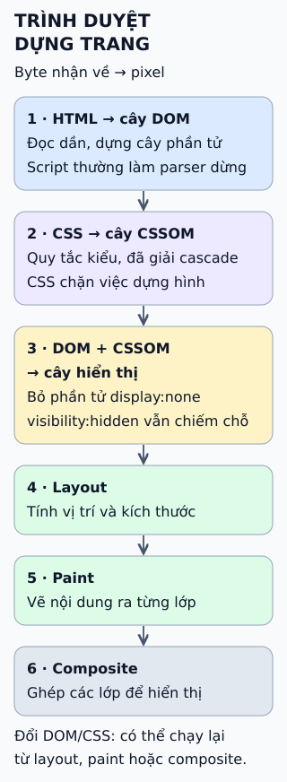

# Trình duyệt dựng trang web thế nào?

Từ chuỗi byte HTML, CSS và JavaScript đến điểm ảnh trên màn hình, trình duyệt đi qua một dây chuyền nhiều bước. Hình dưới là bản rút gọn: tên và cách chia bước khác nhau giữa các engine.

- **Parse:** HTML thành DOM, cây các phần tử; CSS thành các luật kiểu.
- **Style:** ghép luật CSS với từng phần tử để có kiểu cuối cùng: màu, cỡ chữ, `display`…
- **Layout:** tính kích thước và vị trí của từng hộp trên trang.
- **Paint:** ghi lại cách vẽ nền, viền, chữ, ảnh theo thứ tự chồng.
- **Composite:** ghép các lớp đã vẽ thành khung hình để hiển thị.

**Đọc hình:** mũi tên là thứ tự thường gặp khi tải trang lần đầu. Thực tế các bước có thể chồng lên nhau, ví dụ trang được vẽ dần trong khi còn đang tải. JavaScript có thể sửa DOM hoặc kiểu bất cứ lúc nào; khi đó trình duyệt chỉ cần tính lại từ bước bị ảnh hưởng, không nhất thiết từ đầu.

## Nhìn hình thử trả lời

Một nút đổi màu chữ từ đen sang đỏ. Một khối khác đổi `width` từ 200 px sang 300 px. Thay đổi nào dễ buộc tính lại bố cục (bước 3) hơn? Vì sao?

Xem đáp án

Đổi `width`: kích thước hộp thay đổi có thể làm phần tử xung quanh đổi vị trí hoặc xuống dòng, nên thường phải chạy lại layout. Đổi màu chữ không làm đổi hình học, nên thường chỉ cần tính lại kiểu rồi vẽ lại.

## Giới hạn cần nhớ

Đây là mô hình rút gọn, không phải mô tả mã nguồn của một trình duyệt cụ thể. Chi phí thật của một thay đổi phụ thuộc engine, thiết bị và nội dung trang; muốn biết chỗ chậm, hãy đo bằng công cụ hiệu năng của trình duyệt thay vì suy từ hình.

Xem sâu hơn

- **Parse HTML không chỉ là đọc từng thẻ:** HTML Standard mô tả cả cách xử lý HTML sai cú pháp, để các trình duyệt dựng cùng một cây DOM từ cùng một đầu vào.
- **Script có thể chặn parser:** script thường (không `async`, không `defer`) làm parser dừng cho tới khi tải và chạy xong. `defer` chạy sau khi parse xong và giữ thứ tự; `async` chạy ngay khi sẵn sàng, thứ tự không được bảo đảm.
- **CSS cũng có thể chặn:** trình duyệt thường chờ các stylesheet chặn dựng hình tải xong rồi mới vẽ lần đầu, để tránh hiện một trang chưa có kiểu.
- **Hai cách ẩn khác nhau:** `display: none` khiến phần tử không tạo hộp nên không chiếm chỗ; `visibility: hidden` vẫn giữ chỗ nhưng không vẽ.
- **Quy tắc ngón tay cái về chi phí:** đổi `width`, `margin` hoặc nội dung chữ thường cần layout rồi paint; đổi `color` thường bỏ qua layout; đổi `transform` hoặc `opacity` trên phần tử có lớp riêng trong nhiều trường hợp chỉ cần ghép lớp. Engine quyết định, nên đây không phải bảo đảm.
- **Đọc layout sau khi ghi có thể ép tính sớm:** trong JavaScript, sửa kiểu rồi đọc ngay kích thước (ví dụ `offsetWidth`) có thể buộc trình duyệt tính layout ngay, thay vì đợi lần cập nhật hiển thị kế tiếp. Lặp lại trong vòng lặp dễ gây giật. Trình duyệt cập nhật hiển thị khi có cơ hội dựng hình, thường theo tốc độ làm tươi màn hình.

Chi tiết về luồng, lớp và GPU của từng engine khác nhau và nằm ngoài bài nhập môn này.

## Nguồn đối chiếu

Bài tự viết từ tiêu chuẩn và tài liệu công khai; thân bài nguồn chưa được đọc.

- [ByteByteGo tại snapshot cố định](https://github.com/ByteByteGoHq/system-design-101/blob/b28380a4710c5ec9638ec037d4168e288f334cba/data/guides/how-does-the-browser-render-a-web-page.md) (chủ đề của mục này).
- HTML Standard: [phân tích cú pháp](https://html.spec.whatwg.org/multipage/parsing.html), [phần tử script](https://html.spec.whatwg.org/multipage/scripting.html#the-script-element), [update the rendering](https://html.spec.whatwg.org/multipage/webappapis.html#update-the-rendering).
- CSS: [display: none](https://www.w3.org/TR/css-display-3/#valdef-display-none), [visibility](https://www.w3.org/TR/CSS22/visufx.html#visibility), [mô hình định dạng trực quan](https://www.w3.org/TR/CSS22/visuren.html), [Cascading and Inheritance](https://www.w3.org/TR/css-cascade-4/).
- Tài liệu engine và hiệu năng: [MDN: Critical rendering path](https://developer.mozilla.org/en-US/docs/Web/Performance/Guides/Critical_rendering_path), [Chrome: RenderingNG architecture](https://developer.chrome.com/docs/chromium/renderingng-architecture), [web.dev: layout thrashing](https://web.dev/articles/avoid-large-complex-layouts-and-layout-thrashing), [web.dev: compositor-only properties](https://web.dev/articles/stick-to-compositor-only-properties-and-manage-layer-count).
