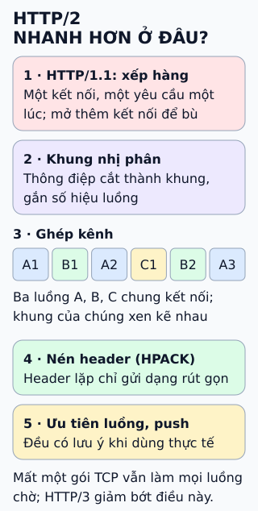

# Vì sao HTTP/2 nhanh hơn HTTP/1?

HTTP/2 **có thể** giảm chờ và giảm byte header khi tải nhiều tài nguyên. Không có mức tăng tốc cố định cho mọi trang.

- **Frame nhị phân:** đơn vị truyền có cấu trúc; mỗi trao đổi dùng một stream.
- **Multiplexing:** nhiều stream dùng chung kết nối, không phải đợi response khác hoàn tất.
- **HPACK:** nén header, không phải thuật toán nén body.

## Nhìn hình thử trả lời

Ở HTTP/2, B1 đến trước A2. Client dựa vào số nào trên frame để ghép dữ liệu về đúng trao đổi?

Xem đáp án

Stream ID: A thuộc stream1, B thuộc stream3. Không ghép chỉ theo thứ tự đến.

## Giới hạn cần nhớ

HTTP/2 vẫn chạy trên TCP. Mất gói có thể làm dữ liệu đến sau của nhiều stream cùng chờ. Server chậm, mạng xấu hay nội dung lớn vẫn có thể khiến trang chậm; cần đo trên workload thực tế.

Xem sâu hơn

HTTP/1.1 cũng có thể tải song song bằng nhiều kết nối. Hình chỉ so sánh thứ tự response trên **một** kết nối; HTTP/2 giúp ghép nhiều trao đổi trên kết nối đó.

HPACK dùng bảng header và cách mã hóa để giảm dữ liệu lặp. Nén body, ví dụ gzip, là cơ chế riêng.

Nguồn còn nêu **ưu tiên stream** và **server push**. Không xem chúng là lời hứa tăng tốc: mô hình trọng số/phụ thuộc của RFC7540 đã bị RFC9113 deprecate; RFC9218 mô tả tín hiệu ưu tiên mới. Server push có thể bị client tắt, nên không coi tài nguyên luôn được đẩy trước là mặc định.

Các ô chỉ là DATA frame minh họa, không phải packet TCP hay toàn bộ header của giao thức. Một khối header có quy tắc riêng, không được xen kẽ tùy ý các fragment của nó với stream khác.

## Nguồn đối chiếu

- [ByteByteGo tại snapshot cố định](https://github.com/ByteByteGoHq/system-design-101/blob/b28380a4710c5ec9638ec037d4168e288f334cba/data/guides/what-makes-http2-faster-than-http1.md).
- [MDN: HTTP/2](https://developer.mozilla.org/en-US/docs/Glossary/HTTP_2).
- [RFC9113: giới hạn TCP, frames/streams, header blocks, priority và push](https://www.rfc-editor.org/rfc/rfc9113.html).
- [RFC7541: HPACK](https://www.rfc-editor.org/rfc/rfc7541.html) và [RFC9218: ưu tiên](https://www.rfc-editor.org/rfc/rfc9218.html).
