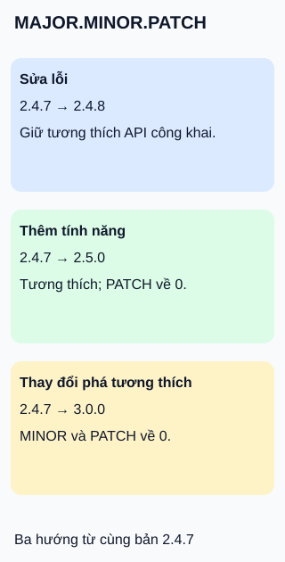

# Đọc số phiên bản theo SemVer

**Ba số nói về thay đổi của API công khai — khi dự án cam kết dùng SemVer.**

## Đọc hình

`MAJOR.MINOR.PATCH` là ba số nguyên, không phải số thập phân. Hình cho ba hướng phát hành độc lập từ `2.4.7`; không phải ba bước liên tiếp.

- **PATCH:** sửa lỗi tương thích ngược với API công khai.
- **MINOR:** thêm chức năng tương thích ngược; đặt PATCH về 0.
- **MAJOR:** thay đổi API công khai không tương thích ngược; đặt hai số sau về 0.

## Giới hạn cần nhớ

Cần công bố API nào là hợp đồng. Một số phiên bản không tự chứng minh chương trình đúng hoặc nâng cấp an toàn; vẫn đọc ghi chú phát hành và kiểm tra ứng dụng. Không suy quy tắc này cho mọi sản phẩm có số phiên bản.

## Nhìn hình thử trả lời

Từ `2.4.7`, nhóm bỏ một tham số công khai mà khách hàng đang dùng. Chọn thẻ nào?

Xem đáp án

Thẻ MAJOR: `3.0.0`, nếu đây là thay đổi không tương thích theo hợp đồng đã công bố.

Xem sâu hơn

`0.y.z` dành cho phát triển ban đầu, API chưa được coi là ổn định. Bản `3.0.0-rc.1` đứng trước `3.0.0`; hậu tố build như `+build.9` không ảnh hưởng thứ tự ưu tiên SemVer. Đừng so phiên bản như chuỗi chữ: `2.10.0` đứng sau `2.9.0`.

## Nguồn đối chiếu

- [ByteByteGo — body tại snapshot ghim](https://github.com/ByteByteGoHq/system-design-101/blob/b28380a4710c5ec9638ec037d4168e288f334cba/data/guides/what-do-version-numbers-mean.md): chủ đề mục lục; ví dụ và sơ đồ tự thiết kế.
- [Tài liệu chính thức — SemVer 2.0.0, quy tắc 1–11](https://semver.org/spec/v2.0.0.html).

Đã đọc body ghim và các phần tài liệu phục vụ claim ngày 2026-10-15. Chưa thử với người học hoặc phê duyệt phát hành.
