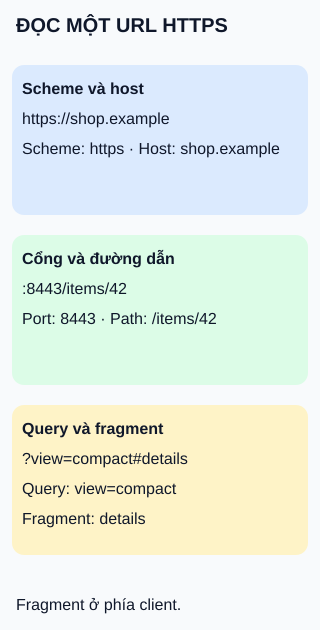

# Tách các thành phần của URL

**Một URL HTTPS minh họa; không phải URL nào cũng có đủ các phần này.**

`https://shop.example:8443/items/42?view=compact#details`

## Từ viết tắt

- **URL** (Uniform Resource Locator) — địa chỉ tài nguyên, gồm các phần được tách trong hình.
- **HTTP** (HyperText Transfer Protocol) — giao thức trao đổi request và response trên web.
- **HTTPS** (HyperText Transfer Protocol Secure) — trao đổi web có lớp bảo vệ kết nối; scheme của ví dụ trong bài.
- **IP** (Internet Protocol) — giao thức mạng dùng địa chỉ để chuyển gói; host có thể viết bằng địa chỉ này.

## Đọc hình

- **Scheme** xác định cách xử lý; ví dụ này dùng HTTPS. **Host** là `shop.example`.
- Dấu `:` tách **port** khỏi host. **Path** ở đây là `/items/42`.
- `?` mở **query**. `view=compact` là quy ước tham số của ứng dụng minh họa; query nói chung không bắt buộc có dạng khóa–giá trị.
- `#` mở **fragment**. Trong truy xuất HTTP, phần này được giữ ở phía client, không gửi như một phần của request target tới server.

## Giới hạn cần nhớ

Path không nhất thiết là đường dẫn tệp trên ổ đĩa. Fragment có thể chọn một phần tài liệu hoặc phục vụ điều hướng phía client. Dùng bộ phân tích URL của nền tảng thay vì tự cắt chuỗi theo dấu: ký tự phân cách còn có quy tắc mã hóa và ngữ cảnh.

## Nhìn hình thử trả lời

Chỉ đổi `#details` thành `#reviews`. Server có nhận fragment mới trong request target HTTP không?

Xem đáp án

Không. Client xử lý fragment; điều này không khẳng định ứng dụng sẽ không tự gửi thêm request khác.

Xem sâu hơn

Ví dụ dùng host dạng tên miền, nhưng host còn có thể là địa chỉ IP. Scheme cũng không luôn chỉ một giao thức mạng. Hãy giới hạn cách đọc hình cho URL HTTPS này thay vì coi nó là mẫu cú pháp của mọi URL.

## Nguồn đối chiếu

- [ByteByteGo — body tại snapshot ghim](https://github.com/ByteByteGoHq/system-design-101/blob/b28380a4710c5ec9638ec037d4168e288f334cba/data/guides/do-you-know-all-the-components-of-a-url.md): chủ đề mục lục; ví dụ và sơ đồ tự thiết kế.
- [Tài liệu chính thức — RFC 3986, §3.1–3.5](https://www.rfc-editor.org/rfc/rfc3986.html).

Đã đọc body ghim và các phần tài liệu phục vụ claim ngày 2026-10-15. Chưa thử với người học hoặc phê duyệt phát hành.

Đính chính nguồn: host và port tách bằng dấu hai chấm `:`, không phải dấu chấm như body nguồn ghi.
