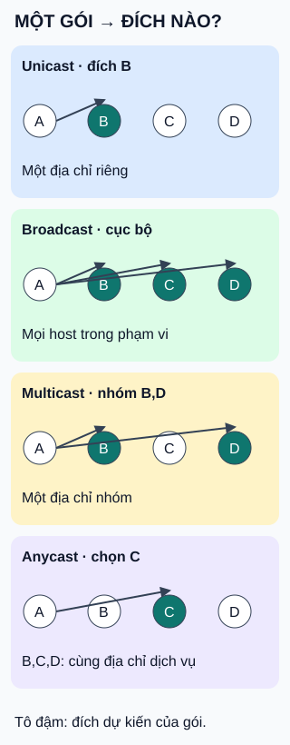

# Unicast, broadcast, multicast và anycast

**Cùng gửi một gói, địa chỉ đích quyết định kiểu tập người nhận.** Bốn khung là bốn tình huống độc lập, không phải các bước nối tiếp.

## Đọc hình

- **Unicast — một đích riêng:** A gửi tới địa chỉ của B.
- **Broadcast — mọi đích trong phạm vi:** ví dụ IPv4 cục bộ hướng tới các host trên mạng đó, không phải toàn Internet.
- **Multicast — một nhóm:** A gửi tới địa chỉ nhóm; B và D là thành viên trong ví dụ. Không cần gửi riêng từng bản unicast từ A.
- **Anycast — một trong các đích:** B,C,D cùng cung cấp một địa chỉ dịch vụ. Định tuyến chọn một nơi cho gói; ở hình là C, không sao chép tới cả ba.

## Giới hạn cần nhớ

Mũi tên biểu diễn đích dự kiến khi mạng hoạt động, không bảo đảm gói đến nơi hay ứng dụng đã xử lý. “Gần” trong anycast theo định tuyến; không mặc nhiên gần nhất địa lý, nhanh nhất hoặc ít tải nhất. Mạng phải hỗ trợ multicast nếu muốn dùng nó xuyên các mạng con.

## Nhìn hình thử trả lời

Cùng một địa chỉ dịch vụ có ở B,C,D, nhưng mỗi gói chỉ được định tuyến tới một nơi. Chọn multicast hay anycast?

Xem đáp án

Anycast. Nếu muốn các thành viên B và D đều là đích nhận của gói gửi tới nhóm, đó mới là multicast.

Xem sâu hơn

- **IP** là giao thức Internet; địa chỉ IP gắn với giao diện mạng. Các ô B,C,D trong hình đại diện những đích qua giao diện, không khẳng định mỗi máy chỉ có một địa chỉ.
- **IPv4 và IPv6:** ví dụ broadcast ở đây là IPv4 cục bộ. IPv6 không có địa chỉ broadcast; multicast đảm nhiệm chức năng tương ứng.
- **Đánh đổi:** broadcast làm nhiều host phải xét gói; multicast cần quản lý nhóm và hỗ trợ chuyển tiếp. Anycast phụ thuộc định tuyến: thay đổi đường đi có thể đổi nơi nhận, cần cân nhắc với giao dịch dài.

## Nguồn đối chiếu

- [ByteByteGo — body ghim](https://github.com/ByteByteGoHq/system-design-101/blob/b28380a4710c5ec9638ec037d4168e288f334cba/data/guides/unicast-vs-broadcast-vs-multicast-vs-anycast.md): chủ đề mục lục; hình và ví dụ A/B/C/D tự thiết kế, không dùng hình nguồn.
- [RFC 4291 §2–2.1](https://www.rfc-editor.org/rfc/rfc4291.html#section-2): kiểu địa chỉ IPv6 và không có broadcast.
- [RFC 919 §4, §7](https://www.rfc-editor.org/rfc/rfc919.html): phạm vi broadcast IPv4; 255.255.255.255 không được chuyển tiếp.
- [RFC 1112 §2](https://www.rfc-editor.org/rfc/rfc1112.html#section-2): nhóm multicast và chuyển tiếp qua multicast router.
- [RFC 4786 §3.1–3.2, §4.1](https://www.rfc-editor.org/rfc/rfc4786.html): chọn anycast bằng định tuyến, không hứa độ trễ thấp hay chia tải đều; ổn định đường đi với giao dịch.

Đã đọc body ghim và các phần chuẩn nêu trên ngày 2026-10-15. Sửa mô tả anycast mơ hồ của nguồn thành một đích trong tập cho mỗi gói. Chưa thử với người học hoặc phê duyệt phát hành.
