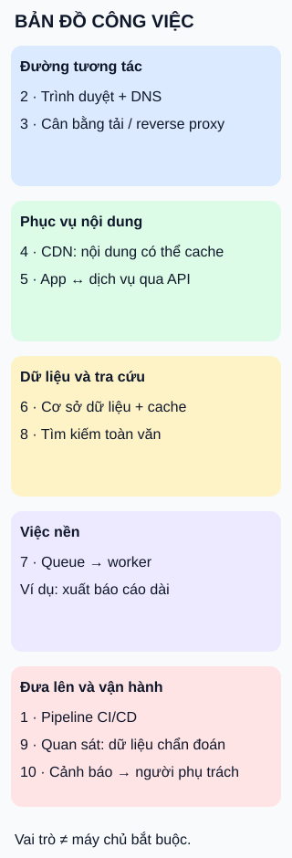

# Các vai trò trong một ứng dụng web vận hành thật

**Nhìn theo công việc, không theo danh sách sản phẩm phải mua.** Hình gom mười chủ đề của mục lục thành năm vùng trách nhiệm; số là nhãn chủ đề, không phải thứ tự xử lý request.

## Từ viết tắt

- **DNS** (Domain Name System) — hệ thống phân giải tên thành thông tin địa chỉ để trình duyệt tìm dịch vụ.
- **API** (Application Programming Interface) — giao diện lập trình ứng dụng: cách app trao đổi với phần xử lý khác.
- **CDN** (Content Delivery Network) — mạng phân phối nội dung; có thể phục vụ ảnh bìa được cache trong ví dụ.
- **CI** (Continuous Integration) — tích hợp liên tục: quy trình tự động kiểm tra thay đổi mã.
- **CD** (Continuous Delivery) — phân phối liên tục; trong cách dùng Continuous Deployment thì chỉ triển khai liên tục. Quy trình quyết định lúc phát hành.

## Đọc hình

Ví dụ một thư viện: người đọc tìm sách, còn nhân viên yêu cầu xuất báo cáo dài.

- **Tương tác:** trình duyệt phân giải tên qua DNS rồi gọi cửa vào. Bộ cân bằng tải/reverse proxy chuyển request theo cấu hình, không hứa tải bằng nhau. CDN có thể phục vụ ảnh bìa.
- **Ứng dụng:** app trao đổi qua API; cơ sở dữ liệu giữ dữ liệu, cache giữ dữ liệu để đọc lại. Tìm kiếm toàn văn phục vụ truy vấn theo chữ.
- **Việc nền:** queue chuyển yêu cầu xuất báo cáo cho worker, thay vì giữ request chờ. Không phải thao tác nào cũng qua queue.
- **Vận hành:** pipeline kiểm tra/đưa phiên bản lên; quan sát giúp chẩn đoán; cảnh báo thông báo theo điều kiện cấu hình. Có dashboard không đồng nghĩa có người nhận cảnh báo.

## Giới hạn cần nhớ

Có thể gộp nhiều vai trong cùng tiến trình hoặc dùng dịch vụ quản lý sẵn. Cache, worker và máy tìm kiếm riêng đều tùy nhu cầu; tách thêm tăng việc phối hợp. Đủ mười nhãn không chứng minh hệ thống an toàn hay sẵn sàng phát hành.

## Nhìn hình thử trả lời

Báo cáo dài làm request chờ quá lâu. Vùng nào đáng xem trước? Thêm dashboard có tự rút ngắn công việc không?

Xem đáp án

Xem queue/worker để cân nhắc xử lý nền và cách người dùng lấy kết quả. Dashboard giúp quan sát, không tự thay đổi thời gian xử lý.

Xem sâu hơn

- **DNS** (Domain Name System): phân giải tên. **API** (Application Programming Interface): giao diện lập trình ứng dụng. **CDN** (Content Delivery Network): mạng phân phối nội dung.
- **CI/CD**: tích hợp liên tục và phân phối/triển khai liên tục tùy quy trình; tự động kiểm tra không có nghĩa mọi thay đổi đều được tự phát hành. **Queue** là hàng đợi; **worker** là tiến trình nhận xử lý việc.
- Cần thiết kế cả lúc thất bại: tài liệu Web-Queue-Worker chỉ ra tình huống ghi cơ sở dữ liệu thành công nhưng gửi message thất bại. Tách hai phần không tự giải quyết tính nhất quán.
- Bản đồ này chưa bao quát mọi yêu cầu như phân quyền, sao lưu, khôi phục và mục tiêu độ sẵn sàng; lựa chọn kiến trúc phải theo nhu cầu thực tế.

## Nguồn đối chiếu

- [ByteByteGo — body ghim](https://github.com/ByteByteGoHq/system-design-101/blob/b28380a4710c5ec9638ec037d4168e288f334cba/data/guides/10-essential-components-of-a-production-web-application.md): mười chủ đề mục lục. Hình, cách gom vai và ví dụ thư viện tự thiết kế, không dùng ảnh nguồn.
- [Microsoft — Web-Queue-Worker](https://learn.microsoft.com/en-us/azure/architecture/guide/architecture-styles/web-queue-worker): web, queue/worker, dữ liệu/cache/CDN; worker có thể không cần, rủi ro ghi DB/gửi message.
- [Microsoft — Baseline web application](https://learn.microsoft.com/en-us/azure/architecture/web-apps/app-service/architectures/baseline-zone-redundant): cửa vào, phân giải tên và vận hành là các vai tách biệt; đây là ví dụ Azure, không áp nguyên cấu hình cho mọi ứng dụng.
- [Elastic — Full-text search](https://www.elastic.co/docs/solutions/search/full-text): tìm kiếm trên trường văn bản được phân tích và lập chỉ mục.
- [Prometheus — Alerting overview](https://prometheus.io/docs/alerting/latest/overview/): luật cảnh báo và gửi thông báo qua Alertmanager.
- [GitHub — Hiểu GitHub Actions](https://docs.github.com/en/actions/get-started/understand-github-actions): tự động hóa quy trình build/test/deploy theo cấu hình.

Đã đọc body ghim và các phần tài liệu phục vụ claim ngày 2026-10-15; không coi mô tả sản phẩm là bảo đảm hiệu năng. Chưa thử với người học hoặc phê duyệt phát hành.
