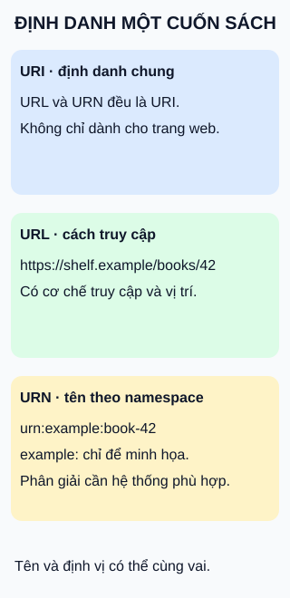

# URI, URL và URN: định danh, vị trí và tên

**“Định danh cái gì?” khác “Truy cập bằng cách nào?”** Hình tách vai trò của địa chỉ và tên, không chia chúng thành hai tập loại trừ nhau.

## Từ viết tắt

- **RFC** (Request for Comments) — tài liệu kỹ thuật được bài dùng để đối chiếu; không phải mọi tài liệu loại này đều là chuẩn Internet.
- **URI** (Uniform Resource Identifier) — định danh tài nguyên: khái niệm chung cho các chuỗi trong hình.
- **URL** (Uniform Resource Locator) — định danh có mô tả cách truy cập tài nguyên, như địa chỉ web trong hình.
- **URN** (Uniform Resource Name) — định danh dùng scheme `urn`, được đặt theo quy tắc namespace, hướng tới tính bền vững và độc lập vị trí.

## Đọc hình

- **URI là tên gọi chung.** Hai ví dụ đều thuộc khái niệm này; tài nguyên không nhất thiết là trang web.
- **URL thêm vai trò định vị.** Địa chỉ `https://shelf.example/books/42` cho biết cơ chế truy cập và nơi để gửi yêu cầu. Nó không bảo đảm tài nguyên hiện tồn tại hoặc bạn có quyền truy cập.
- **URN đặt tên theo namespace.** Trong `urn:example:book-42`, `example` là namespace dành cho ví dụ; `book-42` là phần tên tự đặt để minh họa, không phải mã sách dùng thật.

## Giới hạn cần nhớ

Đừng hiểu URN là “không bao giờ tìm được nội dung”. Có thể có dịch vụ phân giải tên sang địa chỉ hoặc thông tin khác; cũng có URN không nhằm phân giải tới địa chỉ. Một tên bền vững không tự tạo ra dịch vụ đó.

## Nhìn hình thử trả lời

Chỉ nhìn `urn:example:book-42`, có kết luận được máy chủ web nào đang chứa sách không?

Xem đáp án

Không. Đây còn là namespace dành cho minh họa. Với URN dùng thật, cần quy tắc namespace và cơ chế phân giải thích hợp nếu muốn tìm nơi truy cập.

Xem sâu hơn

Theo RFC3986, một URI có thể đóng vai định vị, tên hoặc cả hai; không phải scheme nào cũng chỉ mang đúng một vai. Bài dùng nghĩa URN cụ thể của RFC8141: thuộc scheme `urn`, được gán theo quy tắc namespace. Chỉ viết một chuỗi bắt đầu bằng `urn:` chưa đủ để có định danh hợp lệ dùng thật. Namespace `example` được dành riêng cho tài liệu/thử nghiệm về định danh, không để cấp tên cho ứng dụng thực tế.

## Nguồn đối chiếu

- [ByteByteGo — body ghim](https://github.com/ByteByteGoHq/system-design-101/blob/b28380a4710c5ec9638ec037d4168e288f334cba/data/guides/url-uri-urn-do-you-know-the-differences.md): chủ đề mục lục; hình và ví dụ tự thiết kế, không dùng ảnh nguồn.
- [RFC3986 §1.1.3](https://www.rfc-editor.org/rfc/rfc3986.html#section-1.1.3): định danh có thể là tên, locator hoặc cả hai.
- [RFC8141 §1, §1.1, §1.2.1](https://www.rfc-editor.org/rfc/rfc8141.html): URN, namespace và nhiều cách phân giải; không lặp khẳng định tuyệt đối “URN không thể định vị” của nguồn.
- [RFC6963 §1, §3](https://www.rfc-editor.org/rfc/rfc6963.html): namespace `example` cho minh họa.

Đã đọc body ghim và các phần chuẩn phục vụ claim ngày 2026-10-15. Chưa thử với người học hoặc phê duyệt phát hành.
