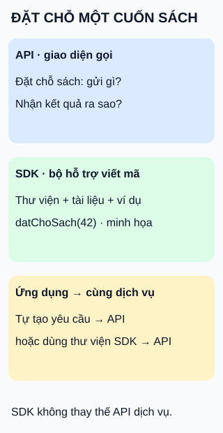

# API và SDK: giao diện gọi và bộ công cụ

**Một bên quy định cách gọi; một bên giúp bạn viết phần tích hợp.** Hai khái niệm thường đi cùng nhau, không phải hai lựa chọn loại trừ nhau.

## Từ viết tắt

- **API** (Application Programming Interface) — giao diện lập trình: những thao tác và quy tắc phần mềm cung cấp cho phần mềm khác.
- **SDK** (Software Development Kit) — bộ công cụ phát triển: tập hợp thư viện, tài liệu, ví dụ hoặc công cụ hỗ trợ xây ứng dụng cho một nền tảng hay dịch vụ.

## Đọc hình

- **API là giao diện được cung cấp.** Với dịch vụ thư viện minh họa, nó quy định thao tác đặt chỗ, dữ liệu cần gửi và kết quả nhận về.
- **SDK là thứ đưa vào môi trường phát triển.** Thư viện trong bộ có thể cung cấp hàm `datChoSach(42)` để người viết ứng dụng bớt tự xử lý chi tiết lời gọi. Đây là tên hàm minh họa, không phải sản phẩm có thật.
- **Cùng một dịch vụ, hai cách tích hợp.** Tự tạo yêu cầu theo tài liệu hoặc dùng thư viện SDK phù hợp. Cách thứ hai vẫn sử dụng API của dịch vụ.

## Giới hạn và đánh đổi

API không nhất thiết là địa chỉ gọi qua mạng: thư viện hoặc trình duyệt cũng có API. SDK cũng không luôn chỉ là lớp bọc dịch vụ từ xa; bộ cho nền tảng có thể chứa cả công cụ biên dịch hay gỡ lỗi.

SDK có thể giảm phần mã phải tự viết, đổi lại bạn thêm phụ thuộc cần cập nhật. Kiểm tra ngôn ngữ, môi trường chạy, phiên bản, giấy phép và phạm vi hỗ trợ; không suy ra cứ dùng SDK là tương thích hoặc nhanh hơn.

## Nhìn hình thử trả lời

Ứng dụng dùng hàm trong SDK để đặt chỗ sách. Như vậy nó đã bỏ qua API của dịch vụ chưa?

Xem đáp án

Chưa. Trong ví dụ này, thư viện tạo lời gọi tới cùng API dịch vụ. SDK giúp viết phần tích hợp; quy tắc giao tiếp với dịch vụ vẫn cần được tuân theo.

Xem sâu hơn

SDK có thể có API riêng cho người viết ứng dụng. Cần phân biệt giao diện hàm của thư viện với giao diện dịch vụ mà nó gọi. Khi nâng phiên bản, kiểm tra cả hai phía thay vì mặc định phiên bản bộ công cụ bằng phiên bản dịch vụ. Thành phần và cách hoạt động cụ thể tùy từng bộ; hình chỉ minh họa SDK có thư viện gọi dịch vụ.

## Nguồn đối chiếu

- [ByteByteGo — body ghim](https://github.com/ByteByteGoHq/system-design-101/blob/b28380a4710c5ec9638ec037d4168e288f334cba/data/guides/api-vs-sdk.md): chủ đề mục lục; lời, ví dụ và hình tự thiết kế.
- [MDN — API](https://developer.mozilla.org/en-US/docs/Glossary/API): giao diện phần mềm gồm nhiều dạng thao tác, không chỉ địa chỉ dịch vụ mạng.
- [Amazon Web Services — SDK](https://aws.amazon.com/what-is/sdk/): thành phần bộ công cụ và các điểm cần kiểm tra về tương thích, giấy phép, hỗ trợ.
- [SDK cho JavaScript — tổng quan](https://docs.aws.amazon.com/sdk-for-javascript/v3/developer-guide/welcome.html): ví dụ cụ thể bộ công cụ cung cấp API JavaScript để dùng dịch vụ, có khác biệt giữa môi trường máy chủ và trình duyệt.

Đã đọc body ghim và tài liệu cho các claim liệt kê ngày 2026-10-15. Chưa chạy thư viện thực, thử người học hoặc phê duyệt phát hành.
