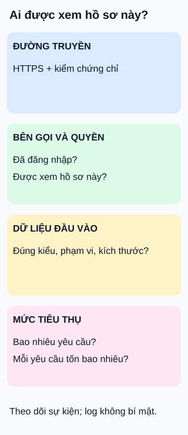

# Bảo vệ API: kiểm tra nhiều lớp

**Đường truyền kín chưa có nghĩa là được phép đọc mọi hồ sơ.** Hình dùng dịch vụ hồ sơ thú cưng để đặt bốn câu hỏi khi thiết kế.

## Từ viết tắt

- **API** (Application Programming Interface) — giao diện để phần mềm gọi thao tác của dịch vụ.
- **HTTPS** (HyperText Transfer Protocol Secure) — giao thức web bảo vệ dữ liệu trên đường truyền khi được cấu hình và xác minh đúng.

## Đọc hình

- **Đường truyền:** dùng HTTPS và xác minh chứng chỉ; mã hóa khi truyền không sửa được lỗi phân quyền trong ứng dụng.
- **Bên gọi và quyền:** xác thực bên gọi, rồi kiểm quyền thực hiện thao tác trên đúng hồ sơ. Đăng nhập được không có nghĩa là xem được hồ sơ của người khác.
- **Dữ liệu:** kiểm kiểu, phạm vi và kích thước đầu vào ở máy chủ; từ chối dữ liệu ngoài hợp đồng. Kiểm định dạng không thay thế kiểm quyền.
- **Mức tiêu thụ:** đặt giới hạn phù hợp cho tần suất, số thao tác trong một yêu cầu và tài nguyên xử lý. Một yêu cầu ít về số lượng vẫn có thể rất tốn kém.

## Theo dõi mà không làm lộ bí mật

Ghi sự kiện cần thiết, kết quả và dấu hiệu bất thường để điều tra; có cảnh báo và người xử lý. Không ghi nguyên mật khẩu, token truy cập hoặc khóa bí mật vào log. Bản thân log cũng cần giới hạn quyền đọc và thời gian lưu.

## Nhìn hình thử trả lời

Người đã đăng nhập sửa mã hồ sơ trong yêu cầu để xem thú cưng của tài khoản khác. Lớp nào phải quyết định cho phép hay từ chối?

Xem đáp án

Kiểm quyền trên đúng tài nguyên ở máy chủ: bên gọi có được xem hồ sơ được yêu cầu không? HTTPS, đầu vào đúng kiểu và tần suất thấp đều chưa trả lời câu hỏi đó.

Giới hạn và đánh đổi

Bốn thẻ không phải trình tự bắt buộc hoặc danh sách bảo mật đầy đủ. Giới hạn quá chặt có thể chặn người dùng hợp lệ; chỉ giới hạn số yêu cầu chưa bao quát yêu cầu tốn tài nguyên hay lưu lượng phân tán. Cần kiểm thử theo mô hình đe dọa và tải thực tế. Bài không đưa công thức chọn token hoặc giao thức phân quyền áp dụng cho mọi hệ thống.

## Nguồn đối chiếu

- [ByteByteGo — body ghim](https://github.com/ByteByteGoHq/system-design-101/blob/b28380a4710c5ec9638ec037d4168e288f334cba/data/guides/a-cheatsheet-to-build-secure-apis.md): chủ đề; hình và ví dụ mới, không dùng ảnh nguồn.
- [Hướng dẫn bảo vệ dịch vụ](https://cheatsheetseries.owasp.org/cheatsheets/REST_Security_Cheat_Sheet.html): HTTPS, kiểm soát truy cập và đầu vào.
- [Quyền trên từng đối tượng](https://owasp.org/API-Security/editions/2023/en/0xa1-broken-object-level-authorization/): kiểm bên gọi được làm gì với đối tượng được yêu cầu.
- [Tiêu thụ tài nguyên không giới hạn](https://owasp.org/API-Security/editions/2023/en/0xa4-unrestricted-resource-consumption/): số yêu cầu không phải thước đo duy nhất của chi phí xử lý.
- [Hướng dẫn ghi log](https://cheatsheetseries.owasp.org/cheatsheets/Logging_Cheat_Sheet.html): loại bí mật khỏi log, bảo vệ và theo dõi log.

Đã đọc body ghim và tài liệu cho các claim liệt kê ngày 2026-10-15. Đây là nháp giáo dục; chưa kiểm thử bảo mật một hệ thống thật hoặc thử với người học.
