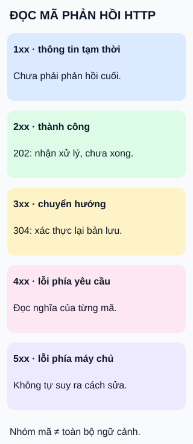

# Mã phản hồi HTTP: đọc nhóm trước, đọc nghĩa sau

**Chữ số đầu phân nhóm; cả mã mới cho nghĩa cụ thể.** Hình là bản đồ tra cứu, không phải năm bước xử lý.

## Từ viết tắt

- **HTTP** (HyperText Transfer Protocol) — giao thức trao đổi yêu cầu và phản hồi trên web.

## Đọc hình

- **1xx:** thông tin tạm thời, chưa phải phản hồi cuối.
- **2xx:** nhóm thành công; riêng `202` chỉ nhận xử lý, chưa hoàn tất và không hứa kết quả cuối thành công.
- **3xx:** cần hành động thêm. Không phải tất cả đều đổi địa chỉ: `304` liên quan xác thực lại bản lưu đệm.
- **4xx:** phía phục vụ nhận định yêu cầu có vấn đề; không phải lời kết tội người dùng.
- **5xx:** phía máy chủ gặp lỗi hoặc không thể thực hiện yêu cầu.

## Nhìn hình thử trả lời

Dịch vụ tạo báo cáo trả `202`. Có thể hiện “Báo cáo đã tạo xong” chưa?

Xem đáp án

Chưa. Ví dụ ứng dụng nên hiện “Đã nhận yêu cầu”, rồi theo dõi kết quả bằng cơ chế dịch vụ cung cấp.

Giới hạn và cách tra cứu

Một mã chưa đủ giải thích toàn bộ sự cố. Đọc thêm phương thức, trường phản hồi và nội dung theo hợp đồng dịch vụ. `304` cho phép tiếp tục dùng bản lưu đã được xác thực lại, không phải lỗi thiếu nội dung cần tải lại bằng mọi giá. Không suy ra từ riêng nhóm mã rằng cứ gửi lại yêu cầu là phù hợp.

## Nguồn đối chiếu

- [ByteByteGo — body ghim](https://github.com/ByteByteGoHq/system-design-101/blob/b28380a4710c5ec9638ec037d4168e288f334cba/data/guides/http-status-code-you-should-know.md): năm nhóm; hình tự thiết kế, không dùng ảnh nguồn.
- [Chuẩn ngữ nghĩa web §15, §15.3.3](https://www.rfc-editor.org/rfc/rfc9110.html#section-15): phân nhóm và ý nghĩa202.
- [Tra cứu mã phản hồi](https://developer.mozilla.org/en-US/docs/Web/HTTP/Reference/Status):304 và ngữ cảnh từng mã.

Đã đọc body ghim và các phần tài liệu cho claim ngày2026-10-15. Chưa thử người học hoặc kiểm thử một dịch vụ thật.
