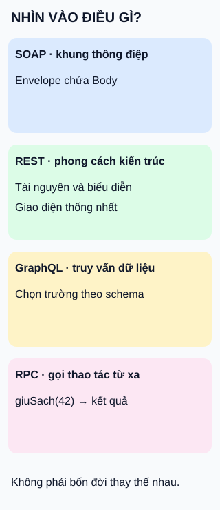

# SOAP, REST, GraphQL và RPC: bốn góc nhìn giao tiếp

**Bốn tên không phải bốn phiên bản kế tiếp của cùng một giao thức.** Hình đặt chúng cạnh nhau theo thứ mà mỗi khái niệm nhấn mạnh.

## Từ viết tắt

- **SOAP** (Simple Object Access Protocol) — tên mở rộng lịch sử; ở phiên bản1.2, SOAP là tên riêng của khung trao đổi thông điệp, không còn được coi là từ viết tắt.
- **REST** (REpresentational State Transfer) — phong cách kiến trúc với các ràng buộc về tương tác, trong đó có giao diện thống nhất và tài nguyên.
- **QL** (Query Language) — ngôn ngữ truy vấn, phần viết tắt trong tên GraphQL; bên gọi mô tả các trường muốn nhận theo lược đồ kiểu dữ liệu.
- **RPC** (Remote Procedure Call) — gọi thủ tục từ xa: truyền tham số để phía khác thực hiện thao tác rồi trả kết quả.
- **HTTP** (HyperText Transfer Protocol) — giao thức web có thể dùng để chuyên chở lời gọi; tên phong cách không tự quyết định toàn bộ đường truyền.

## Đọc hình

- **SOAP:** khung thông điệp dựa trên ngôn ngữ đánh dấu mở rộng (Extensible Markup Language), có phần bao `Envelope` và phần nội dung `Body`; có thể gắn với nhiều giao thức nền. Tên SOAP không tự bảo đảm bảo mật hay giao nhận tin cậy.
- **REST:** tài nguyên được thao tác qua biểu diễn và giao diện thống nhất. Chỉ đặt đường dẫn đẹp hoặc dùng HTTP chưa đủ để gọi một thiết kế là REST.
- **GraphQL:** bên gọi chọn trường trong truy vấn phù hợp schema, phía phục vụ thực thi để trả dữ liệu. Ví dụ tự đặt: `{ sach { ten } }` chọn tên sách; hình không khẳng định cơ sở dữ liệu nằm phía sau dùng công nghệ nào.
- **RPC:** giao diện được trình bày như thao tác, chẳng hạn `giuSach(42)` với tham số mã sách. Ví dụ chỉ minh họa mô hình; không có nghĩa gọi qua mạng giống hệt gọi hàm cục bộ khi gặp lỗi.

## Nhìn hình thử trả lời

Một màn hình chỉ cần tên sách và gửi truy vấn chọn đúng trường đó theo schema. Thẻ nào mô tả trực tiếp đặc điểm này?

Xem đáp án

GraphQL. Đây là nhận diện cách mô tả dữ liệu cần lấy, không chứng minh nó luôn nhanh hơn những cách còn lại.

Giới hạn và đánh đổi

Các khái niệm không cùng cấp: phong cách kiến trúc, khung thông điệp, ngôn ngữ truy vấn và mô hình gọi có thể giao nhau. SOAP còn có cách biểu diễn lời gọi RPC. REST có nhiều ràng buộc hơn phần tài nguyên nêu ở hình: tách bên gọi/phục vụ, không giữ ngữ cảnh phiên giữa các yêu cầu ở máy chủ, quy tắc lưu đệm, phân lớp và giao diện thống nhất; tải mã theo yêu cầu là tùy chọn. GraphQL vẫn cần kiểm quyền và giới hạn chi phí truy vấn; RPC cần xử lý lỗi mạng. Chọn theo hợp đồng tích hợp và nhu cầu vận hành, không theo nhãn “mới nhất”.

## Nguồn đối chiếu

- [ByteByteGo — body ghim](https://github.com/ByteByteGoHq/system-design-101/blob/b28380a4710c5ec9638ec037d4168e288f334cba/data/guides/soap-vs-rest-vs-graphql-vs-rpc.md): body chỉ giới thiệu, chi tiết nằm trong ảnh chưa dùng làm evidence; không sao chép ảnh hoặc dòng thời gian.
- [SOAP1.2 — phần1](https://www.w3.org/TR/soap12-part1/):§1,§5 khung thông điệp, tên riêng và phần bao/nội dung.
- [SOAP1.2 — phần2 §4](https://www.w3.org/TR/soap12-part2/#soapforrpc): cách biểu diễn lời gọi RPC.
- [GraphQL — quyền và chi phí](https://graphql.org/learn/security/): kiểm soát truy vấn; [phân quyền](https://graphql.org/learn/authorization/).
- [Fielding — chương5](https://ics.uci.edu/~fielding/pubs/dissertation/rest_arch_style.htm): các ràng buộc kiến trúc.
- [GraphQL — truy vấn](https://graphql.org/learn/queries/): lựa chọn trường theo schema.
- [Mô hình gọi từ xa —§3–4](https://www.rfc-editor.org/rfc/rfc5531.html): ví dụ một họ RPC, tham số/kết quả và khác biệt lỗi mạng.

Đã đọc body ghim và các phần tài liệu cho claim ngày2026-10-15. Ví dụ tự thiết kế; chưa chạy bốn triển khai thật hoặc thử với người học.
