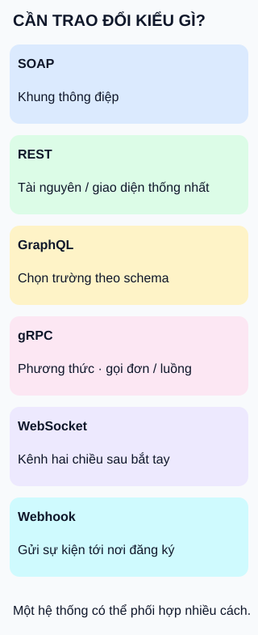

# So sánh sáu cách giao tiếp: bắt đầu từ nhu cầu

**Đừng chọn chỉ vì tên công nghệ.** Hình là sáu điểm cần đối chiếu, không phải bảng xếp hạng hoặc sáu lựa chọn loại trừ nhau.

## Từ viết tắt

- **SOAP** (Simple Object Access Protocol) — tên mở rộng lịch sử; SOAP1.2 là tên riêng của khung thông điệp, không còn là từ viết tắt.
- **REST** (REpresentational State Transfer) — phong cách kiến trúc có tài nguyên và giao diện thống nhất, cùng các ràng buộc khác.
- **QL** (Query Language) — ngôn ngữ truy vấn; phần viết tắt trong GraphQL, nơi bên gọi chọn trường theo schema.
- **gRPC** (gRPC Remote Procedure Calls) — tên viết tắt đệ quy của một hệ thống gọi thủ tục từ xa, dựa trên định nghĩa dịch vụ và phương thức.

## Đọc hình

- **SOAP và REST:** kiểm tra hợp đồng tích hợp của đối tác; chúng không cùng cấp khái niệm. Một bên là khung thông điệp, một bên là phong cách kiến trúc.
- **GraphQL và gRPC:** phân biệt nhu cầu chọn các trường dữ liệu với giao diện phương thức dịch vụ. gRPC có cả gọi đơn và truyền luồng, không chỉ một yêu cầu/một kết quả.
- **WebSocket và webhook:** một bên giữ kênh để hai phía gửi thông điệp độc lập sau bắt tay; một bên gửi dữ liệu sự kiện tới nơi nhận đã đăng ký. Webhook không đòi hỏi giữ một kênh WebSocket.

## Ba câu hỏi trước khi chọn

1. Cần đọc dữ liệu, thực hiện thao tác hay nhận thông báo sự kiện?
2. Cần phản hồi đơn, luồng liên tục hay giao tiếp hai chiều?
3. Đối tác, thư viện và môi trường chạy hỗ trợ gì; ai vận hành và kiểm thử khi có lỗi?

## Nhìn hình thử trả lời

Ứng dụng quản lý cửa hàng cần tải danh mục khi mở màn hình và nhận thông báo từ đối tác khi đơn đổi trạng thái. Có bắt buộc dùng một cách cho cả hai không?

Xem đáp án

Không. Ví dụ tự thiết kế có thể dùng giao diện đọc danh mục và webhook cho thông báo trạng thái nếu đối tác hỗ trợ. Nếu cần trò chuyện hai chiều liên tục thì đối chiếu thêm thẻ WebSocket. Đó là lựa chọn thiết kế, không phải quy tắc buộc dùng một sản phẩm.

Giới hạn và đánh đổi

Các tên mô tả những lớp khác nhau và có thể phối hợp. Hình không chứng minh cách nào nhanh hơn, bảo mật hơn hoặc giao đúng một lần. Kênh lâu dài cần quản lý vòng đời; thông báo sự kiện cần hợp đồng xử lý lỗi của bên gửi/nhận. Khả năng có sẵn không thay cho kiểm thử tải và tình huống mất kết nối.

## Nguồn đối chiếu

- [ByteByteGo — body ghim](https://github.com/ByteByteGoHq/system-design-101/blob/b28380a4710c5ec9638ec037d4168e288f334cba/data/guides/a-cheatsheet-on-comparing-api-architectural-styles.md): body liệt kê sáu tên; bảng chi tiết trong ảnh chưa dùng làm evidence. Hình và ví dụ tự thiết kế.
- [SOAP1.2 §1](https://www.w3.org/TR/soap12-part1/) và [Fielding §5.1](https://ics.uci.edu/~fielding/pubs/dissertation/rest_arch_style.htm): phân biệt khung thông điệp và phong cách kiến trúc.
- [GraphQL — chọn trường](https://graphql.org/learn/queries/): truy vấn theo schema.
- [gRPC — khái niệm](https://grpc.io/docs/what-is-grpc/core-concepts/): định nghĩa dịch vụ, phương thức và bốn dạng lời gọi.
- [WebSocket — §1.2](https://www.rfc-editor.org/rfc/rfc6455.html#section-1.2): kênh hai chiều sau bắt tay.
- [GitHub — webhook](https://docs.github.com/en/webhooks/about-webhooks): đăng ký sự kiện và nhận dữ liệu tại máy chủ.

Đã đọc body ghim và tài liệu phục vụ claim ngày2026-10-15. Chưa triển khai sáu cách, đo hiệu năng hoặc thử với người học.
