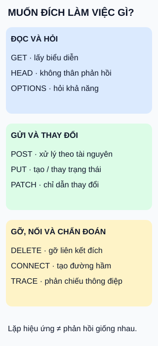

# Chín phương thức HTTP: yêu cầu làm việc gì?

**Cùng một tài nguyên, phương thức nói lên ý định khác nhau.** Ba nhóm trong hình chỉ để dễ tra cứu, không phải danh sách đầy đủ mọi phương thức.

## Từ viết tắt

- **HTTP** (HyperText Transfer Protocol) — giao thức trao đổi yêu cầu và phản hồi trên web. Tên phương thức như `GET` là từ khóa, không phải từ viết tắt cần khai triển.

## Đọc hình

- **Đọc/hỏi:** `GET` lấy biểu diễn hiện tại; `HEAD` có nghĩa như `GET` nhưng không gửi thân phản hồi; `OPTIONS` hỏi khả năng giao tiếp với đích.
- **Gửi/thay đổi:** `POST` yêu cầu xử lý theo ngữ nghĩa của tài nguyên, có thể gồm tạo mới; `PUT` yêu cầu tạo hoặc thay trạng thái đích bằng biểu diễn gửi lên; `PATCH` áp dụng chỉ dẫn thay đổi, không đơn thuần là “PUT với ít trường hơn”.
- **Các việc khác:** `DELETE` yêu cầu gỡ liên kết của đích với chức năng hiện tại, không bảo đảm xóa vật lý mọi bản dữ liệu; `CONNECT` thiết lập đường hầm; `TRACE` phản chiếu thông điệp để chẩn đoán đường đi.

## Nhìn hình thử trả lời

Ứng dụng gửi lại cùng `DELETE /notes/42`. Lần đầu trả thành công, lần sau báo không tìm thấy. Điều này có tự phủ định tính idempotent không?

Xem đáp án

Không. Idempotent xét hiệu ứng được yêu cầu khi lặp so với làm một lần, không buộc mã hoặc thân phản hồi giống nhau. Trong ví dụ, đích không còn liên kết hoạt động đó.

Giới hạn khi lặp yêu cầu

`GET`, `HEAD`, `OPTIONS`, `TRACE`, `PUT` và `DELETE` có ngữ nghĩa idempotent. Điều này không hứa dữ liệu đọc luôn bất biến. `POST` không được bảo đảm idempotent theo phương thức; việc chống trùng tùy hợp đồng ứng dụng, không phải cứ gọi hai lần là chắc chắn tạo hai bản. `PATCH` cũng không mặc định idempotent: “đặt giá bằng10” khác “tăng giá thêm10”. Đọc hợp đồng trước khi tự động gửi lại khi mất phản hồi.

## Nguồn đối chiếu

- [ByteByteGo — body ghim](https://github.com/ByteByteGoHq/system-design-101/blob/b28380a4710c5ec9638ec037d4168e288f334cba/data/guides/top-9-http-request-methods.md): chủ đề chín phương thức; sửa khẳng định phản hồi luôn giống nhau/POST luôn tạo trùng, không dùng ảnh nguồn.
- [Ngữ nghĩa chuẩn §9.2.2, §9.3](https://www.rfc-editor.org/rfc/rfc9110.html#section-9): hiệu ứng idempotent và phương thức.
- [Tra cứu phương thức](https://developer.mozilla.org/en-US/docs/Web/HTTP/Reference/Methods): bảng tra cứu chín mục.
- [PATCH §2](https://www.rfc-editor.org/rfc/rfc5789.html#section-2): chỉ dẫn thay đổi và tính idempotent phụ thuộc thao tác.

Đã đọc body ghim và tài liệu cho claim ngày2026-10-15. Ví dụ tự thiết kế; chưa gửi yêu cầu tới dịch vụ thật hoặc thử với người học.
