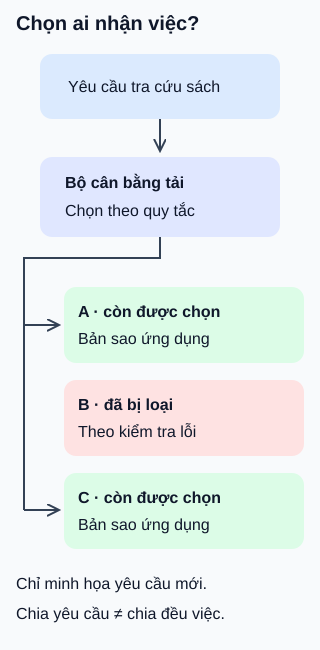

# Bộ cân bằng tải: chọn đích cho mỗi yêu cầu

**Nhiều bản sao ứng dụng cần một cách chọn nơi nhận việc.** Bộ cân bằng tải phân phối lưu lượng tới các đích theo quy tắc đã cấu hình. Ví dụ: ba bản sao cùng phục vụ trang tra cứu sách.

## Từ viết tắt

- **LB** (Load Balancer) — bộ cân bằng tải: thành phần chọn đích nhận lưu lượng giữa các máy hoặc bản sao ứng dụng.

## Đọc hình

1. **Chọn trong nhóm đích.** LB dùng danh sách bản sao và quy tắc chọn. Luân phiên là một lựa chọn; ít kết nối đang hoạt động hơn là lựa chọn khác. Không phải mọi hệ thống đều dùng cùng quy tắc.
2. **Theo dõi điều kiện phục vụ.** Trong hình, B đã bị loại sau kiểm tra lỗi; yêu cầu mới được chọn giữa A và C. Kiểm tra có chu kỳ và ngưỡng, nên không phát hiện lỗi tức thì hoặc chứng minh mọi chức năng đều tốt.
3. **Còn phải đủ sức xử lý.** Khi mất B, A và C phải gánh phần việc còn lại. LB không tự tạo thêm bản sao, sửa B hoặc làm một cơ sở dữ liệu đang nghẽn nhanh hơn.

## Nhìn hình thử trả lời

A và C nhận số yêu cầu bằng nhau. A đang chạy nhiều truy vấn nặng hơn. Có thể kết luận hai bản sao chịu tải bằng nhau không?

Xem đáp án

Không. Số yêu cầu không cho biết chi phí từng việc hoặc thời gian xử lý. Cần quan sát độ trễ, số việc đang chạy và tài nguyên sử dụng trước khi chọn quy tắc hay tăng năng lực.

Giới hạn của hình

Hình mô tả yêu cầu mới khi vẫn còn đích đủ điều kiện, không hứa chuyển tiếp thành công mọi yêu cầu đang xử lý. Khi tất cả đích lỗi, hành vi tùy sản phẩm và cấu hình: chẳng hạn Application Load Balancer của Amazon có thể vẫn gửi tới các đích lỗi khi toàn nhóm không khỏe. Không suy từ hình rằng LB luôn chặn mọi đích lỗi.

Thiết bị chuyên dụng, phần mềm tự vận hành và dịch vụ đám mây là các cách triển khai. Chọn theo địa chỉ/cổng hay nội dung yêu cầu là khả năng định tuyến; phạm vi một vùng hay nhiều vùng là quyết định khác. Chúng không phải các loại loại trừ nhau. Chính lớp cân bằng cũng cần phương án dự phòng; hình chỉ gom thành một ô để dễ đọc.

## Nguồn đối chiếu

- [ByteByteGo — body ghim](https://github.com/ByteByteGoHq/system-design-101/blob/b28380a4710c5ec9638ec037d4168e288f334cba/data/guides/what-is-a-load-balancer.md): chủ đề và danh sách góc phân loại; không dùng ảnh nguồn.
- [NGINX — phân phối yêu cầu và quy tắc chọn](https://docs.nginx.com/nginx/admin-guide/load-balancer/http-load-balancer/): ví dụ sản phẩm, không bảo đảm hiệu năng cho mọi hệ thống.
- [Amazon — kiểm tra sức khỏe đích](https://docs.aws.amazon.com/elasticloadbalancing/latest/application/target-group-health-checks.html): chu kỳ/ngưỡng và trường hợp toàn nhóm lỗi.

Đã đọc body ghim và các mục tài liệu cho claim ngày 2026-10-15. Hình và ví dụ thư viện tự thiết kế; chưa chạy bộ cân bằng tải thật hoặc thử với người học.
