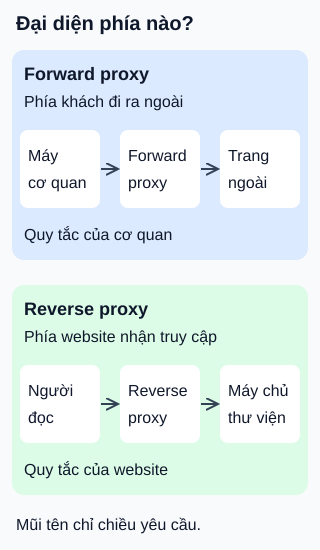

# Forward proxy và reverse proxy: đại diện phía nào?

**Cùng chuyển tiếp yêu cầu, khác phía được đại diện.** Với truy cập web qua HTTP, đừng chỉ nhìn proxy nằm “ở giữa”; hãy hỏi ai dùng nó để kiểm soát việc đi ra hoặc đi vào.

## Từ viết tắt

- **HTTP** (HyperText Transfer Protocol) — giao thức trao đổi yêu cầu và phản hồi trên web; ở đây giúp mô tả hai vai trò chuyển tiếp.

## Đọc hình

- **Forward proxy — thay mặt phía khách.** Ví dụ, cơ quan cấu hình máy nhân viên dùng một proxy khi truy cập trang ngoài. Proxy có thể áp quy tắc truy cập chung hoặc lưu bản trả lời phù hợp để dùng lại.
- **Reverse proxy — thay mặt phía website.** Người đọc mở địa chỉ thư viện như một website bình thường. Proxy nhận yêu cầu, chọn máy chủ phía sau và trả kết quả; máy người đọc không cần cấu hình một forward proxy cho vai trò này.

“Reverse” không đảo chiều mũi tên yêu cầu. Tên gọi phân biệt vai trò; phản hồi vẫn đi về người yêu cầu.

## Nhìn hình thử trả lời

Website thư viện muốn đưa các yêu cầu tới một trong ba bản sao phục vụ. Chọn vai trò nào trong hình? Vì sao không yêu cầu mọi người đọc cấu hình proxy cơ quan?

Xem đáp án

Reverse proxy ở phía website có thể đảm nhiệm việc chọn bản sao. Forward proxy cơ quan phục vụ nhóm máy khách của cơ quan, không phải điểm vào do thư viện quản lý.

Giới hạn cần nhớ

Lưu bản trả lời và cân bằng tải là khả năng cần cấu hình, không phải cứ đặt proxy là tự có. Forward proxy không mặc nhiên bảo đảm ẩn danh: thông tin máy khách có thể được chuyển tiếp. Reverse proxy cũng không tự sửa lỗi ứng dụng hoặc thay mọi biện pháp bảo vệ máy chủ.

Không mở forward proxy cho bất kỳ ai sử dụng: tài liệu Apache yêu cầu giới hạn quyền truy cập. Hai hình là hai ví dụ độc lập; một đường đi thực tế có thể có cả hai vai trò.

## Nguồn đối chiếu

- [ByteByteGo — body ghim](https://github.com/ByteByteGoHq/system-design-101/blob/b28380a4710c5ec9638ec037d4168e288f334cba/data/guides/proxy-vs-reverse-proxy.md): chủ đề so sánh; không dùng ảnh nguồn hoặc coi “bảo vệ” là bảo đảm tuyệt đối.
- [Apache — forward/reverse proxy và kiểm soát truy cập](https://httpd.apache.org/docs/2.4/mod/mod_proxy.html#forwardreverse): vai trò và cấu hình tính năng.
- [MDN — proxy và thông tin máy khách](https://developer.mozilla.org/en-US/docs/Web/HTTP/Guides/Proxy_servers_and_tunneling): phân biệt hai phía và thông tin có thể được chuyển tiếp.

Đã đọc body ghim và các mục tài liệu cho claim ngày 2026-10-15. Ví dụ cơ quan/thư viện và hình tự thiết kế; chưa chạy proxy thật hoặc thử với người học.
