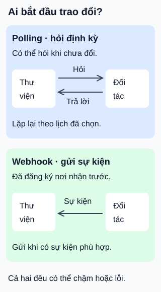

# Polling và webhook: hỏi định kỳ hay nhận thông báo?

**Ai bắt đầu lần trao đổi tiếp theo?** Thư viện muốn biết đối tác đã giao thùng sách chưa. Polling để thư viện hỏi lại; webhook để đối tác gửi sự kiện tới nơi nhận đã đăng ký.

## Từ viết tắt

- **HTTP** (HyperText Transfer Protocol) — giao thức trao đổi yêu cầu và phản hồi trên web; webhook trong ví dụ dùng yêu cầu gửi tới máy chủ nhận.

## Đọc hình

- **Polling — chủ động hỏi.** Thư viện định kỳ đọc trạng thái giao sách. Dễ chọn lịch hỏi, nhưng nhiều lần có thể nhận lại “chưa đổi”. Hỏi dày hơn thường tăng số yêu cầu; hỏi thưa hơn có thể nhận ra thay đổi muộn hơn.
- **Webhook — đăng ký nhận sự kiện.** Thư viện cung cấp địa chỉ nhận và chọn sự kiện đối tác hỗ trợ. Khi có sự kiện phù hợp, đối tác gửi yêu cầu HTTP tới địa chỉ đó. Không cần liên tục hỏi chỉ để biết có thay đổi hay chưa.

Chọn polling khi nhu cầu tra cứu ít hoặc bên cung cấp không hỗ trợ webhook phù hợp. Chọn webhook khi cần theo dõi sự kiện và có thể vận hành nơi nhận; “được báo gần thời điểm xảy ra” không phải bảo đảm đến ngay.

## Nhìn hình thử trả lời

Đối tác báo “đã giao” đúng lúc máy chủ thư viện dừng. Chỉ có đăng ký webhook đã đủ để chắc chắn thư viện cập nhật trạng thái chưa?

Xem đáp án

Chưa. Lần gửi có thể thất bại. Cần biết hợp đồng gửi lại, theo dõi lỗi và có cách đối soát hoặc khôi phục. Không mặc định bên gửi sẽ tự thử lại: GitHub không tự giao lại webhook lỗi, còn Stripe có cơ chế thử lại riêng.

Giới hạn khi vận hành

Webhook có thể tới trùng hoặc không đúng thứ tự, tùy dịch vụ. Xác minh nguồn gửi theo tài liệu, nhận diện sự kiện đã xử lý và tránh để sự kiện cũ ghi đè trạng thái mới. Stripe ghi rõ các trường hợp trùng/lệch thứ tự; không suy thành một bảo đảm chung cho mọi nhà cung cấp.

Polling chỉ đọc trạng thái hiện tại có thể bỏ qua trạng thái trung gian. Nếu cần lịch sử đầy đủ, phải có cách đọc lịch sử hoặc dòng sự kiện được lưu. Hai cách có thể phối hợp: nhận webhook để phản ứng sớm và truy vấn đối soát khi cần. Đây là lựa chọn thiết kế, không phải quy trình bắt buộc.

## Nguồn đối chiếu

- [ByteByteGo — body ghim](https://github.com/ByteByteGoHq/system-design-101/blob/b28380a4710c5ec9638ec037d4168e288f334cba/data/guides/polling-vs-webhooks.md): chủ đề; không dùng ảnh hoặc giữ khẳng định giao tức thì/hiệu quả tuyệt đối.
- [GitHub — webhook và polling](https://docs.github.com/en/webhooks/about-webhooks): cơ chế đăng ký và lựa chọn theo nhu cầu.
- [GitHub — lần giao thất bại](https://docs.github.com/en/webhooks/using-webhooks/handling-failed-webhook-deliveries): không tự giao lại.
- [Stripe — giao sự kiện và thực hành xử lý](https://docs.stripe.com/webhooks): thử lại, thứ tự, trùng và xác minh nguồn gửi.

Đã đọc body ghim và các mục tài liệu cho claim ngày 2026-10-16. Ví dụ giao sách và hình tự thiết kế; chưa đăng ký webhook thật, thử lỗi giao nhận hoặc thử với người học.
