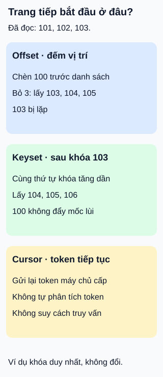

# Phân trang: vị trí, khóa tiếp tục và cursor

**Lấy từng phần, nhưng phải biết “phần tiếp” bắt đầu ở đâu.** API danh mục sách trả ba mục mỗi lần. Ban đầu, khóa tăng dần từ 101 tới 106; người đọc đã nhận 101, 102, 103.

## Từ viết tắt

- **API** (Application Programming Interface) — giao diện để chương trình yêu cầu dữ liệu hoặc chức năng; ở đây là cách lấy danh mục theo từng phần.

## Đọc hình

- **Offset và số trang — đếm vị trí.** `offset=3&limit=3` bỏ ba mục rồi lấy tối đa ba mục. Số trang có thể quy đổi thành offset theo kích thước trang. Nếu có mục mới chen trước, vị trí dịch chuyển: hình cho thấy khóa103 bị đọc lại.
- **Keyset — đi sau khóa đã đọc.** Với thứ tự khóa tăng dần và khóa không đổi, lấy `id > 103` rồi giới hạn ba mục. Chèn100 phía trước không đẩy mốc này lùi lại. Truy vấn cần thứ tự phân biệt được từng bản ghi và chỉ mục phù hợp để hoạt động hiệu quả.
- **Cursor — hợp đồng tiếp tục.** Máy chủ trả token để máy khách gửi lại khi lấy trang sau. Token có thể chứa thông tin cho keyset hoặc một cách tiếp tục khác; không suy “có cursor” thành “chắc chắn không dùng offset”. Máy khách nên coi token là giá trị không tự phân tích.

## Nhìn hình thử trả lời

Hai sách có cùng thời điểm tạo. Nếu chỉ dùng điều kiện “thời điểm lớn hơn mốc cuối”, có chắc trang sau chứa đủ sách chưa đọc không?

Xem đáp án

Không. Sách chưa đọc nhưng cùng thời điểm với mốc sẽ bị loại. Cần thứ tự đủ phân biệt, chẳng hạn cặp thời điểm và khóa duy nhất, rồi dùng đúng cặp đó để tiếp tục. Lọc theo thời gian một mình không bảo đảm không bỏ sót.

Giới hạn và đánh đổi

Offset dễ biểu diễn “tới trang số…”, nhưng bỏ nhiều mục vẫn có thể tốn công xử lý. Keyset phù hợp đi tiếp theo thứ tự, không tự cung cấp nhảy tới một trang số bất kỳ; hiệu năng còn tùy chỉ mục và bộ lọc.

Cả hai không tự tạo ảnh chụp dữ liệu bất biến giữa các lần gọi. Nếu bản ghi bị xóa, đổi khóa sắp xếp hoặc thêm vào phần đã đi qua, kết quả cần được hiểu theo hợp đồng nhất quán của dịch vụ. Cursor không tự giải quyết điều này, cũng không thay phân quyền.

Trong hướng dẫn phân trang của Google, giữ nguyên các tham số ngoài kích thước trang khi dùng token và dùng token kế tiếp để biết còn trang. Một trang ít mục, thậm chí rỗng, chưa chắc là hết. Đây là hợp đồng cụ thể cần đọc, không áp tên tham số cho mọi API.

## Nguồn đối chiếu

- [ByteByteGo — body ghim](https://github.com/ByteByteGoHq/system-design-101/blob/b28380a4710c5ec9638ec037d4168e288f334cba/data/guides/how-do-we-perform-pagination-in-api-design.md): chủ đề; không dùng ảnh hoặc giữ bảo đảm phân trang thời gian không bỏ sót.
- [Tài liệu truy vấn §7.6](https://www.postgresql.org/docs/18/queries-limit.html): thứ tự xác định và chi phí offset lớn.
- [GitLab — keyset](https://docs.gitlab.com/development/database/keyset_pagination/): khóa phân biệt, cursor và chỉ mục; cần kiểm tra cả truy vấn trang sau.
- [Google — phân trang](https://google.aip.dev/158): token không để máy khách phân tích, tham số tiếp tục, phân quyền và dấu hiệu kết thúc.

Đã đọc body ghim và các mục tài liệu cho claim ngày 2026-10-16. Danh sách số và hình tự thiết kế; chưa đo truy vấn cơ sở dữ liệu hoặc thử với người học.
