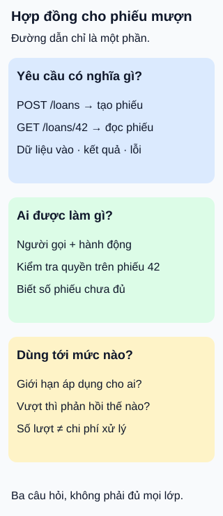

# Thiết kế API: hợp đồng trước đường dẫn

**Một địa chỉ dễ nhớ chưa đủ tạo ra giao diện dễ dùng và an toàn.** Thư viện mở API cho ứng dụng bạn đọc. Trước khi chọn tên đường dẫn, cần thống nhất ý nghĩa yêu cầu, quyền thao tác và cách xử lý giới hạn.

## Từ viết tắt

- **API** (Application Programming Interface) — giao diện để chương trình yêu cầu dữ liệu hoặc chức năng, ở đây là dịch vụ mượn sách.
- **HTTP** (HyperText Transfer Protocol) — giao thức mang yêu cầu và phản hồi; phương thức, trường đầu và mã phản hồi cùng diễn đạt hợp đồng.

## Đọc hình

- **Yêu cầu có nghĩa gì?** Trong thiết kế này, `POST /loans` tạo phiếu mượn, `GET /loans/42` đọc phiếu42. Dùng tài nguyên và phương thức nhất quán; mô tả cả dữ liệu vào, dữ liệu trả về và lỗi. Đường dẫn không cần phản chiếu từng bảng lưu trữ.
- **Ai được làm gì?** Biết số42 hoặc đã đăng nhập chưa đủ. Máy chủ phải kiểm tra người gọi có quyền thực hiện hành động đó trên phiếu42. Đổi sang mã khó đoán cũng không thay được kiểm tra quyền.
- **Dùng tới mức nào?** Ghi rõ giới hạn, phạm vi áp dụng và phản hồi khi vượt. Giới hạn số yêu cầu giúp kiểm soát tải, nhưng một yêu cầu vẫn có thể rất tốn công. Không coi nó là toàn bộ cơ chế bảo vệ.

## Nhìn hình thử trả lời

Bạn đọc A đăng nhập hợp lệ, đổi số42 trong yêu cầu thành số43 — phiếu của B. Tên đường dẫn vẫn đúng và chưa vượt giới hạn. Máy chủ có nên trả phiếu43 chỉ vì hai kiểm tra đó đạt?

Xem đáp án

Không. Máy chủ còn phải xét quyền đọc của A đối với phiếu43 theo chính sách thư viện. Hợp lệ về cú pháp và tần suất không đồng nghĩa được phép đọc đối tượng.

Đi sâu: phần hợp đồng không nằm trong đường dẫn

Trường đầu `Content-Type` cho biết định dạng nội dung gửi đi; `Accept` nêu các định dạng phản hồi máy khách chấp nhận. Cần tài liệu hóa định dạng được hỗ trợ, không suy ra chỉ từ tên đường dẫn.

Quy ước tài nguyên giúp giao diện nhất quán, không có nghĩa mọi nghiệp vụ đều phải ép thành một thao tác thêm/xóa bảng. Ví dụ phiếu mượn ở đây là lựa chọn mô hình của bài, không phải chuẩn bắt buộc cho thư viện.

Với dịch vụ cổng API của Amazon, throttling và quota là mục tiêu áp dụng theo khả năng, không phải trần số yêu cầu được bảo đảm tuyệt đối; máy khách có thể nhận mã429 khi bị hạn chế. Không áp hợp đồng của sản phẩm này cho mọi API. Cần xét thêm kích thước dữ liệu và chi phí xử lý, chứ không chỉ đếm lượt gọi.

Ba thẻ là câu hỏi thiết kế, không quy định thứ tự các lớp kiểm tra. Đây cũng chưa phải danh sách đầy đủ để chứng nhận hệ thống an toàn.

## Nguồn đối chiếu

- [ByteByteGo — body ghim](https://github.com/ByteByteGoHq/system-design-101/blob/b28380a4710c5ec9638ec037d4168e288f334cba/data/guides/how-do-we-design-effective-and-safe-apis.md): giới thiệu chủ đề, chủ yếu dẫn ảnh; không dùng ảnh làm bằng chứng.
- [Microsoft — thiết kế giao diện web](https://learn.microsoft.com/en-us/azure/architecture/best-practices/api-design): tài nguyên, phương thức và các trường đầu về định dạng.
- [Kiểm soát quyền trên từng đối tượng](https://owasp.org/API-Security/editions/2023/en/0xa1-broken-object-level-authorization/): kiểm tra người gọi, hành động và đối tượng.
- [Amazon — giới hạn tại cổng API](https://docs.aws.amazon.com/apigateway/latest/developerguide/api-gateway-request-throttling.html): mục tiêu giới hạn và phản hồi429.

Đã đọc body ghim và các mục tài liệu cho claim ngày2026-10-16. Ví dụ và hình tự thiết kế; chưa triển khai dịch vụ, thử bảo mật hoặc thử với người học.
