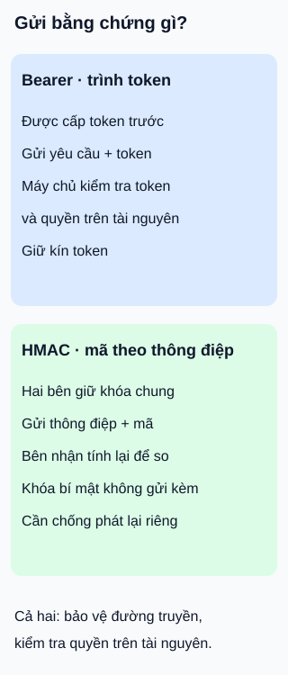

# Bearer token và HMAC: gửi bằng chứng gì?

**Một bên trình token; một bên tính mã trên thông điệp.** API thư viện nhận yêu cầu từ ứng dụng bạn đọc và từ máy chủ đối tác. Hai cách dưới đây cần bảo vệ những bí mật khác nhau; không phải bảng xếp hạng an toàn.

## Từ viết tắt

- **API** (Application Programming Interface) — giao diện để chương trình yêu cầu dữ liệu hoặc chức năng của thư viện.
- **HMAC** (Hash-based Message Authentication Code) — mã xác thực thông điệp dùng hàm băm và khóa bí mật chung để bên nhận kiểm tra thông điệp.
- **TLS** (Transport Layer Security) — cơ chế bảo vệ dữ liệu giữa hai đầu kết nối khi truyền qua mạng.

## Đọc hình

- **Bearer — trình token đã cấp.** Ai có token có thể dùng nó trong phạm vi được chấp nhận, không cần chứng minh có thêm khóa mật mã. Máy chủ kiểm tra tính hợp lệ và quyền; chưa hết hạn không đồng nghĩa chắc chắn được chấp nhận. Token bị lộ có thể bị dùng lại.
- **HMAC — tính mã theo thông điệp.** Hai bên giữ khóa bí mật chung. Bên gửi tính mã trên dữ liệu đã thống nhất; bên nhận tính lại rồi so sánh. Mã hợp lệ hỗ trợ kiểm tra tính toàn vẹn của phần dữ liệu được đưa vào phép tính. Nó không mã hóa nội dung, không tự ngăn phát lại và không thay kiểm tra quyền.

## Nhìn hình thử trả lời

Kẻ khác chép nguyên một thông điệp cùng mã HMAC hợp lệ rồi gửi lại. Chỉ tính lại mã và thấy khớp có đủ kết luận đây là một yêu cầu mới không?

Xem đáp án

Không. Bản sao nguyên vẹn vẫn có thể có mã khớp. Cần cơ chế chống phát lại ở giao thức, chẳng hạn giá trị dùng một lần được bảo vệ cùng thông điệp và bên nhận phát hiện việc dùng lại. Mốc thời gian có kiểm tra giới hạn tuổi giúp thu hẹp cửa sổ; riêng nó không bảo đảm mỗi yêu cầu chỉ được xử lý một lần.

Giới hạn và bối cảnh dùng

HMAC hợp lệ không chứng minh ai đang gửi bản sao hiện tại. Trong giả định khóa còn bí mật và cơ chế mật mã an toàn, bên tạo mã đã có khóa lúc tạo; cả hai bên giữ khóa đều có thể tạo mã. Đây không phải cặp khóa công khai/bí mật.

Không nhúng khóa bí mật dùng chung lâu dài của cả dịch vụ vào mã tải xuống trình duyệt. Người chạy ứng dụng có thể tiếp cận mã và thông tin xác thực; ứng dụng trình duyệt không được coi như máy chủ có khả năng giữ bí mật đó. Token cấp cho người dùng cũng vẫn cần được bảo vệ.

Bearer token chỉ là một loại token, không đại diện cho mọi cơ chế dựa trên token. Cách cấp, lưu, thu hồi và kiểm tra phụ thuộc giao thức; bài này không đề xuất luồng gửi mật khẩu cho ứng dụng. Với bearer, dùng TLS và xác minh máy chủ; HMAC cũng không thay bảo vệ đường truyền.

Khi xác thực thông điệp, hai bên phải thống nhất phần dữ liệu được bảo vệ và cách biểu diễn; phần bỏ ngoài có thể bị thay mà mã vẫn khớp. Chọn giao thức và thư viện đã được rà soát, không tự ghép các mảnh trong hình thành cơ chế bảo mật để triển khai.

## Nguồn đối chiếu

- [ByteByteGo — body ghim](https://github.com/ByteByteGoHq/system-design-101/blob/b28380a4710c5ec9638ec037d4168e288f334cba/data/guides/how-to-design-secure-web-api-access-for-your-website.md): đọc thân bài; không dùng ảnh, không giữ mô tả HMAC là cặp khóa bất đối xứng hoặc token cứ chưa hết hạn là hợp lệ.
- [Chuẩn6750 §1.2,3.1,5](https://www.rfc-editor.org/rfc/rfc6750.html): bearer, quyền, token không hợp lệ và bảo vệ đường truyền.
- [Chuẩn2104 §1–2](https://www.rfc-editor.org/rfc/rfc2104.html): HMAC dùng khóa bí mật chung.
- [Chuẩn6749 §2.1](https://www.rfc-editor.org/rfc/rfc6749.html#section-2.1): ứng dụng chạy trong trình duyệt là máy khách công khai.
- [Chuẩn9421 §7.1.2,7.2.1–2](https://www.rfc-editor.org/rfc/rfc9421.html#section-7.2.2): phạm vi thông điệp được bảo vệ, TLS và chống phát lại.

Đã đọc body ghim và các mục chuẩn cho claim ngày2026-10-16. Hình tự thiết kế; chưa triển khai xác thực hoặc thử tấn công/người học.
