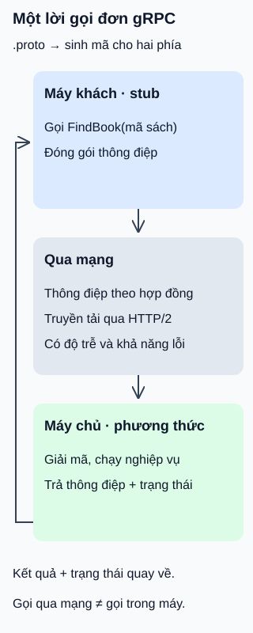

# gRPC: gọi phương thức qua mạng

**Gọi tên phương thức trong chương trình, nhưng công việc diễn ra ở máy khác.** Dịch vụ thư viện cung cấp `FindBook`: gửi mã sách, nhận thông tin sách. gRPC cung cấp khung giao tiếp; người viết dịch vụ vẫn phải cài đặt nghiệp vụ.

## Từ viết tắt

- **gRPC** (gRPC Remote Procedure Calls) — tên viết tắt đệ quy của khung gọi thủ tục từ xa: chương trình gọi phương thức do dịch vụ ở máy khác cung cấp.
- **HTTP** (HyperText Transfer Protocol) — giao thức mang yêu cầu và phản hồi; gRPC thông dụng dùng phiên bản2 làm lớp truyền tải.

## Đọc hình

- **Thống nhất hợp đồng.** Với cách dùng mặc định, tệp `.proto` mô tả dịch vụ, phương thức và cấu trúc thông điệp bằng Protocol Buffers. Công cụ sinh mã hỗ trợ hai phía dùng cùng hợp đồng, kể cả khác ngôn ngữ được hỗ trợ.
- **Máy khách gọi qua mã đại diện.** Stub là phần mã cục bộ đại diện cho dịch vụ: đóng gói tham số và chuyển lời gọi qua mạng. Cú pháp trông như gọi trong máy không xóa được độ trễ hoặc lỗi mạng.
- **Máy chủ thực hiện.** Thư viện nhận, giải mã thông điệp và gọi phần nghiệp vụ do người phát triển viết. Khi lời gọi đơn thành công, máy khách nhận một thông điệp kết quả cùng trạng thái hoàn tất.

## Nhìn hình thử trả lời

Máy khách hết thời gian chờ khi gọi phương thức tạo phiếu mượn. Có thể kết luận máy chủ chưa tạo phiếu rồi gọi lại ngay mà không xét trùng không?

Xem đáp án

Không. Máy chủ có thể đã xử lý nhưng kết quả tới muộn. Hết thời gian chờ phản ánh điều máy khách biết; không tự hoàn tác thay đổi đã xảy ra. Việc gọi lại thao tác có tác dụng phụ cần dựa vào hợp đồng chống trùng hoặc cách kiểm tra kết quả của ứng dụng.

Bốn dạng lời gọi và giới hạn

- Gọi đơn: một thông điệp yêu cầu, một thông điệp phản hồi khi thành công.
- Luồng từ máy chủ: một yêu cầu, chuỗi thông điệp trả về.
- Luồng từ máy khách: chuỗi thông điệp gửi đi, một thông điệp phản hồi khi thành công.
- Luồng hai chiều: mỗi phía gửi một chuỗi; thứ tự giữ trong từng chiều của một lời gọi, không có thứ tự chung giữa hai chiều.

Nên đặt hạn chót (deadline) thực tế cho lời gọi thay vì chờ vô hạn. Hết hạn, máy khách ngừng chờ; phần ứng dụng máy chủ phải chú ý hủy và dừng công việc do nó tạo ra. Hủy lời gọi không tự hoàn tác thay đổi trước đó.

Protocol Buffers là lựa chọn mặc định, không phải định dạng duy nhất được phép. Dùng dữ liệu nhị phân hoặc HTTP/2 không tự bảo đảm nhanh hơn một thiết kế khác: còn phụ thuộc dữ liệu, xử lý và môi trường. Hình minh họa lời gọi đơn, không hàm ý mọi lời gọi đều chỉ có một phản hồi hoặc cứ gọi là thành công.

## Nguồn đối chiếu

- [ByteByteGo — body ghim](https://github.com/ByteByteGoHq/system-design-101/blob/b28380a4710c5ec9638ec037d4168e288f334cba/data/guides/what-is-grpc.md): chủ đề; không dùng ảnh hay giữ khẳng định hiệu năng tuyệt đối.
- [Giới thiệu gRPC](https://grpc.io/docs/what-is-grpc/introduction/): hợp đồng, sinh mã và Protocol Buffers mặc định.
- [Khái niệm và vòng đời](https://grpc.io/docs/what-is-grpc/core-concepts/): stub, bốn dạng lời gọi, kết quả hai phía và hủy không hoàn tác.
- [Hạn chót lời gọi](https://grpc.io/docs/guides/deadlines/): đặt hạn chót và trách nhiệm dừng tác vụ của máy chủ.
- [Giải thích tên gRPC](https://grpc.io/docs/what-is-grpc/faq/): tên đệ quy, lớp truyền tải và khả năng dùng định dạng khác.

Đã đọc body ghim và các mục tài liệu cho claim ngày2026-10-16. Ví dụ và hình mới; chưa sinh mã, chạy hai dịch vụ, đo hiệu năng hoặc thử người học.
