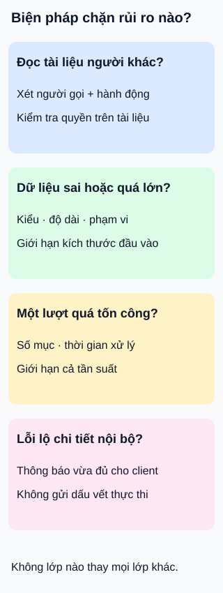

# Bảo vệ API: bắt đầu từ rủi ro

**Mỗi biện pháp cần trả lời: nó chặn điều gì, và còn bỏ ngỏ điều gì?** API kho tài liệu của lớp học cho phép tải tệp lên, xem nội dung và tìm kiếm. Một yêu cầu đúng định dạng vẫn có thể đọc nhầm tài liệu hoặc làm hệ thống tốn quá nhiều công.

## Từ viết tắt

- **API** (Application Programming Interface) — giao diện để chương trình yêu cầu dữ liệu hoặc chức năng của kho tài liệu.
- **TLS** (Transport Layer Security) — cơ chế bảo vệ dữ liệu giữa hai đầu kết nối khi truyền qua mạng.

## Đọc hình

- **Ai được xem?** Máy chủ xét quyền của người gọi đối với tài liệu và hành động cụ thể. Biết mã tài liệu hoặc đã đăng nhập không tự cho phép đọc tài liệu của người khác.
- **Nhận dữ liệu gì?** Kiểm tra kiểu, độ dài, phạm vi và kích thước đầu vào theo hợp đồng. Dữ liệu hợp lệ về định dạng vẫn cần kiểm tra quyền và quy tắc nghiệp vụ.
- **Tốn bao nhiêu công?** Hạn chế cả tần suất lẫn kích thước tệp, số mục xử lý trong một yêu cầu và thời gian thực thi. Đếm lượt gọi không thay được giới hạn chi phí của từng lượt.
- **Lỗi tiết lộ gì?** Trả thông báo đủ để máy khách xử lý, tránh gửi dấu vết thực thi và chi tiết nội bộ không cần thiết. Giấu lỗi khỏi phản hồi không có nghĩa nguyên nhân đã được sửa.

## Nhìn hình thử trả lời

Một người chỉ gửi một yêu cầu tìm kiếm, nhưng yêu cầu lấy hàng triệu tài liệu cùng lúc. Giới hạn số lượt gọi đã đủ bảo vệ tài nguyên chưa?

Xem đáp án

Chưa. Một lượt vẫn có thể tiêu tốn nhiều bộ nhớ, thời gian và băng thông. Cần giới hạn số mục trả về hoặc khối lượng công việc theo hợp đồng. Các mức cụ thể phải dựa trên nhu cầu và năng lực của hệ thống, không lấy con số tùy ý từ một bảng mẹo.

Đi sâu: phối hợp các lớp, kiểm tra giới hạn

Dùng TLS và xác minh máy chủ để bảo vệ thông tin xác thực trên đường truyền. Kênh được bảo vệ không quyết định người dùng có quyền đọc một tài liệu hay không.

Khóa truy cập có thể hỗ trợ nhận diện ứng dụng và quản lý mức sử dụng, nhưng không nên là biện pháp duy nhất cho tài nguyên nhạy cảm. Cổng chung cũng cần chính sách đúng và các dịch vụ phía sau phải thực thi quyền phù hợp. Không chọn một công nghệ chỉ vì nó xuất hiện trong danh sách bảo mật.

Với mỗi biện pháp, thiết kế tình huống kiểm tra cả yêu cầu được phép lẫn bị từ chối: đổi mã tài liệu, vượt kích thước tệp, tăng số mục, hoặc gây lỗi có kiểm soát trong môi trường thử nghiệm. Đây là việc cần làm khi triển khai; bài chưa chạy các thử nghiệm đó. Bốn thẻ là điểm bắt đầu để đặt câu hỏi, không chứng nhận hệ thống an toàn hoặc bao quát mọi rủi ro.

## Nguồn đối chiếu

- [ByteByteGo — body ghim](https://github.com/ByteByteGoHq/system-design-101/blob/b28380a4710c5ec9638ec037d4168e288f334cba/data/guides/top-12-tips-for-api-security.md): chỉ liệt kê12 tên biện pháp; không dùng ảnh hoặc coi danh sách là cấu hình bắt buộc.
- [Hướng dẫn bảo vệ dịch vụ web](https://cheatsheetseries.owasp.org/cheatsheets/REST_Security_Cheat_Sheet.html): đường truyền, khóa truy cập, dữ liệu đầu vào và phản hồi lỗi.
- [Quyền trên từng đối tượng](https://owasp.org/API-Security/editions/2023/en/0xa1-broken-object-level-authorization/): kiểm tra người gọi, hành động và đối tượng.
- [Tiêu thụ tài nguyên không giới hạn](https://owasp.org/API-Security/editions/2023/en/0xa4-unrestricted-resource-consumption/): kích thước, số thao tác, số mục và thời gian xử lý.

Đã đọc body ghim và các mục tài liệu cho claim ngày2026-10-16. Ví dụ và hình mới; chưa kiểm thử bảo mật dịch vụ thật hoặc thử với người học.
