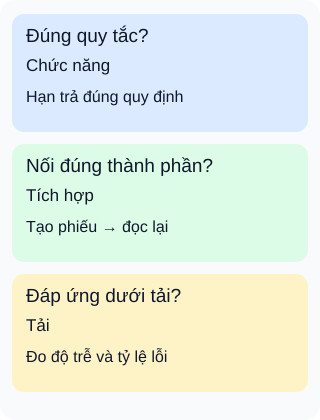

# Kiểm thử API: chọn câu hỏi trước tên gọi

**Một phản hồi thành công chưa trả lời hết mọi câu hỏi.** Với chức năng mượn sách, ta còn cần biết dữ liệu lưu đúng không, người khác có đọc được phiếu không và hệ thống chịu tải ra sao.

## Từ viết tắt

- **API** (Application Programming Interface) — giao diện để chương trình yêu cầu chức năng hoặc dữ liệu.

## Đọc hình

- **Đúng quy tắc?** Kiểm thử chức năng so kết quả với yêu cầu: mượn thành công thì hạn trả có đúng quy định không? Chỉ kiểm tra mã phản hồi dễ bỏ sót dữ liệu sai.
- **Nối đúng thành phần?** Kiểm thử tích hợp cho các thành phần phối hợp: tạo phiếu rồi đọc lại từ nơi lưu thử nghiệm. Không cần luôn đi qua toàn bộ giao diện hay tất cả dịch vụ.
- **Đáp ứng dưới tải?** Kiểm thử tải đặt một mô hình sử dụng, đo độ trễ và lỗi. Kết quả phụ thuộc dữ liệu, môi trường, thời lượng và kiểu tải; không phải sức chứa cố định cho mọi tình huống.

## Nhìn hình thử trả lời

Hạn trả đúng trong một lượt mượn. Có thể kết luận hệ thống vẫn phản hồi tốt khi nhiều người cùng mượn không?

Xem đáp án

Không. Thẻ chức năng chưa kiểm tra điều kiện tải ở thẻ cuối. Ngược lại, phản hồi nhanh dưới tải cũng chưa chứng minh hạn trả đúng.

Đi sâu: chín tên không phải chín bước bắt buộc

- **Kiểm tra nhanh (smoke)** — Những đường chính có hoạt động để tiếp tục kiểm tra?
- **Chức năng (functional)** — Kết quả có đúng yêu cầu?
- **Tích hợp (integration)** — Các thành phần trao đổi đúng không?
- **Hồi quy (regression)** — Thay đổi có làm hỏng hành vi cần giữ?
- **Tải (load)** — Hệ thống đáp ứng thế nào với tải dự kiến?
- **Áp lực (stress)** — Khi vượt tải thông thường, hệ thống phản ứng thế nào?
- **Bảo mật (security)** — Rủi ro quyền truy cập, dữ liệu hay tài nguyên nào còn xuất hiện?
- **Giao diện** — Người dùng có thao tác và thấy dữ liệu đúng không?
- **Sinh đầu vào biến thể (fuzz)** — Dữ liệu lạ, sai cấu trúc có làm lộ lỗi?

Đây là các góc nhìn có thể chồng lấp: một ca tích hợp cũng có thể được giữ làm kiểm tra hồi quy. Kiểm tra nhanh không chỉ diễn ra khi đã hoàn tất phát triển. Kiểm tra giao diện khác với gọi thẳng API; có thể phối hợp hai cách. Sinh đầu vào biến thể cần quan sát phản hồi và trạng thái, không chỉ tìm chương trình bị sập.

Vượt qua bộ kiểm tra bảo mật đã chọn không chứng minh chống được mọi mối đe dọa. Chọn mục tiêu, đầu vào và điều kiện đạt trước; xem [bài về chọn bộ kiểm tra sau thay đổi](../sd-10-023/lesson.md) để chuyển các tên này thành kế hoạch.

## Nguồn đối chiếu

- [ByteByteGo — body ghim](https://github.com/ByteByteGoHq/system-design-101/blob/b28380a4710c5ec9638ec037d4168e288f334cba/data/guides/explaining-9-types-of-api-testing.md): đã đọc chín mục, không dùng ảnh.
- [Giáo trình kiểm thử nền tảng, §1.3 và §2.2.3](https://istqb.org/wp-content/uploads/2024/11/ISTQB_CTFL_Syllabus_v4.0.1.pdf).
- [Microsoft: phối hợp thành phần](https://learn.microsoft.com/en-us/aspnet/core/test/integration-tests?view=aspnetcore-10.0).
- [Playwright: gọi trực tiếp và phối hợp kiểm tra trình duyệt](https://playwright.dev/docs/api-testing).
- [Grafana: mục tiêu của các kiểu tải và giới hạn kết luận](https://grafana.com/docs/k6/latest/testing-guides/test-types/).
- [Hướng dẫn sinh đầu vào biến thể](https://owasp.org/www-community/Fuzzing).

Đã đọc body ghim và các mục tài liệu nêu trên ngày2026-10-16. Ví dụ và hình tự thiết kế; đây là kế hoạch minh họa, chưa chạy kiểm thử API, đo tải hay thử bảo mật dịch vụ thật.
