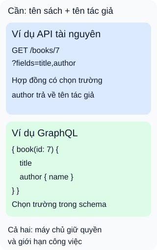

# REST API và GraphQL: ai chọn dữ liệu trả về?

**Cùng một màn hình sách, hợp đồng có thể cho máy khách chọn dữ liệu theo những cách khác nhau.** Màn hình chỉ cần tên sách và tên tác giả. Hình đặt hai ví dụ cạnh nhau để so cách yêu cầu, không xếp hạng tốc độ.

## Từ viết tắt

- **REST** (REpresentational State Transfer) — phong cách kiến trúc với các ràng buộc cho giao tiếp, gồm giao diện thống nhất và biểu diễn tài nguyên.
- **API** (Application Programming Interface) — giao diện để chương trình yêu cầu chức năng hoặc dữ liệu.
- **QL** (Query Language) — ngôn ngữ truy vấn; phần tên trong GraphQL nói đến cách mô tả dữ liệu muốn lấy.
- **HTTP** (HyperText Transfer Protocol) — giao thức yêu cầu và phản hồi mà ví dụ tài nguyên sử dụng.

## Đọc hình

- **Ví dụ tài nguyên:** máy khách gọi `GET /books/7?fields=title,author`. Máy chủ quy định tham số `fields` và biểu diễn của trường `author`. Đây là một khả năng thiết kế, không phải mọi REST API đều hỗ trợ.
- **Ví dụ GraphQL:** máy khách chọn `title` và `author { name }` trong truy vấn. Máy chủ phải có các trường và quan hệ ấy trong schema, tức hợp đồng kiểu dữ liệu; máy khách không tự tạo trường mới.
- **Cùng giới hạn:** chọn trường không cấp quyền đọc dữ liệu. Máy chủ vẫn phải kiểm tra quyền và giới hạn công việc xử lý.

## Nhìn hình thử trả lời

Thẻ tài nguyên có thể trả cả tên sách và tác giả trong một lần gọi. Vậy REST luôn phải gọi nhiều lần, còn GraphQL luôn nhanh hơn phải không?

Xem đáp án

Không. Chính hợp đồng của ví dụ cho phép lấy dữ liệu liên quan cùng nhau. Với GraphQL, một yêu cầu từ máy khách vẫn có thể kéo theo nhiều lần đọc phía sau. Số lượt gọi từ máy khách không đủ kết luận tốc độ.

Đi sâu: so cùng nhu cầu, không so hai nhãn

REST là phong cách kiến trúc; GraphQL là ngôn ngữ truy vấn và cơ chế thực thi theo schema. Dùng đường dẫn dạng danh từ và các phương thức HTTP chưa đủ chứng minh một hệ thống tuân thủ mọi ràng buộc REST. Hai thẻ chỉ minh họa phần lựa chọn dữ liệu.

Với giao diện tài nguyên, có thể kết hợp dữ liệu liên quan hoặc cung cấp lựa chọn trường nếu hợp đồng hỗ trợ. Đổi lại, nhóm phải thiết kế biểu diễn đủ dùng và tránh trả thừa dữ liệu. Với GraphQL, nhiều màn hình có thể chọn các tập trường khác nhau trong schema; nhóm vẫn phải xây cách lấy dữ liệu, kiểm soát độ sâu, số mục và chi phí truy vấn. Phức tạp không tự biến mất hoặc chỉ chuyển hết sang máy khách.

Bộ nhớ đệm cần thiết kế ở cả hai cách. Biểu diễn tài nguyên phải xác định khi nào được dùng lại; GraphQL cũng có thể dùng định danh đối tượng để hỗ trợ bộ nhớ đệm ở máy khách. Tên công nghệ không tự làm dữ liệu luôn mới hoặc ngăn lộ dữ liệu riêng tư.

Khi chọn, thử cùng một nhu cầu và dữ liệu: đo kích thước phản hồi, thời gian, số lần đọc phía sau và chi phí vận hành. Quyền phải được thực thi nhất quán ở logic nghiệp vụ, dù dữ liệu đi qua giao diện nào. Bài chỉ đưa ra tình huống thiết kế, chưa triển khai hoặc đo hai dịch vụ.

## Nguồn đối chiếu

- [ByteByteGo — body ghim](https://github.com/ByteByteGoHq/system-design-101/blob/b28380a4710c5ec9638ec037d4168e288f334cba/data/guides/rest-api-vs-graphql.md): đã đọc phần so sánh; không dùng ảnh nguồn.
- [Fielding, §5.1.4–5](https://ics.uci.edu/~fielding/pubs/dissertation/rest_arch_style.htm): bộ nhớ đệm và bốn ràng buộc của giao diện thống nhất.
- [Microsoft: thiết kế giao diện tài nguyên](https://learn.microsoft.com/en-us/azure/architecture/best-practices/api-design): kết hợp dữ liệu liên quan, lựa chọn trường và kiểm tra quyền trên trường.
- [Trường và truy vấn GraphQL](https://graphql.org/learn/queries/): lựa chọn trường trong schema và quan hệ lồng nhau.
- [Quyền truy cập](https://graphql.org/learn/authorization/) và [giới hạn công việc](https://graphql.org/learn/security/): quyền nghiệp vụ, phân trang, độ sâu, độ rộng và chi phí.
- [Bộ nhớ đệm GraphQL](https://graphql.org/learn/caching/): định danh đối tượng hỗ trợ bộ nhớ đệm ở máy khách.

Đã đọc body ghim và các mục đối chiếu ngày2026-10-16. Ví dụ và hình tự thiết kế; chưa chạy API, đo hiệu năng hoặc thử với người học.
