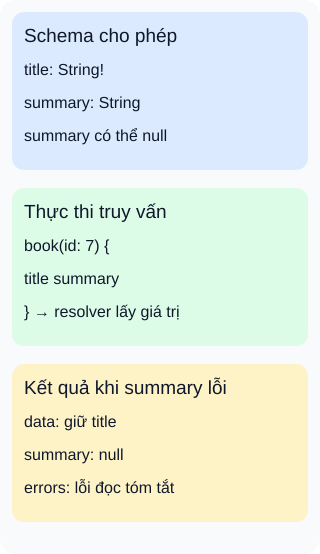

# GraphQL: từ schema đến dữ liệu và lỗi

**Schema mô tả điều được hỏi; phần thực thi phải tìm được giá trị để trả lời.** GraphQL gồm ngôn ngữ truy vấn và cơ chế thực thi theo hệ kiểu. Trong ví dụ thư viện, máy khách hỏi tên và tóm tắt sách. Biết hai trường tồn tại chưa bảo đảm việc đọc tóm tắt thành công.



## Từ viết tắt

- **QL** (Query Language) — ngôn ngữ truy vấn; phần tên trong GraphQL nói đến cách mô tả dữ liệu cần lấy.
- **API** (Application Programming Interface) — giao diện để chương trình yêu cầu chức năng hoặc dữ liệu.

## Đọc hình

- **Hợp đồng:** schema định nghĩa các kiểu, trường và tham số. Yêu cầu hỏi trường không có trong schema bị từ chối trước khi thực thi; không trả một phần dữ liệu của truy vấn sai ấy.
- **Thực thi:** với yêu cầu hợp lệ, resolver là cách máy chủ cung cấp giá trị cho trường. Nó có thể đọc thuộc tính đã có hoặc gọi nơi lưu dữ liệu; không phải mỗi trường đều cần một lần gọi mạng.
- **Kết quả:** giả sử resolver của `summary` gặp lỗi, còn `title` lấy được. Vì `summary` cho phép `null`, phản hồi có thể giữ tên sách, trả `summary: null` và thêm thông tin lỗi trong `errors`.

## Nhìn hình thử trả lời

Phản hồi đã có tên sách trong `data`. Có thể bỏ qua `errors` và kết luận toàn bộ yêu cầu thành công không?

<details>
<summary>Xem đáp án</summary>

Không. Tóm tắt đã lỗi trong ví dụ này. Máy khách cần quyết định hiển thị phần còn dùng được và thông báo phần thiếu; có `data` không đồng nghĩa mọi trường đều thành công. Bản thân `null` cũng chưa đủ kết luận có lỗi: trường có thể hợp lệ khi không có dữ liệu, nên phải xét cả hợp đồng và `errors`.

</details>

<details>
<summary>Đi sâu: điều kiện của ví dụ lỗi từng phần</summary>

Schema minh họa:

```graphql
type Query {
  book(id: Int!): Book
}
type Book {
  title: String!
  summary: String
}
```

Yêu cầu minh họa:

```graphql
{
  book(id: 7) {
    title
    summary
  }
}
```

Giả sử sách tồn tại, tên sách đọc được, nhưng resolver tóm tắt báo lỗi. `String` cho phép `null`; `String!` thì không. Nếu đổi `summary` thành `String!`, lỗi không còn được giữ ở riêng trường tóm tắt: nó lan lên vị trí cha cho phép `null` gần nhất. Với schema trên, `book` có thể trở thành `null`; nếu chuỗi cha đều không cho phép `null`, toàn bộ `data` có thể là `null`. Đây là quy tắc hoàn tất kết quả, không phải cơ chế tự sửa dữ liệu.

Ba loại thao tác phục vụ mục tiêu khác nhau: `query` đọc dữ liệu, `mutation` yêu cầu thay đổi, `subscription` nhận cập nhật dữ liệu theo sự kiện mà schema cung cấp. Subscription không mặc định thông báo việc sửa schema; ứng dụng phải có cách tạo sự kiện và chuyển cập nhật đến máy khách.

Hệ kiểu giúp phát hiện yêu cầu sai cấu trúc nhưng không tự bảo đảm quyền truy cập, dữ liệu nghiệp vụ đúng hoặc truy vấn rẻ. Máy chủ vẫn cần logic quyền và giới hạn công việc. Một truy vấn có thể kéo theo nhiều lần đọc; nhóm triển khai phải thiết kế phần lấy dữ liệu. Hình chỉ là luồng khái niệm của ví dụ, không yêu cầu ba dịch vụ riêng.

</details>

## Nguồn đối chiếu

- [ByteByteGo — body ghim](https://github.com/ByteByteGoHq/system-design-101/blob/b28380a4710c5ec9638ec037d4168e288f334cba/data/guides/what-is-graphql.md): đã đọc; không dùng ảnh và không giữ mô tả subscription là báo thay đổi schema.
- [Kiểm tra yêu cầu](https://graphql.org/learn/validation/) và [thực thi](https://graphql.org/learn/execution/): trường trong schema, resolver và cách tạo kết quả.
- [Phản hồi](https://graphql.org/learn/response/): phân biệt lỗi trước thực thi với lỗi từng trường; dữ liệu và lỗi có thể đi cùng nhau.
- [Đặc tả tháng9/2025, §3.12 và §6.4.4](https://spec.graphql.org/September2025/#sec-Handling-Execution-Errors): kiểu không cho phép null và lan truyền lỗi.
- [Subscription](https://graphql.org/learn/subscriptions/): cập nhật theo sự kiện dữ liệu.
- [Quyền truy cập](https://graphql.org/learn/authorization/) và [giới hạn công việc](https://graphql.org/learn/security/): các trách nhiệm triển khai ngoài kiểm tra kiểu.

Đã đọc body ghim và các mục đối chiếu ngày2026-10-16. Ví dụ và hình tự thiết kế; chưa chạy máy chủ GraphQL, thử lỗi dịch vụ thật hoặc thử với người học.
