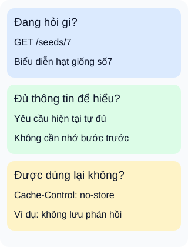

# Bảng kiểm REST: nhìn xa hơn đường dẫn

**Một đường dẫn đẹp chưa chứng minh một API tuân thủ REST.** Với danh mục hạt giống, hãy xem cả ý nghĩa yêu cầu lẫn cách máy khách hiểu và dùng phản hồi. Ba thẻ là câu hỏi rà soát, không phải ba máy chủ hoặc chứng nhận đầy đủ.

## Từ viết tắt

- **REST** (REpresentational State Transfer) — phong cách kiến trúc đặt ràng buộc cho cách các thành phần giao tiếp.
- **API** (Application Programming Interface) — giao diện để chương trình yêu cầu chức năng hoặc dữ liệu.
- **HTTP** (HyperText Transfer Protocol) — giao thức yêu cầu và phản hồi; phương thức và trường điều khiển có ý nghĩa chung.

## Đọc hình

- **Đang hỏi gì?** `GET /seeds/7` yêu cầu biểu diễn của tài nguyên hạt giống số7, chẳng hạn tên và mô tả. Máy khách không cần biết dữ liệu lấy từ tệp hay bảng nào phía sau.
- **Có đủ thông tin không?** Máy chủ hiểu yêu cầu hiện tại mà không phải nhớ bước trước của phiên. Điều này không cấm lưu dữ liệu hàng hóa; trạng thái tài nguyên khác với trạng thái hội thoại giữa các yêu cầu.
- **Có được dùng lại không?** Chính sách phản hồi cho biết cách xử lý bộ nhớ đệm. Ví dụ `Cache-Control: no-store` yêu cầu bộ nhớ đệm không lưu phản hồi, không phải dấu hiệu API “sai REST”.

## Nhìn hình thử trả lời

Máy chủ vẫn lưu tên hạt giống trong cơ sở dữ liệu, nhưng không dựa vào bước gọi trước để hiểu yêu cầu đọc. Điều đó có tự vi phạm ràng buộc không trạng thái phiên không?

Xem đáp án

Không. Dữ liệu tài nguyên vẫn được lưu. Điều cần tránh ở đây là máy chủ phải nhớ ngữ cảnh phiên từ yêu cầu trước mới hiểu được yêu cầu tiếp theo. Chỉ nhìn thấy cơ sở dữ liệu không đủ kết luận vi phạm.

Đi sâu: sáu ràng buộc, một mục tùy chọn

- **Máy khách–máy chủ:** tách trách nhiệm giao diện khỏi lưu trữ.
- **Không trạng thái phiên:** mỗi yêu cầu tự chứa thông tin cần để hiểu nó.
- **Bộ nhớ đệm:** xác định phản hồi được hoặc không được dùng lại.
- **Giao diện thống nhất:** tài nguyên, biểu diễn, thông điệp tự mô tả và liên kết dẫn bước tiếp theo.
- **Hệ thống phân lớp:** thành phần chỉ thấy lớp tương tác trực tiếp.
- **Mã theo yêu cầu:** tải mã thực thi xuống máy khách; đây là mục tùy chọn.

Giao diện thống nhất không chỉ là đặt tên đường dẫn bằng danh từ. Với danh mục hạt giống, hợp đồng có thể mô tả biểu diễn cùng liên kết tới các mục liên quan và thao tác khả dụng, để máy khách đi tiếp mà không phải tự suy mọi đường dẫn. Cần xét toàn bộ thiết kế trước khi gọi nó tuân thủ REST; ba thẻ trong hình chỉ chọn vài điểm dễ bỏ sót.

Bộ nhớ đệm có đánh đổi: giảm trao đổi nhưng có thể giữ dữ liệu cũ. `no-store` trong phản hồi là chỉ dẫn không lưu, khác với `no-cache` không kèm tham số: được lưu nhưng phải xác minh thành công trước khi dùng lại cho yêu cầu khác. Các chỉ dẫn này không tự bảo đảm riêng tư trước bên trung gian độc hại hoặc bị xâm nhập.

Phân trang, lọc và quy ước phiên bản giúp hợp đồng dễ dùng, nhưng thêm chúng không thay cho những ràng buộc trên. Khi triển khai, kiểm tra ý nghĩa phương thức, biểu diễn, liên kết, ngữ cảnh yêu cầu và chính sách dùng lại trên các tình huống cụ thể. Bài chưa chạy máy chủ hoặc bộ nhớ đệm thật.

## Nguồn đối chiếu

- [ByteByteGo — body ghim](https://github.com/ByteByteGoHq/system-design-101/blob/b28380a4710c5ec9638ec037d4168e288f334cba/data/guides/rest-api-cheatsheet.md): body chỉ giới thiệu bảng tra cứu, chưa dùng ảnh làm evidence.
- [Fielding, §5.1.2–5.1.7](https://ics.uci.edu/~fielding/pubs/dissertation/rest_arch_style.htm): các ràng buộc, bộ nhớ đệm, giao diện thống nhất và mã theo yêu cầu tùy chọn.
- [Chuẩn ngữ nghĩa HTTP, §9.3.1](https://www.rfc-editor.org/rfc/rfc9110.html#section-9.3.1): phương thức đọc yêu cầu biểu diễn, không buộc lộ cách lưu dữ liệu.
- [Chuẩn bộ nhớ đệm, §5.2.2.4–5](https://www.rfc-editor.org/rfc/rfc9111.html#section-5.2.2.5): phân biệt hai chỉ dẫn bộ nhớ đệm và giới hạn bảo đảm riêng tư.

Đã đọc body ghim và các mục chuẩn ngày2026-10-16. Ví dụ và hình tự thiết kế; chỉ minh họa bảng kiểm, chưa kiểm tra hệ thống thật hoặc thử với người học.
