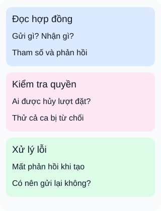

# Học API bằng ba năng lực thực hành

**Đừng đo tiến bộ bằng số tên công nghệ đã thuộc.** Hãy chọn một bài tập nhỏ: ứng dụng đặt sân thể thao. Ba thẻ dưới đây là các năng lực có thể quay lại luyện, không phải ba bước xử lý của máy chủ hay chứng chỉ thành thạo.

## Từ viết tắt

- **API** (Application Programming Interface) — giao diện để chương trình yêu cầu chức năng hoặc dữ liệu.
- **HTTP** (HyperText Transfer Protocol) — giao thức trao đổi yêu cầu và phản hồi với ý nghĩa phương thức được quy định chung.

## Đọc hình

- **Đọc hợp đồng:** trước khi gọi, chỉ ra tham số, dữ liệu gửi và các phản hồi được mô tả. Có thể dùng tài liệu OpenAPI cho một giao diện HTTP; không phải mọi loại giao diện đều dùng đặc tả này.
- **Kiểm tra quyền:** người đã đăng nhập có được hủy lượt đặt của người khác không? Viết ca bị từ chối bên cạnh ca thành công. Xác thực danh tính không thay quyền trên từng đối tượng.
- **Xử lý lỗi:** gửi tạo lượt đặt nhưng mất phản hồi. Đừng tự gửi lại vô hạn: yêu cầu trước có thể đã được áp dụng. Cần hiểu hợp đồng thử lại và cách đối chiếu kết quả.

## Nhìn hình thử trả lời

Ứng dụng đọc đúng tài liệu và đăng nhập thành công. Hai điều đó đã đủ để cho phép hủy mọi lượt đặt chưa?

Xem đáp án

Chưa. Thẻ kiểm tra quyền vẫn cần được kiểm chứng. Máy chủ phải xét người này có quyền thực hiện thao tác trên lượt đặt cụ thể hay không; biết mã lượt đặt không tạo ra quyền.

Đi sâu: chọn nhánh học từ bài tập

Đây là cách tổ chức học do bài đề xuất, không phải thứ tự chuẩn dành cho mọi người. Người mới có thể bắt đầu bằng đọc một phản hồi rồi bổ sung từng tình huống; người đã biết lập trình có thể đi thẳng vào phần mình còn yếu.

Một mô tả OpenAPI có thể ghi tham số, thân yêu cầu, phản hồi và cơ chế bảo mật của thao tác. Mô tả này giúp hiểu hợp đồng nhưng không chứng minh máy chủ thực hiện đúng: cần kiểm tra triển khai, cả tình huống thành công lẫn thất bại. Tài liệu cũng cần theo kịp thay đổi.

Khi mất kết nối, thử lại một yêu cầu không có tính lũy đẳng có thể lặp tác động. Theo ngữ nghĩa HTTP, chỉ tự thử lại khi có cơ sở biết tác động thực tế là lũy đẳng hoặc biết yêu cầu trước chưa được áp dụng. Lũy đẳng nói về tác động mong muốn, không hứa mọi phản hồi giống nhau. Với thao tác tạo lượt đặt, cách chống trùng hoặc tra cứu kết quả phải có hợp đồng cụ thể; chỉ nhìn tên phương thức chưa đủ.

Khi bài tập phát sinh danh sách dài, học phân trang; khi cần nhận tin thay đổi, so sánh hỏi định kỳ với thông báo đẩy; khi có mục tiêu tải, thiết kế phép đo phù hợp. Không cần học mọi khung triển khai hoặc dựng gateway trước khi làm bài tập đầu tiên. Tối ưu phải dựa vào vấn đề đã quan sát, không phải cứ thêm công cụ là nhanh hơn.

Bài này mới thiết kế tình huống học: chưa tạo dịch vụ đặt sân, thử lỗi mạng hay đo tải thật. Xem [bài 045](../sd-01-045/lesson.md) để chọn góc kiểm thử phù hợp.

## Nguồn đối chiếu

- [Body nguồn ghim](https://github.com/ByteByteGoHq/system-design-101/blob/b28380a4710c5ec9638ec037d4168e288f334cba/data/guides/the-ultimate-api-learning-roadmap.md): đã đọc danh sách chủ đề; không dùng ảnh hoặc sao chép bố cục nguồn.
- [OpenAPI 3.1.1, giới thiệu và Operation Object](https://spec.openapis.org/oas/v3.1.1.html#operation-object): phạm vi mô tả giao diện HTTP, tham số, thân yêu cầu, phản hồi và khai báo bảo mật.
- [Quyền trên đối tượng](https://owasp.org/API-Security/editions/2023/en/0xa1-broken-object-level-authorization/): cần kiểm tra quyền người dùng cho thao tác trên đối tượng cụ thể.
- [Ngữ nghĩa HTTP §9.2.2](https://www.rfc-editor.org/rfc/rfc9110.html#section-9.2.2): tác động lũy đẳng và điều kiện tự thử lại.

Đối chiếu ngày2026-10-16. Ví dụ, ba năng lực và hình do người biên soạn tự thiết kế; chưa thử với người học.
