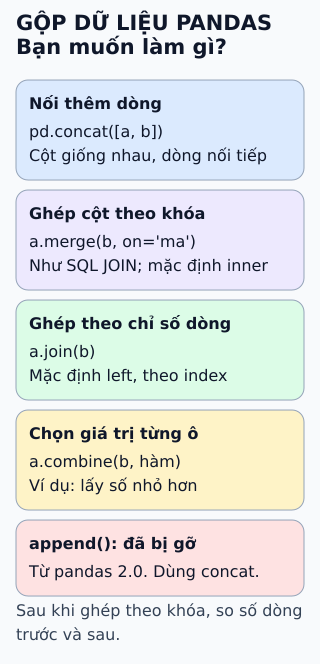

# Năm hàm gộp dữ liệu trong pandas

**Trước khi gộp hai bảng, hãy hỏi chúng liên hệ với nhau thế nào.** Nối thêm dòng, ghép cột theo khóa,
ghép theo chỉ số dòng và chọn giá trị từng ô là bốn việc khác nhau; mỗi việc có một hàm hợp nhất.

## Đọc hình

**Nối thêm dòng — `concat`.** Dùng khi hai bảng cùng loại cột, như dữ liệu của nhiều shard hay nhiều tháng.
Mặc định `axis=0` xếp dòng nối tiếp nhau; `axis=1` đặt cạnh nhau và căn theo index.

**Ghép cột theo khóa — `merge`.** Gần với JOIN của SQL. Mặc định `how="inner"`: chỉ giữ khóa có ở cả hai bảng.
Đổi sang `"left"`, `"right"` hoặc `"outer"` để giữ thêm dòng không khớp.

**Ghép theo chỉ số dòng — `join`.** Cách viết ngắn để ghép theo index. Mặc định `how="left"`: giữ mọi dòng của bảng bên trái.

**Chọn giá trị từng ô — `combine`.** Nhận một hàm và áp dụng cho các cặp cột tương ứng của hai bảng.
Ví dụ `np.minimum` giữ số nhỏ hơn ở mỗi ô, hữu ích khi hợp nhất hai nguồn cùng đo một đại lượng.

**`append` không còn.** Hàm này đã bị gỡ ở pandas 2.0. Thay bằng `pd.concat`.

## Giới hạn cần nhớ

Ghép theo khóa dễ làm số dòng đổi mà không báo lỗi: khóa trùng nhân dòng lên, khóa lệch bị loại (`inner`)
hoặc thành `NaN` (`outer`). Hãy so số dòng trước và sau khi gộp. Tham số `validate` của `merge`
(như `"one_to_one"`, `"many_to_one"`) kiểm tra kiểu quan hệ của khóa.

## Nhìn hình trả lời

Bảng A có khách mã 1, 2, 3; bảng B có doanh thu của mã 2, 3, 4. Muốn giữ cả bốn mã, dù thiếu ở một phía,
bạn gọi hàm nào, với tham số nào?

Xem đáp án

`a.merge(b, on="ma", how="outer")`. Kết quả có bốn mã 1–4; ô không có dữ liệu là `NaN`.
Mặc định `inner` chỉ còn mã 2 và 3.

Xem sâu hơn: thêm dữ liệu từng đợt

Khi dữ liệu đến dần, như một trình thu thập trang web, đừng thêm từng dòng vào bảng trong vòng lặp.
Tài liệu của `concat` khuyên gom các dòng vào một danh sách rồi gọi `concat` một lần.

`concat(axis=1)` căn theo index chứ không theo một cột khóa. Cần ghép theo cột khóa thì dùng `merge`.

## Nguồn đối chiếu

- [ByteByteGo — bài nguồn tại commit cố định](https://github.com/ByteByteGoHq/system-design-101/blob/b28380a4710c5ec9638ec037d4168e288f334cba/data/guides/5-functions-to-merge-data-with-pandas.md): danh sách năm hàm.
- [pandas — `concat`](https://pandas.pydata.org/docs/reference/api/pandas.concat.html): `axis`, `join`, khuyến nghị gom danh sách.
- [pandas — `merge`](https://pandas.pydata.org/docs/reference/api/pandas.merge.html): `how` mặc định `inner`, tham số `validate`.
- [pandas — `DataFrame.join`](https://pandas.pydata.org/docs/reference/api/pandas.DataFrame.join.html): `how` mặc định `left`, ghép theo index.
- [pandas — `DataFrame.combine`](https://pandas.pydata.org/docs/reference/api/pandas.DataFrame.combine.html): kết hợp từng cột bằng một hàm.
- [pandas 2.0.0 — những thay đổi](https://pandas.pydata.org/docs/whatsnew/v2.0.0.html): `append` bị gỡ, dùng `concat`.

Đã đọc nguồn ngày 2026-10-13. Các trang pandas.pydata.org không mở được trong môi trường biên soạn;
mọi hành vi trên được chạy lại bằng pandas 3.0.5 và đối chiếu với docstring của bản cài đặt.
Bài viết và hình được thiết kế độc lập. Bài nguồn gọi `join` là outer join và liệt kê `append`; hai điểm đó
không được giữ vì không khớp hành vi hiện tại.
