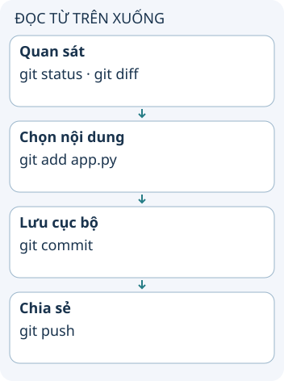

# Các lệnh Git theo việc cần làm

Bạn vừa sửa hai file nhưng chỉ muốn lưu một thay đổi. Hãy nhìn Git theo ba trạng thái: file đang sửa, nội dung đã chọn cho lần lưu tới và lịch sử đã commit. Lệnh đúng phụ thuộc vào trạng thái bạn muốn thay đổi.

**Đọc hình:** Các thẻ là các bước hoặc góc nhìn của ví dụ; đọc từ trên xuống. Mũi tên chỉ thứ tự đọc, không biểu diễn luồng mạng hoặc sự phụ thuộc bắt buộc.

`git init` tạo kho mới; `git clone` lấy một kho có sẵn. Trước khi lưu, dùng `git status` xem file nào thay đổi, `git diff` xem phần chưa stage và `git diff --staged` xem phần sẽ vào commit. `git add app.py` chọn nội dung hiện tại của file; nếu sửa tiếp, cần add lại để chọn phiên bản mới.

`git switch -c fix-title` tạo và chuyển sang nhánh làm việc. `git fetch` cập nhật thông tin từ remote; đọc diff trước khi tích hợp. `git push` gửi commit, không gửi mọi file chưa commit trong thư mục.

## Nhìn hình thử trả lời

Bạn add một file rồi sửa thêm một dòng. Commit ngay có chứa dòng mới không?

Xem đáp án

Không. Commit lấy nội dung trong index. Cần git add lại nếu muốn đưa dòng mới vào commit.

## Giới hạn cần nhớ

`git restore --staged app.py` bỏ chọn nội dung nhưng giữ sửa đổi trong file. `git restore app.py` có thể bỏ sửa đổi chưa stage. `git revert` tạo commit đảo thay đổi; đừng nhầm với reset hoặc xóa file.

Xem sâu hơn

Một commit là một mốc để so sánh, không phải bản sao tự động của tất cả file trên máy. File chưa được theo dõi cần add trước. `.gitignore` không làm file đã được theo dõi biến mất khỏi lịch sử.

## Nguồn đối chiếu

- [Chủ đề ByteByteGo tại snapshot cố định](https://github.com/ByteByteGoHq/system-design-101/blob/b28380a4710c5ec9638ec037d4168e288f334cba/data/guides/git-commands-cheat-sheet.md). Bài viết và hình này được thiết kế độc lập; không dịch thân bài hoặc sử dụng ảnh nguồn.
- [Git: các lệnh](https://git-scm.com/docs).
- [Git add](https://git-scm.com/docs/git-add).
- [Git restore](https://git-scm.com/docs/git-restore).
