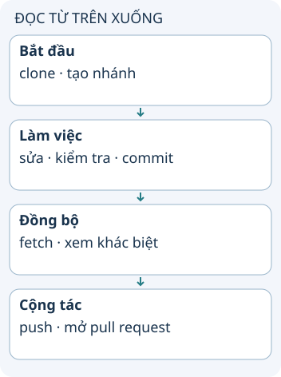

# Quy trình làm việc với Git

Hai người cùng sửa dự án không cần dùng chung một thư mục. Mỗi người có kho Git cục bộ, tạo commit riêng rồi trao đổi lịch sử qua một remote. Quy trình tốt giúp thay đổi được xem xét trước khi ghép vào nhánh chung.

**Đọc hình:** Các thẻ là các bước hoặc góc nhìn của ví dụ; đọc từ trên xuống. Mũi tên chỉ thứ tự đọc, không biểu diễn luồng mạng hoặc sự phụ thuộc bắt buộc.

Ví dụ Lan sửa thông báo lỗi trên nhánh riêng. Lan kiểm tra ứng dụng, chọn thay đổi và commit với lời giải thích. Minh vẫn có thể làm việc trên máy khác mà không chờ Lan hoàn thành.

Sau `git fetch`, Lan thấy nhánh chung có commit mới của Minh. Lan chọn merge hoặc rebase theo quy ước nhóm, xử lý xung đột nếu có và chạy kiểm tra lại. Khi push nhánh, Lan mở pull request để người khác xem diff. Pull request là tính năng của nền tảng cộng tác; Git tự nó quản lý commit, nhánh và việc tích hợp lịch sử.

## Nhìn hình thử trả lời

Mất mạng có ngăn bạn tạo commit trong kho Git đã có trên máy không?

Xem đáp án

Không. Commit là thao tác cục bộ. Trao đổi với remote mới cần kết nối tới remote đó.

## Giới hạn cần nhớ

Fetch không tự ghép thay đổi vào nhánh đang làm. Pull gồm fetch rồi tích hợp theo tùy chọn và cấu hình; không nên hiểu pull luôn là merge.

Xem sâu hơn

Xung đột là yêu cầu quyết định nội dung cuối cùng, không phải chỉ xóa dấu phân cách. Sau giải quyết, kiểm tra cả ý nghĩa chương trình: hai sửa đổi riêng đều đúng vẫn có thể sai khi kết hợp.

## Nguồn đối chiếu

- [Chủ đề ByteByteGo tại snapshot cố định](https://github.com/ByteByteGoHq/system-design-101/blob/b28380a4710c5ec9638ec037d4168e288f334cba/data/guides/git-workflow.md). Bài viết và hình này được thiết kế độc lập; không dịch thân bài hoặc sử dụng ảnh nguồn.
- [Git cơ bản](https://git-scm.com/book/en/v2/Getting-Started-What-is-Git%3F).
- [Git pull](https://git-scm.com/docs/git-pull).
