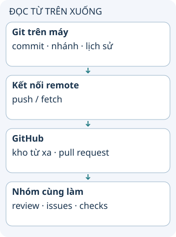

# Git và GitHub giải quyết việc gì?

Bạn có thể lưu lịch sử dự án bằng Git ngay trên máy. GitHub bổ sung nơi lưu kho từ xa và các công cụ để nhóm trao đổi về thay đổi. Hiểu hai vai trò này giúp bạn biết dữ liệu đã nằm ở đâu sau mỗi thao tác.

**Đọc hình:** Các thẻ là các bước hoặc góc nhìn của ví dụ; đọc từ trên xuống. Mũi tên chỉ thứ tự đọc, không biểu diễn luồng mạng hoặc sự phụ thuộc bắt buộc.

Git là hệ thống quản lý phiên bản phân tán. Kho cục bộ chứa lịch sử để so sánh, tạo nhánh và commit. Remote có thể là GitHub, một dịch vụ khác hoặc kho do nhóm tự vận hành.

GitHub lưu kho và cung cấp pull request, issue, quyền truy cập và tự động hóa như GitHub Actions. Khi bạn commit, mốc mới trước tiên có ở máy bạn. Sau push thành công, remote mới nhận các đối tượng cần thiết và cập nhật nhánh được gửi. Người khác thường fetch hoặc pull để nhận thay đổi vào kho của họ.

## Nhìn hình thử trả lời

Bạn đã commit nhưng chưa push. Đồng đội có tự thấy commit đó trên GitHub không?

Xem đáp án

Không. Commit cục bộ chưa được gửi lên remote.

## Giới hạn cần nhớ

Không cần tài khoản GitHub để dùng Git cục bộ. GitHub có gói miễn phí và trả phí; không nên mô tả mọi sử dụng đều phải trả tiền.

Xem sâu hơn

Giao diện web có thể tạo commit thay bạn, nhưng việc đó không có nghĩa file trên máy tự cập nhật. Repo công khai cũng không có nghĩa mọi người được push vào nhánh của bạn; quyền đọc và quyền ghi khác nhau.

## Nguồn đối chiếu

- [Chủ đề ByteByteGo tại snapshot cố định](https://github.com/ByteByteGoHq/system-design-101/blob/b28380a4710c5ec9638ec037d4168e288f334cba/data/guides/git-vs-github.md). Bài viết và hình này được thiết kế độc lập; không dịch thân bài hoặc sử dụng ảnh nguồn.
- [Git](https://git-scm.com/about).
- [GitHub: Git là gì?](https://docs.github.com/en/get-started/using-git/about-git).
