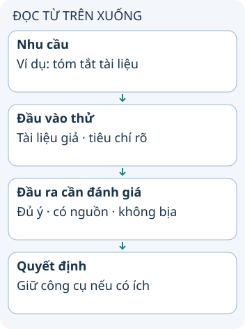

# Chọn ứng dụng AI theo đầu ra cần kiểm tra

Danh sách “30 ứng dụng AI năm 2025” là một ảnh chụp thị trường trong nguồn. Thay vì cài cả danh sách, hãy chọn một công việc cụ thể, thử bằng dữ liệu phù hợp rồi đánh giá đầu ra có giúp bạn hoàn thành việc đó hay không.

**Đọc hình:** Các thẻ là các bước hoặc góc nhìn của ví dụ; đọc từ trên xuống. Mũi tên chỉ thứ tự đọc, không biểu diễn luồng mạng hoặc sự phụ thuộc bắt buộc.

Với trợ lý viết code, hãy đo xem bản sửa có vượt qua kiểm tra và dễ review không. Với công cụ ghi chú, hãy so tóm tắt với nội dung gốc. Với công cụ tạo hình hoặc giọng nói, hãy kiểm tra quyền sử dụng đầu ra và yêu cầu của nơi bạn định dùng.

Tên ứng dụng không tự chứng minh độ chính xác. Hãy bắt đầu bằng một nhiệm vụ nhỏ có đáp án hoặc tiêu chí kiểm tra. Ghi cả thời gian sửa lỗi và kiểm chứng, không chỉ thời gian tạo bản nháp. Quy trình này dùng được ngay cả khi danh sách sản phẩm thay đổi.

## Nhìn hình thử trả lời

Một ứng dụng trả lời nhanh gấp đôi nhưng cần sửa nhiều lỗi hơn. Có chắc bạn đã tiết kiệm thời gian không?

Xem đáp án

Không. Cần đo toàn bộ thời gian tới đầu ra đạt yêu cầu, gồm sửa và kiểm chứng.

## Giới hạn cần nhớ

Các tên dưới đây ghi nhận danh mục lịch sử của nguồn, không phải xác nhận tính năng, giá, quyền riêng tư hoặc khả năng cung cấp vào tháng 10/2026.

Xem sâu hơn

30 tên trong snapshot, sắp theo tên để tra cứu: Adobe (PDF Chat), Anthropic Claude, Ash, Captions, ChatGPT, Cursor, Delphi, ElevenLabs, Gamma, Gemini, Gemini for Gmail, GitHub Copilot, GoodInside, Granola, Grok, HeyGen, Krea, Midjourney, NotebookLM, OpusClips, Particle News App, Perplexity, Persona, Photoroom, Replit, Rosebud, Suno AI, Tabnine, Windsurf AI, WisprFlow. Đây là dữ liệu danh mục nguồn; tính năng từng sản phẩm chưa được xác minh lại.

## Nguồn đối chiếu

- [Chủ đề ByteByteGo tại snapshot cố định](https://github.com/ByteByteGoHq/system-design-101/blob/b28380a4710c5ec9638ec037d4168e288f334cba/data/guides/30-useful-ai-apps-that-can-help-you-in-2025.md). Bài viết và hình này được thiết kế độc lập; không dịch thân bài hoặc sử dụng ảnh nguồn.
- [NIST: quản lý rủi ro AI](https://www.nist.gov/itl/ai-risk-management-framework).
