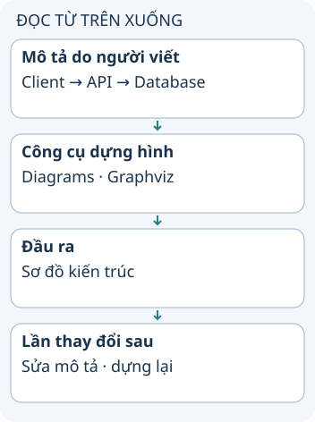

# Viết sơ đồ bằng mã

Khi kiến trúc đổi, hình trong tài liệu dễ bị quên cập nhật. Diagram as Code dùng một mô tả văn bản hoặc chương trình làm đầu vào để sinh sơ đồ. Bạn có thể lưu đầu vào cùng mã nguồn và review thay đổi như các file khác.

**Đọc hình:** Các thẻ là các bước hoặc góc nhìn của ví dụ; đọc từ trên xuống. Mũi tên chỉ thứ tự đọc, không biểu diễn luồng mạng hoặc sự phụ thuộc bắt buộc.

Thư viện Diagrams cho phép khai báo các node và liên kết trong Python, rồi dùng Graphviz để dựng hình. Ví dụ bạn mô tả client gọi API, API truy cập database. Đây là mô hình do người viết lựa chọn, không mặc nhiên là kết quả đọc toàn bộ code ứng dụng.

Trong pull request thay đổi kiến trúc, sửa cả phần mô tả sơ đồ. Người review xem diff văn bản để biết thành phần nào được thêm hoặc bỏ, rồi xem hình để hiểu quan hệ. Ghim phiên bản renderer giúp giảm khác biệt bố cục giữa các máy khi cùng dựng một mô tả.

## Nhìn hình thử trả lời

Ứng dụng thêm cache nhưng file mô tả sơ đồ không đổi. Renderer có tự biết cache tồn tại không?

Xem đáp án

Không, nếu công cụ chỉ dựng từ mô tả khai báo. Cần cập nhật đầu vào hoặc có cơ chế trích xuất riêng.

## Giới hạn cần nhớ

Tự động dựng hình không bảo đảm sơ đồ phản ánh hệ thống thật. Cần có người chịu trách nhiệm cập nhật mô tả.

Xem sâu hơn

Chọn mức chi tiết phục vụ câu hỏi của người đọc. Sơ đồ tổng quan có thể giấu các replica, còn sơ đồ vận hành cần chỉ rõ môi trường và hướng dữ liệu. Không đưa mọi chi tiết vào một hình.

## Nguồn đối chiếu

- [Chủ đề ByteByteGo tại snapshot cố định](https://github.com/ByteByteGoHq/system-design-101/blob/b28380a4710c5ec9638ec037d4168e288f334cba/data/guides/diagram-as-code.md). Bài viết và hình này được thiết kế độc lập; không dịch thân bài hoặc sử dụng ảnh nguồn.
- [Diagrams: hướng dẫn](https://diagrams.mingrammer.com/docs/getting-started/installation).
- [Graphviz](https://graphviz.org/documentation/).
