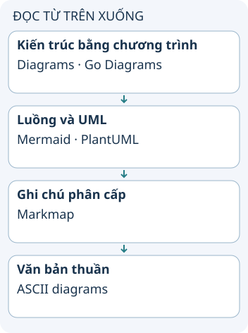

# Sáu lựa chọn để dựng sơ đồ từ văn bản

“Code thành sơ đồ” có nhiều nghĩa: mô tả node bằng chương trình, viết cú pháp sơ đồ hoặc chuyển cấu trúc ghi chú thành bản đồ tư duy. Chọn công cụ theo điều bạn muốn diễn đạt và nơi người đọc sẽ xem hình.

**Đọc hình:** Các thẻ là các bước hoặc góc nhìn của ví dụ; đọc từ trên xuống. Mũi tên chỉ thứ tự đọc, không biểu diễn luồng mạng hoặc sự phụ thuộc bắt buộc.

Diagrams dùng Python, còn Go Diagrams dùng Go để khai báo kiến trúc. Mermaid hỗ trợ nhiều loại sơ đồ với cú pháp văn bản và được GitHub hỗ trợ trong các ngữ cảnh Markdown. PlantUML phù hợp khi bạn cần các sơ đồ UML hoặc sequence. Markmap biến cấu trúc Markdown thành mind map. ASCII diagrams biểu diễn bằng ký tự và không phải một sản phẩm duy nhất.

Thử một hình nhỏ trước: ba thành phần, hai liên kết và một chú thích. Kiểm tra renderer nơi tài liệu sẽ được đọc, font tiếng Việt và khả năng xem trên điện thoại. Một công cụ có nhiều loại node vẫn có thể làm hình đơn giản trở nên quá rộng.

## Nhìn hình thử trả lời

Bạn muốn dựng cây ý từ tiêu đề Markdown. Công cụ nào trong hình phù hợp để thử trước?

Xem đáp án

Markmap là lựa chọn trực tiếp cho cấu trúc Markdown thành mind map.

## Giới hạn cần nhớ

Các công cụ khai báo sơ đồ không mặc nhiên phân tích source code để tìm kiến trúc. Khả năng xuất file và hỗ trợ cú pháp phụ thuộc công cụ, phiên bản và nơi hiển thị.

Xem sâu hơn

Lưu cả mô tả và hình xuất nếu nơi đọc không có renderer. Ghim phiên bản khi cần kết quả lặp lại; review hướng mũi tên và nội dung thay vì chỉ nhìn hình có dựng thành công hay không.

## Nguồn đối chiếu

- [Chủ đề ByteByteGo tại snapshot cố định](https://github.com/ByteByteGoHq/system-design-101/blob/b28380a4710c5ec9638ec037d4168e288f334cba/data/guides/top-6-tools-to-turn-code-into-beautiful-diagrams.md). Bài viết và hình này được thiết kế độc lập; không dịch thân bài hoặc sử dụng ảnh nguồn.
- [Mermaid](https://mermaid.js.org/intro/).
- [PlantUML](https://plantuml.com/).
- [Markmap](https://markmap.js.org/).
- [Diagrams](https://diagrams.mingrammer.com/).
- [Go Diagrams](https://github.com/blushft/go-diagrams).
