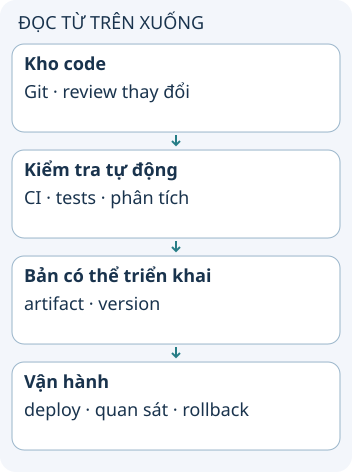

# Chọn công cụ đưa code tới production

Nhóm nhỏ cũng cần biết bản nào đang chạy và cách quay lại khi lỗi. Nhóm lớn cần phối hợp nhiều thay đổi hơn. Chọn công cụ theo trách nhiệm và rủi ro thực tế, thay vì mặc định một bộ sản phẩm cho từng số lượng nhân viên.

**Đọc hình:** Các thẻ là các bước hoặc góc nhìn của ví dụ; đọc từ trên xuống. Mũi tên chỉ thứ tự đọc, không biểu diễn luồng mạng hoặc sự phụ thuộc bắt buộc.

Một nhóm có thể bắt đầu bằng GitHub và CI, kho artifact có phiên bản, một cách triển khai lặp lại và hệ thống log/metrics. GitHub Actions hay Jenkins thực thi pipeline; registry giữ bản build; công cụ triển khai đưa bản đó tới môi trường đích. Đây là các vai trò khác nhau dù một nền tảng có thể cung cấp nhiều vai trò.

Khi nhiều nhóm dùng chung dịch vụ, bổ sung quyền theo môi trường, kiểm tra hợp đồng, lịch phối hợp và theo dõi bản phát hành. Tăng công cụ chỉ có ích nếu giải quyết điểm nghẽn cụ thể. Hãy hỏi ai sở hữu pipeline, ai xử lý khi triển khai lỗi và bằng chứng nào cho phép tiếp tục.

## Từ viết tắt

- **CI** (Continuous Integration) — tích hợp liên tục: tự động xây dựng và kiểm tra mã mỗi khi có thay đổi; trong bài, đây là bước kiểm tra tự động trước khi một bản có thể triển khai.

## Nhìn hình thử trả lời

CI xanh nhưng không biết artifact nào được đưa lên production. Còn thiếu điều gì?

Xem đáp án

Khả năng truy vết từ commit tới artifact và bản đang chạy; CI xanh một mình chưa đủ.

## Giới hạn cần nhớ

Số nhân viên không quyết định nhu cầu chất lượng. Nhóm nhỏ vận hành thanh toán vẫn có thể cần kiểm soát nghiêm ngặt.

Xem sâu hơn

Tách việc build khỏi deploy để thử đúng artifact sẽ chạy. Gắn phiên bản hoặc digest; biết cách quay lại cũng như thay đổi dữ liệu nào không thể đảo chỉ bằng rollback code.

## Nguồn đối chiếu

- [Chủ đề ByteByteGo tại snapshot cố định](https://github.com/ByteByteGoHq/system-design-101/blob/b28380a4710c5ec9638ec037d4168e288f334cba/data/guides/what-tools-does-your-team-use-to-ship-code-to-production-and-ensure-code-quality.md). Bài viết và hình này được thiết kế độc lập; không dịch thân bài hoặc sử dụng ảnh nguồn.
- [GitHub Actions](https://docs.github.com/en/actions).
- [Jenkins Pipeline](https://www.jenkins.io/doc/book/pipeline/).
- [DORA: continuous delivery](https://dora.dev/capabilities/continuous-delivery/).
