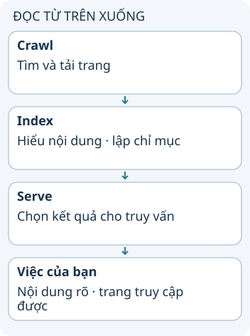

# SEO: giúp công cụ tìm kiếm hiểu trang

Bạn đã xuất bản một trang hữu ích nhưng người tìm kiếm chưa thấy nó. SEO bắt đầu từ việc công cụ tìm kiếm có thể truy cập và hiểu nội dung, rồi nội dung có phù hợp câu hỏi người dùng hay không. Không có thao tác kỹ thuật nào bảo đảm vị trí đứng đầu.

**Đọc hình:** Các thẻ là các bước hoặc góc nhìn của ví dụ; đọc từ trên xuống. Mũi tên chỉ thứ tự đọc, không biểu diễn luồng mạng hoặc sự phụ thuộc bắt buộc.

Dùng tiêu đề mô tả đúng chủ đề, heading rõ ràng, liên kết điều hướng có thể theo và nội dung trả lời nhu cầu thật. Kiểm tra mã HTTP, canonical và chỉ thị index khi trang không xuất hiện. Sitemap giúp thông báo URL, nhưng không buộc máy tìm kiếm lập chỉ mục.

Trang dùng JavaScript không tự bị loại khỏi tìm kiếm; cần kiểm tra nội dung mà crawler/rendering có thể tiếp cận. Meta description có thể được dùng để tạo snippet, nhưng máy tìm kiếm có thể chọn đoạn khác. Theo dõi trải nghiệm đọc, tốc độ và mức phù hợp của nội dung; tránh nhồi từ khóa hoặc mua liên kết nhằm thao túng thứ hạng.

## Nhìn hình thử trả lời

Sitemap đã chứa URL. Có thể khẳng định Google đã index URL đó không?

Xem đáp án

Không. Crawl, index và phục vụ kết quả là các bước khác nhau; sitemap chỉ là một tín hiệu hỗ trợ khám phá.

## Giới hạn cần nhớ

Crawl được không đồng nghĩa index, và index không đồng nghĩa xếp hạng cao. `robots.txt` chặn crawl cũng không phải cách đáng tin để xóa URL khỏi chỉ mục.

Xem sâu hơn

Core Web Vitals hiện gồm LCP, INP và CLS. Chỉ số tốt hỗ trợ trải nghiệm, không bảo đảm thứ hạng. Đo dữ liệu thực tế khi có thể và kiểm tra phiên bản hướng dẫn trước khi áp dụng ngưỡng.

## Nguồn đối chiếu

- [Chủ đề ByteByteGo tại snapshot cố định](https://github.com/ByteByteGoHq/system-design-101/blob/b28380a4710c5ec9638ec037d4168e288f334cba/data/guides/making-sense-of-search-engine-optimization.md). Bài viết và hình này được thiết kế độc lập; không dịch thân bài hoặc sử dụng ảnh nguồn.
- [Google: cách tìm kiếm hoạt động](https://developers.google.com/search/docs/fundamentals/how-search-works).
- [SEO starter guide](https://developers.google.com/search/docs/fundamentals/seo-starter-guide).
- [Core Web Vitals](https://developers.google.com/search/docs/appearance/core-web-vitals).
