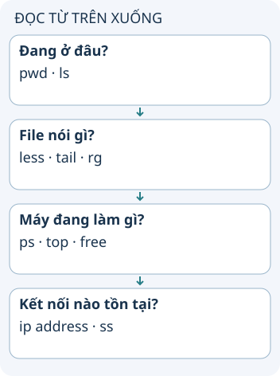

# Tra lệnh Linux theo câu hỏi

Khi mở terminal trên một máy lạ, đừng bắt đầu bằng một lệnh sửa cấu hình. Hãy xác định bạn muốn biết gì: đang ở đâu, file chứa gì, process nào chạy hoặc máy có tài nguyên nào. Lệnh quan sát giúp thu hẹp câu hỏi trước khi thay đổi.

**Đọc hình:** Các thẻ là các bước hoặc góc nhìn của ví dụ; đọc từ trên xuống. Mũi tên chỉ thứ tự đọc, không biểu diễn luồng mạng hoặc sự phụ thuộc bắt buộc.

`pwd` in thư mục hiện tại; `ls -la` liệt kê cả file ẩn. Dùng `less` đọc file dài, `tail` xem cuối log và `rg` tìm chuỗi nếu ripgrep đã được cài. `ps` xem process, `top` quan sát mức sử dụng, `free` xem bộ nhớ và `df` xem dung lượng filesystem.

`id` cho biết user và nhóm hiện tại. `ip address` xem địa chỉ mạng, `ss` xem socket. Quản lý package phụ thuộc bản phân phối: Debian/Ubuntu thường dùng apt, Fedora dùng dnf. Không sao chép một lệnh cài package mà chưa biết hệ điều hành và quyền đang dùng.

## Nhìn hình thử trả lời

Cần đọc cuối log mà không sửa file. Bạn chọn tail hay chmod?

Xem đáp án

tail. chmod thay đổi quyền, không phục vụ việc đọc cuối file.

## Giới hạn cần nhớ

Không phải mọi lệnh có sẵn trên mọi bản Linux. `sudo`, `rm`, `chmod`, trình quản lý package và lệnh dừng process có thể thay đổi máy; đọc tùy chọn trước khi dùng.

Xem sâu hơn

Một pipe nối đầu ra lệnh trước vào đầu vào lệnh sau. Dùng lệnh quan sát từng bước để hiểu dữ liệu trước khi nối vào lệnh sửa hoặc xóa. Tên file có khoảng trắng cần được xử lý đúng bằng quoting.

## Nguồn đối chiếu

- [Chủ đề ByteByteGo tại snapshot cố định](https://github.com/ByteByteGoHq/system-design-101/blob/b28380a4710c5ec9638ec037d4168e288f334cba/data/guides/most-used-linux-commands-map.md). Bài viết và hình này được thiết kế độc lập; không dịch thân bài hoặc sử dụng ảnh nguồn.
- [GNU Coreutils](https://www.gnu.org/software/coreutils/manual/coreutils.html).
- [ss](https://man7.org/linux/man-pages/man8/ss.8.html).
- [ip](https://man7.org/linux/man-pages/man8/ip.8.html).
