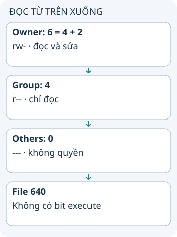

# Quyền Linux: ai được làm gì?

Một file có chủ sở hữu, nhóm sở hữu và các bit quyền cho owner, group, others. Với file thường, r/w/x lần lượt cho phép đọc nội dung, sửa nội dung và thực thi khi các điều kiện khác cũng cho phép. Ví dụ 640 giúp tách quyền người viết và người đọc.

**Đọc hình:** Các thẻ là các bước hoặc góc nhìn của ví dụ; đọc từ trên xuống. Mũi tên chỉ thứ tự đọc, không biểu diễn luồng mạng hoặc sự phụ thuộc bắt buộc.

Trong dạng số, r là 4, w là 2 và x là 1. `chmod 640 report.txt` đặt owner đọc/sửa, group đọc, others không có quyền qua các bit này. Chủ sở hữu có thể được đổi bằng chown khi có quyền; không luôn là người đang tạo hoặc sửa file.

Với thư mục, r cho phép liệt kê tên, x cho phép đi qua/tìm entry và w cho phép sửa danh sách entry khi các điều kiện cần thiết được đáp ứng. Vì vậy quyền x trên thư mục không có nghĩa “chạy thư mục”. Việc xóa một file thường phụ thuộc quyền ở thư mục chứa nó, không chỉ bit w của chính file.

## Từ viết tắt

- **ACL** (Access Control List) — danh sách kiểm soát truy cập: danh sách gắn với tài nguyên, ghi ai được làm gì với nó; bài nhắc ACL có thể làm kết quả khác với suy luận chỉ từ ba lớp owner, group, others.
- **SELinux** (Security-Enhanced Linux) — cơ chế kiểm soát truy cập bổ sung của Linux, dùng nhãn và chính sách riêng; có thể từ chối một thao tác dù quyền owner, group, others cho phép.

## Nhìn hình thử trả lời

File 640 có cho nhóm chạy file qua bit execute không?

Xem đáp án

Không. Nhóm có r--, không có x.

## Giới hạn cần nhớ

ACL, sticky bit, mount options và cơ chế như SELinux có thể ảnh hưởng kết quả. Thông thường Linux chọn lớp owner, rồi group, rồi others phù hợp; không cộng cả ba lớp quyền.

Xem sâu hơn

Dùng `ls -l` xem bit quyền và ownership; cần xét cả thư mục cha khi bị từ chối truy cập. Tránh dùng 777 để chữa mọi lỗi: hãy xác định đúng user, nhóm và quyền cần cho tác vụ.

## Nguồn đối chiếu

- [Chủ đề ByteByteGo tại snapshot cố định](https://github.com/ByteByteGoHq/system-design-101/blob/b28380a4710c5ec9638ec037d4168e288f334cba/data/guides/linux-file-permission-illustrated.md). Bài viết và hình này được thiết kế độc lập; không dịch thân bài hoặc sử dụng ảnh nguồn.
- [inode: quyền và ownership](https://man7.org/linux/man-pages/man7/inode.7.html).
- [path_resolution](https://man7.org/linux/man-pages/man7/path_resolution.7.html).
- [chmod](https://man7.org/linux/man-pages/man1/chmod.1.html).
