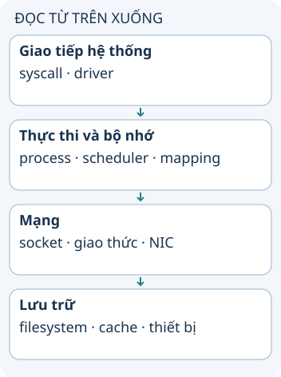

# Năm góc nhìn để hiểu Linux

Một ứng dụng ghi file và gửi dữ liệu mạng phải làm việc với nhiều phần của hệ điều hành. Năm góc nhìn dưới đây giúp đặt câu hỏi về Linux: giao tiếp hệ thống, bộ nhớ, process, mạng và lưu trữ. Đây là bản đồ học tập, không phải năm bộ phận độc lập tuyệt đối.

**Đọc hình:** Các thẻ là các bước hoặc góc nhìn của ví dụ; đọc từ trên xuống. Mũi tên chỉ thứ tự đọc, không biểu diễn luồng mạng hoặc sự phụ thuộc bắt buộc.

Giao tiếp hệ thống gồm các lời gọi để ứng dụng yêu cầu kernel làm việc và driver nối kernel với thiết bị. Bộ nhớ gồm địa chỉ ảo, ánh xạ và cấp phát. Process gồm lập lịch, thread và đồng bộ. Mạng gồm socket, xử lý giao thức và đường tới card mạng. Lưu trữ gồm filesystem, cache và thiết bị.

Khi chương trình ghi log, một thread gọi API thư viện, dẫn tới syscall; kernel kiểm tra quyền và làm việc qua filesystem. Dữ liệu có thể được đệm trước khi thiết bị hoàn tất ghi. Ví dụ này cho thấy các góc nhìn giao nhau, nên không thể quy mọi chậm trễ ghi file cho riêng ổ đĩa.

## Từ viết tắt

- **API** (Application Programming Interface) — giao diện lập trình ứng dụng: cách để một chương trình yêu cầu dữ liệu hoặc chức năng của chương trình khác; trong bài, một thread gọi API của thư viện để ghi log, việc này dẫn tới syscall.
- **CPU** (Central Processing Unit) — bộ xử lý trung tâm: phần của máy chạy lệnh; bài khuyên tách thời gian ứng dụng chạy trên CPU khỏi thời gian đợi khi đo hiệu năng.
- **NIC** (Network Interface Card) — card giao tiếp mạng: phần cứng nối máy với mạng; trong hình, tầng mạng đi từ socket và giao thức xuống NIC.

## Nhìn hình thử trả lời

Địa chỉ ảo của process và nơi dữ liệu nằm trên thiết bị lưu trữ có phải một khái niệm không?

Xem đáp án

Không. Địa chỉ ảo thuộc mô hình bộ nhớ; lưu trữ và filesystem là các lớp khác, dù có cơ chế liên kết như mmap.

## Giới hạn cần nhớ

Linux theo nghĩa chặt là kernel. Một bản phân phối còn có thư viện, shell, công cụ và dịch vụ; học kernel không thay thế hiểu môi trường ứng dụng.

Xem sâu hơn

Bắt đầu từ một hành động cụ thể như đọc file, rồi lần qua syscall, quyền, filesystem và cache. Tách thời gian ứng dụng chạy CPU khỏi thời gian đợi khi đo hiệu năng.

## Nguồn đối chiếu

- [Chủ đề ByteByteGo tại snapshot cố định](https://github.com/ByteByteGoHq/system-design-101/blob/b28380a4710c5ec9638ec037d4168e288f334cba/data/guides/5-important-components-of-linux.md). Bài viết và hình này được thiết kế độc lập; không dịch thân bài hoặc sử dụng ảnh nguồn.
- [Linux kernel documentation](https://www.kernel.org/doc/html/latest/).
- [System calls](https://man7.org/linux/man-pages/man2/syscalls.2.html).
- [Memory management](https://www.kernel.org/doc/html/latest/admin-guide/mm/index.html).
