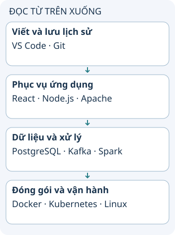

# Các dự án nguồn mở qua một đường đi ứng dụng

Nguồn liệt kê 15 dự án có ảnh hưởng; đó là lựa chọn biên tập, không phải bảng xếp hạng đo được. Để hiểu ích lợi, hãy theo một thay đổi ứng dụng từ nơi viết code tới nơi chạy và nơi phân tích dữ liệu.

**Đọc hình:** Các thẻ là các bước hoặc góc nhìn của ví dụ; đọc từ trên xuống. Mũi tên chỉ thứ tự đọc, không biểu diễn luồng mạng hoặc sự phụ thuộc bắt buộc.

Trong một hệ thống giả định, React dựng giao diện, Node.js chạy phần server và Apache HTTP Server phục vụ hoặc chuyển tiếp HTTP. PostgreSQL lưu dữ liệu quan hệ; Redis có thể phục vụ cache; Elasticsearch hỗ trợ tìm kiếm. Git theo dõi thay đổi, VS Code hỗ trợ soạn thảo và Jupyter Notebook kết hợp code với ghi chú, kết quả.

Kafka trao đổi luồng sự kiện, Apache Spark xử lý dữ liệu và TensorFlow hỗ trợ xây mô hình học máy. Docker đóng gói/chạy container; Kubernetes điều phối workload; Linux cung cấp nền tảng hệ điều hành. Đó là đủ 15 tên trong danh mục, nhưng không có nghĩa một ứng dụng cần dùng tất cả.

## Từ viết tắt

- **HTTP** (HyperText Transfer Protocol) — giao thức truyền siêu văn bản: quy ước để trình duyệt gửi yêu cầu và máy chủ gửi trả lời; Apache HTTP Server trong ví dụ phục vụ hoặc chuyển tiếp các yêu cầu HTTP.
- **SQL** (Structured Query Language) — ngôn ngữ truy vấn có cấu trúc: ngôn ngữ chuẩn để hỏi và ghi dữ liệu trong cơ sở dữ liệu quan hệ; có trong tên PostgreSQL, hệ lưu dữ liệu quan hệ trong ví dụ.

## Nhìn hình thử trả lời

Một ứng dụng nhỏ không xử lý dữ liệu lớn có cần Spark chỉ vì nó nằm trong danh sách không?

Xem đáp án

Không. Chọn theo bài toán và chi phí vận hành, không theo độ nổi tiếng.

## Giới hạn cần nhớ

Giấy phép phụ thuộc dự án, thành phần và phiên bản. Redis, Elasticsearch, bản phân phối VS Code và Docker Desktop cần xem điều khoản cụ thể; không suy mọi thứ mang tên dự án đều cùng một giấy phép.

Xem sâu hơn

Nguồn mở không đồng nghĩa không có chi phí vận hành hoặc hỗ trợ. Trước khi nhận dependency, xem tình trạng bảo trì, cách cập nhật, license và khả năng thay thế. Ví dụ hình là một cách ghép vai trò, không mô tả mọi hệ thống.

## Nguồn đối chiếu

- [Chủ đề ByteByteGo tại snapshot cố định](https://github.com/ByteByteGoHq/system-design-101/blob/b28380a4710c5ec9638ec037d4168e288f334cba/data/guides/15-open-source-projects-that-changed-the-world.md). Bài viết và hình này được thiết kế độc lập; không dịch thân bài hoặc sử dụng ảnh nguồn.
- [Định nghĩa nguồn mở](https://opensource.org/osd).
- [PostgreSQL](https://www.postgresql.org/docs/current/intro-whatis.html).
- [Kubernetes concepts](https://kubernetes.io/docs/concepts/).
- [Redis licensing](https://redis.io/legal/licenses/).
