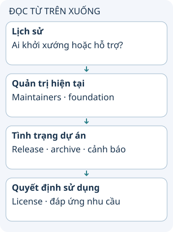

# Dự án được doanh nghiệp khởi xướng hoặc hỗ trợ

Một dự án có thể bắt đầu trong công ty, sau đó chuyển quản trị sang cộng đồng hoặc foundation. Vì vậy logo doanh nghiệp cho biết một phần lịch sử, không đủ để kết luận ai đang sở hữu, ai duy trì và phiên bản nào nên dùng.

**Đọc hình:** Các thẻ là các bước hoặc góc nhìn của ví dụ; đọc từ trên xuống. Mũi tên chỉ thứ tự đọc, không biểu diễn luồng mạng hoặc sự phụ thuộc bắt buộc.

Ví dụ Kafka bắt đầu tại LinkedIn và hiện thuộc hệ sinh thái Apache; Kubernetes bắt đầu tại Google và được quản trị trong CNCF. Mối liên hệ ban đầu giúp hiểu bối cảnh nhưng không thay thế đọc tài liệu dự án hiện hành.

Danh mục lịch sử trong snapshot có 20 tên: Angular, Ansible, Cassandra, Ceph Storage, Chaos Monkey, Go, GraphQL, Hystrix, Kafka, Kubernetes, OpenShift, Pinot, Playwright, PyTorch, React, Samza, TensorFlow, TypeScript, VSCode, Zuul. Các tên bao gồm những dạng khác nhau: ngôn ngữ, thư viện, đặc tả và nền tảng. Không coi chúng là 20 sản phẩm đang được hỗ trợ như nhau.

## Từ viết tắt

- **CNCF** (Cloud Native Computing Foundation) — tổ chức quản trị các dự án nguồn mở về hạ tầng đám mây; theo bài, Kubernetes bắt đầu tại Google và được quản trị trong CNCF.
- **QL** (Query Language) — ngôn ngữ truy vấn: chữ QL trong tên GraphQL, một dự án trong danh sách mà bài gắn với Meta.

## Nhìn hình thử trả lời

Dự án được một công ty lớn khởi xướng có bảo đảm vẫn được bảo trì tích cực không?

Xem đáp án

Không. Cần kiểm tra thông báo, release và repository hiện tại; lịch sử xuất phát không bảo đảm hỗ trợ.

## Giới hạn cần nhớ

Không suy “khởi xướng” từ “hỗ trợ”: Ansible và Ceph không phải đều do Red Hat ban đầu tạo ra. Hystrix thông báo chế độ bảo trì; không giới thiệu nó như lựa chọn mặc định cho hệ thống mới.

Xem sâu hơn

Trong snapshot, Google gắn với Angular/Go/Kubernetes/TensorFlow; Meta với Cassandra/GraphQL/PyTorch/React; Microsoft với Playwright/TypeScript/VSCode; Netflix với Chaos Monkey/Hystrix/Zuul; LinkedIn với Kafka/Pinot/Samza; Red Hat với Ansible/Ceph/OpenShift. Các liên hệ này là dữ liệu nguồn chưa được xác minh toàn bộ từng dự án. Kiểm tra chủ thể và phạm vi hỗ trợ trước khi dùng chúng để ra quyết định.

## Nguồn đối chiếu

- [Chủ đề ByteByteGo tại snapshot cố định](https://github.com/ByteByteGoHq/system-design-101/blob/b28380a4710c5ec9638ec037d4168e288f334cba/data/guides/20-popular-open-source-projects-started-or-supported-by-big-companies.md). Bài viết và hình này được thiết kế độc lập; không dịch thân bài hoặc sử dụng ảnh nguồn.
- [Kafka introduction](https://kafka.apache.org/intro).
- [Kubernetes history](https://kubernetes.io/blog/2018/07/20/the-history-of-kubernetes-the-community-behind-it/).
- [Hystrix: maintenance mode](https://github.com/Netflix/Hystrix).
- [Ceph: mã nguồn và cộng đồng](https://github.com/ceph/ceph).
