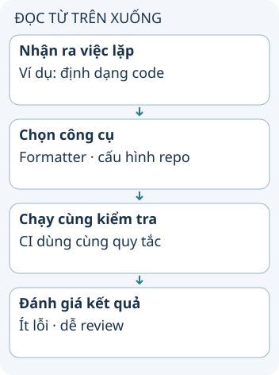

# Dùng dev tools để bỏ việc lặp lại

Mỗi ngày bạn mất thời gian định dạng code, tìm lỗi và nhớ lệnh deploy. Công cụ tốt giúp biến những việc lặp lại thành quy trình có thể kiểm tra. Hãy chọn từ điểm nghẽn bạn gặp, thay vì tăng số ứng dụng đang mở.

**Đọc hình:** Các thẻ là các bước hoặc góc nhìn của ví dụ; đọc từ trên xuống. Mũi tên chỉ thứ tự đọc, không biểu diễn luồng mạng hoặc sự phụ thuộc bắt buộc.

Editor như VS Code hoặc IntelliJ giúp điều hướng; debugger giúp dừng và xem trạng thái. Mermaid hoặc Excalidraw giúp giải thích ý tưởng. ESLint/Jest giải quyết các loại kiểm tra khác nhau; một bên phân tích code, một bên chạy test. Markdown hoặc công cụ ghi chú giúp giữ quyết định để không phải tìm lại.

Với hosting, chọn nền tảng theo runtime, dữ liệu và cách vận hành. Với bảo mật, phân biệt trình quản lý mật khẩu, quét dependency và quan sát mạng; chúng không thay nhau. Với AI, đưa đầu ra qua cùng bước review và kiểm tra như thay đổi do người viết. Công cụ thiết kế hỗ trợ hình ảnh, không tự xác nhận hành vi sản phẩm.

## Từ viết tắt

- **AI** (Artificial Intelligence) — trí tuệ nhân tạo: các hệ thống máy tính làm những việc thường cần trí thông minh của con người, như hiểu ngôn ngữ hay nhận ra hình ảnh; bài dặn đưa đầu ra do AI tạo qua cùng bước review và kiểm tra như thay đổi do người viết.
- **CI** (Continuous Integration) — tích hợp liên tục: tự động xây dựng và kiểm tra mã mỗi khi có thay đổi; trong bài, CI chạy cùng quy tắc kiểm tra với máy người viết, ví dụ quy tắc định dạng code.
- **OWASP** (Open Worldwide Application Security Project) — cộng đồng, tổ chức chuyên về bảo mật ứng dụng với nhiều tài liệu và dự án; theo bài, OWASP không phải một ứng dụng để cài.

## Nhìn hình thử trả lời

Nhóm có formatter nhưng mỗi người dùng cấu hình riêng. Đã giải quyết được việc diff khó đọc chưa?

Xem đáp án

Chưa chắc. Cần thống nhất cấu hình và phiên bản để kết quả không thay đổi giữa các máy.

## Giới hạn cần nhớ

Không phải mọi tên trong danh sách dev tools là một ứng dụng: OWASP là cộng đồng/tổ chức với nhiều tài liệu và dự án. Cài nhiều công cụ không tự làm code tốt hơn.

Xem sâu hơn

Tự động hóa một việc nhỏ, đo thời gian tới kết quả đạt yêu cầu và ghi cách phục hồi khi công cụ lỗi. Cấu hình chung nên nằm trong repo nếu không chứa bí mật.

## Nguồn đối chiếu

- [Chủ đề ByteByteGo tại snapshot cố định](https://github.com/ByteByteGoHq/system-design-101/blob/b28380a4710c5ec9638ec037d4168e288f334cba/data/guides/life-is-short-use-dev-tools.md). Bài viết và hình này được thiết kế độc lập; không dịch thân bài hoặc sử dụng ảnh nguồn.
- [VS Code debugging](https://code.visualstudio.com/docs/debugtest/debugging).
- [ESLint](https://eslint.org/docs/latest/use/core-concepts/).
- [OWASP](https://owasp.org/about/).
