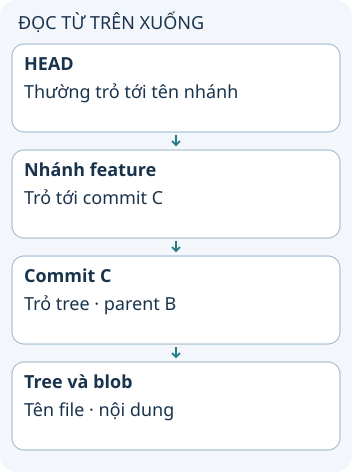

# Git lưu snapshot và nhánh như thế nào?

Nếu quy trình Git cho biết khi nào add hay push, mô hình lưu trữ giải thích vì sao chúng khác nhau. Git lưu các đối tượng và tham chiếu; một nhánh là tên trỏ tới commit. Trong mô hình phổ biến, commit mới ghi một snapshot và liên hệ tới lịch sử trước đó.

**Đọc hình:** Các thẻ là các bước hoặc góc nhìn của ví dụ; đọc từ trên xuống. Mũi tên chỉ thứ tự đọc, không biểu diễn luồng mạng hoặc sự phụ thuộc bắt buộc.

Blob chứa nội dung file; tree liên hệ tên và mode với các đối tượng con. Commit tham chiếu tree và metadata như tác giả, thông điệp, parent. Khi hai commit dùng cùng nội dung, Git có thể dùng lại đối tượng thay vì sao chép mọi byte một lần nữa.

Working tree là các file để bạn chỉnh sửa. Index chọn nội dung cho commit tiếp theo. `git add` cập nhật index; `git commit` tạo commit từ index rồi thường cập nhật nhánh hiện tại. `git push` trao đổi đối tượng và cập nhật ref phía remote theo quyền/quy tắc của remote. Các thao tác không chỉ là “chuyển file giữa bốn hộp”.

## Từ viết tắt

- **ID** (IDentifier) — mã định danh: chuỗi dùng để phân biệt một đối tượng với các đối tượng khác; ở bài này là ID của một đối tượng Git, dựa trên hash của nội dung.
- **SHA** (Secure Hash Algorithm) — họ thuật toán băm: biến dữ liệu bất kỳ thành một chuỗi cố định; SHA-1 là một loại trong họ này, và bài dặn đừng cho rằng kho Git nào cũng mãi dùng SHA-1.

## Nhìn hình thử trả lời

Bạn chuyển nhánh nhưng hai nhánh dùng cùng nội dung một file. Có nhất thiết tồn tại hai blob khác nhau cho file đó không?

Xem đáp án

Không. Các đối tượng nội dung giống nhau có thể được dùng chung.

## Giới hạn cần nhớ

HEAD không luôn trỏ tên nhánh: detached HEAD trỏ trực tiếp commit. ID đối tượng dựa trên hash; đừng suy mọi kho mãi mãi dùng SHA-1.

Xem sâu hơn

`git log --oneline --graph` giúp nhìn ancestry; `git show` xem một commit. Không chỉnh thủ công file trong .git để học. Mô hình đối tượng giải thích lưu trữ, không thay hướng dẫn xử lý mất dữ liệu.

## Nguồn đối chiếu

- [Chủ đề ByteByteGo tại snapshot cố định](https://github.com/ByteByteGoHq/system-design-101/blob/b28380a4710c5ec9638ec037d4168e288f334cba/data/guides/how-does-git-work.md). Bài viết và hình này được thiết kế độc lập; không dịch thân bài hoặc sử dụng ảnh nguồn.
- [Git objects](https://git-scm.com/book/en/v2/Git-Internals-Git-Objects).
- [Git references](https://git-scm.com/book/en/v2/Git-Internals-Git-References).
- [Git hash-function transition](https://git-scm.com/docs/hash-function-transition).
