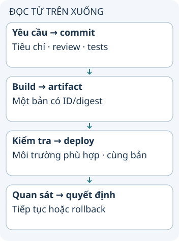

# Từ thay đổi code tới bản chạy production

Một commit qua test chưa có nghĩa người dùng đã nhận bản mới. Quy trình phát hành nối yêu cầu, code, artifact, môi trường kiểm tra và quan sát sau deploy. Mục tiêu là biết đang đưa bản nào lên, bằng chứng nào cho phép tiếp tục và làm gì nếu kết quả xấu.

**Đọc hình:** Các thẻ là các bước hoặc góc nhìn của ví dụ; đọc từ trên xuống. Mũi tên chỉ thứ tự đọc, không biểu diễn luồng mạng hoặc sự phụ thuộc bắt buộc.

Bắt đầu bằng tiêu chí chấp nhận, rồi viết code trên nhánh và review diff. CI chạy kiểm tra phù hợp, build artifact và lưu kèm phiên bản. Đưa cùng artifact qua các môi trường cần thiết giúp tránh tình huống thử một bản nhưng chạy bản khác.

Sau kiểm thử và chấp nhận, triển khai có thể theo đợt, canary hoặc lịch đã chọn. Theo dõi lỗi, độ trễ và hành vi nghiệp vụ; chuẩn bị cách dừng hoặc quay lại khi chỉ số xấu. Tín hiệu từ vận hành quay về yêu cầu/test để cải thiện vòng sau. Nhóm nhỏ có thể gộp vai trò; nhóm lớn cần phân trách nhiệm rõ.

## Nhìn hình thử trả lời

Bạn build lại source trước khi deploy dù artifact đã qua QA. Có còn chắc đang chạy đúng bản đã thử không?

Xem đáp án

Không. Build lại có thể khác dependency, cấu hình hoặc môi trường. Nên truy vết và triển khai đúng artifact đã kiểm tra.

## Giới hạn cần nhớ

Sprint hai tuần, Jenkins, SonarQube, UAT riêng và một đội SRE không phải điều kiện bắt buộc cho mọi công ty. Rollback code không tự đảo migration hoặc tác dụng đã xảy ra.

Xem sâu hơn

Dùng immutable artifact và lưu liên hệ commit → artifact → môi trường. Quyền deploy, kiểm tra dữ liệu và tiêu chí dừng cần phù hợp rủi ro; coverage cao không tự chứng minh test bắt được lỗi quan trọng.

## Nguồn đối chiếu

- [Chủ đề ByteByteGo tại snapshot cố định](https://github.com/ByteByteGoHq/system-design-101/blob/b28380a4710c5ec9638ec037d4168e288f334cba/data/guides/how-do-companies-ship-code-to-production.md). Bài viết và hình này được thiết kế độc lập; không dịch thân bài hoặc sử dụng ảnh nguồn.
- [DORA continuous delivery](https://dora.dev/capabilities/continuous-delivery/).
- [Jenkins Pipeline](https://www.jenkins.io/doc/book/pipeline/).
- [Kubernetes deployments](https://kubernetes.io/docs/concepts/workloads/controllers/deployment/).
