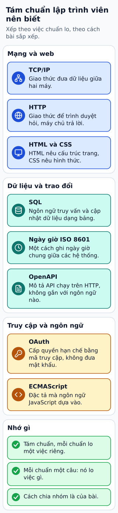

# Tám chuẩn mọi lập trình viên nên biết

**Tám chuẩn: TCP/IP, HTTP, SQL, OAuth, HTML và CSS, ECMAScript, định dạng ngày giờ ISO 8601 và OpenAPI; mỗi chuẩn giải một việc mà lập trình viên gặp thường xuyên.**
Bài giữ tên tám chuẩn của bài nguồn, gom chúng thành ba nhóm theo việc chuẩn lo, và giải thích từng chuẩn bằng tài liệu gốc của chính chúng.

## Từ viết tắt

- **TCP** (Transmission Control Protocol) — giao thức điều khiển truyền: quy ước để hai máy truyền dữ liệu tin cậy; cùng với IP làm nên bộ giao thức TCP/IP.
- **IP** (Internet Protocol) — giao thức Internet: quy ước đánh địa chỉ để dữ liệu tìm đúng máy.
- **HTTP** (HyperText Transfer Protocol) — giao thức truyền siêu văn bản: quy ước để trình duyệt gửi yêu cầu và máy chủ gửi trả lời.
- **SQL** (Structured Query Language) — ngôn ngữ truy vấn có cấu trúc: ngôn ngữ để hỏi và ghi dữ liệu trong cơ sở dữ liệu.
- **OAuth** (Open AUTHorization) — ủy quyền mở: chuẩn cho một ứng dụng được làm một số việc thay bạn mà không phải biết mật khẩu của bạn.
- **HTML** (HyperText Markup Language) — ngôn ngữ đánh dấu siêu văn bản: văn bản dùng thẻ để mô tả cấu trúc của một trang web.
- **CSS** (Cascading Style Sheets) — bảng kiểu xếp tầng: các luật mô tả màu sắc, cỡ chữ và cách bố trí của trang.
- **ECMA** (European Computer Manufacturers Association) — hiệp hội các nhà sản xuất máy tính châu Âu, nay gọi là Ecma International: tổ chức ban hành đặc tả ECMAScript mà JavaScript tuân theo.
- **ISO** (International Organization for Standardization) — Tổ chức Tiêu chuẩn hóa Quốc tế: nơi ban hành chuẩn ngày giờ ISO 8601.
- **OAS** (OpenAPI Specification) — đặc tả OpenAPI: văn bản chuẩn của OpenAPI, định dạng mô tả API.
- **RFC** (Request For Comments) — yêu cầu bình luận: loạt văn bản kỹ thuật về Internet, mỗi văn bản một số; bài nhắc RFC 6749, văn bản của OAuth 2.0.
- **MDN** (Mozilla Developer Network) — tên cũ của MDN Web Docs, bộ tài liệu tra cứu công nghệ web do Mozilla và cộng đồng viết; bài dùng nó để đối chiếu.
- **API** (Application Programming Interface) — giao diện lập trình ứng dụng: tập quy ước để một chương trình dùng chức năng của chương trình khác.

## Đọc hình

**Mạng và web.**
- TCP/IP: theo tài liệu MDN, TCP cho phép hai máy nối với nhau và trao đổi dòng dữ liệu, bảo đảm dữ liệu đến đủ và đúng thứ tự gửi, đồng thời có cơ chế kiểm soát tắc nghẽn để lượng gửi tăng dần theo sức chịu của mạng. IP là giao thức mà địa chỉ IP gắn vào: mỗi thiết bị trên một mạng IP có một địa chỉ riêng để được tìm thấy.
- HTTP: giao thức đưa các tài liệu siêu văn bản qua Web, thường giữa trình duyệt và máy chủ. MDN nhấn mạnh hai tính chất: nó dạng văn bản và không nhớ trạng thái, tức mỗi lần trao đổi không biết gì về lần trước. Địa chỉ bắt đầu bằng `https` vẫn dùng HTTP nhưng đi qua một kênh bảo mật.
- HTML và CSS: HTML mô tả cấu trúc của trang web bằng các phần tử đặt trong thẻ; CSS là ngôn ngữ khai báo quyết định trang trông thế nào trong trình duyệt, mỗi luật gồm một bộ chọn và các thuộc tính. Kho mã của chuẩn HTML tự giới thiệu là nơi chứa HTML Standard.

**Dữ liệu và trao đổi.**
- SQL: ngôn ngữ mô tả để cập nhật, truy xuất và tính toán trên dữ liệu trong cơ sở dữ liệu dạng bảng.
- ISO 8601: chuẩn của ISO về cách ghi ngày và giờ, để hai hệ thống ở hai nơi hiểu cùng một chuỗi ngày giờ theo một nghĩa. Một chuỗi theo chuẩn này viết từ đơn vị lớn đến nhỏ: năm, tháng, ngày, rồi giờ, phút, giây. Phần này là hiểu biết chung của người biên soạn, chưa đối chiếu với văn bản chuẩn của ISO.
- OpenAPI, còn gọi là OAS: theo README của dự án, đặc tả này định nghĩa một cách mô tả giao diện chuẩn, không phụ thuộc ngôn ngữ lập trình, cho các API chạy trên HTTP. Nhờ mô tả đó, cả người lẫn máy hiểu được dịch vụ làm được gì mà không cần xem mã nguồn hay tài liệu khác; README nêu thêm các việc có thể làm từ một bản mô tả, như dựng tài liệu tương tác và sinh mã.

**Truy cập và ngôn ngữ.**
- OAuth: bản nháp OAuth 2.1 giải thích đây là một lớp ủy quyền thêm vào mô hình khách–máy chủ. Thay vì đưa mật khẩu của chủ tài nguyên cho ứng dụng, ứng dụng xin một mã truy cập (access token), một thông tin xác nhận quyền hạn nhất định với thời hạn nhất định, do máy chủ ủy quyền cấp khi chủ tài nguyên đồng ý. Bản nháp liệt kê các rắc rối của cách cũ: ứng dụng phải giữ mật khẩu, và máy chủ buộc phải hỗ trợ đăng nhập bằng mật khẩu.
- ECMAScript: theo MDN, đây là đặc tả ngôn ngữ kịch bản mà JavaScript dựa trên, do Ecma International lo việc chuẩn hóa; văn bản đặc tả là ECMA-262 và kho mã của nó ghi đây là bản nháp hiện hành của "ECMAScript Language Specification".

## Giới hạn cần nhớ

Bài chỉ nói mỗi chuẩn lo việc gì, không đi vào chi tiết kỹ thuật, không xếp hạng và không giải thích vì sao bài nguồn chọn đúng tám chuẩn này. Cách chia ba nhóm là của bài; chính các chuẩn không phân loại thành giao thức, ngôn ngữ hay định dạng một cách đồng đều.
OAuth được mô tả theo bản nháp OAuth 2.1, chưa phải văn bản chuẩn đã công bố, nên chi tiết có thể đổi. Bài không đối chiếu OAuth 2.0 đã công bố (RFC 6749) hay văn bản ISO 8601.

## Nhìn hình trả lời

Hai hệ thống ở hai nước trao đổi dữ liệu có ngày giờ và hay hiểu nhầm nhau vì mỗi bên ghi theo một kiểu. Chuẩn nào trong tám chuẩn nhắm đúng vấn đề này? Còn muốn một ứng dụng đọc được thông tin của người dùng mà không biết mật khẩu thì dùng chuẩn nào, và ứng dụng cầm gì thay cho mật khẩu?

Xem đáp án

Chuẩn ngày giờ ISO 8601: một cách ghi chung để hai hệ thống hiểu cùng một chuỗi ngày giờ theo cùng một nghĩa.
Chuẩn OAuth: ứng dụng cầm một mã truy cập có phạm vi và thời hạn, không cầm mật khẩu.

Xem sâu hơn: điều đã sắp xếp lại so với bài nguồn

Bài nguồn có một ảnh và tám đoạn ngắn theo thứ tự TCP/IP, HTTP, SQL, OAuth, HTML/CSS, ECMAScript, ISO Date, OpenAPI. Bài này giữ tên tám chuẩn rồi tự giải thích từng chuẩn từ tài liệu gốc của nó, nên không lặp câu chữ của nguồn; hình gom chúng thành ba nhóm theo việc chuẩn lo và không dùng ảnh nguồn.
Các mô tả lấy từ bảng thuật ngữ MDN (TCP, địa chỉ IP, HTTP, HTML, CSS, SQL, ECMAScript), README của OpenAPI, ECMA-262 và HTML Standard, cùng bản nháp OAuth 2.1, đều tại commit cố định ở mục nguồn.

## Nguồn đối chiếu

- [ByteByteGo — bài nguồn tại commit cố định](https://github.com/ByteByteGoHq/system-design-101/blob/b28380a4710c5ec9638ec037d4168e288f334cba/data/guides/top-8-standards-every-developer-should-know.md): chỉ lấy tên tám chuẩn.
- MDN bảng thuật ngữ: [TCP](https://github.com/mdn/content/blob/a1aa79c09717761fc72c20bac94bb9c430ed487a/files/en-us/glossary/tcp/index.md), [địa chỉ IP](https://github.com/mdn/content/blob/a1aa79c09717761fc72c20bac94bb9c430ed487a/files/en-us/glossary/ip_address/index.md), [HTTP](https://github.com/mdn/content/blob/a1aa79c09717761fc72c20bac94bb9c430ed487a/files/en-us/glossary/http/index.md), [HTML](https://github.com/mdn/content/blob/a1aa79c09717761fc72c20bac94bb9c430ed487a/files/en-us/glossary/html/index.md), [CSS](https://github.com/mdn/content/blob/a1aa79c09717761fc72c20bac94bb9c430ed487a/files/en-us/glossary/css/index.md), [SQL](https://github.com/mdn/content/blob/a1aa79c09717761fc72c20bac94bb9c430ed487a/files/en-us/glossary/sql/index.md) và [ECMAScript](https://github.com/mdn/content/blob/a1aa79c09717761fc72c20bac94bb9c430ed487a/files/en-us/glossary/ecmascript/index.md). Đọc từ kho mã.
- [OpenAPI — README](https://github.com/OAI/OpenAPI-Specification/blob/8273770d983c99bb07b389d1706a9f8312ced503/README.md), [ECMA-262 — README](https://github.com/tc39/ecma262/blob/4feb0272b799ea795c5eadee9b482aea0c10ce45/README.md) và [HTML Standard — README](https://github.com/whatwg/html/blob/de953a7cf0523f5873a1904ba2ce010c689dfb66/README.md): OpenAPI mô tả API trên HTTP, ECMA-262 là đặc tả ECMAScript, kho mã của HTML Standard. Đọc từ kho mã.
- [OAuth 2.1 — bản nháp](https://github.com/oauth-wg/oauth-v2-1/blob/d04b368313c8835a930a2e55a68ef547312b7b32/draft-ietf-oauth-v2-1.md): lớp ủy quyền, mã truy cập, các rắc rối khi đưa mật khẩu cho ứng dụng. Đọc từ kho mã.

Đã đọc nguồn ngày 2026-10-19. Phần ISO 8601 và các câu giải nghĩa viết tắt trong mục từ viết tắt là kiến thức chung của người biên soạn, chưa đối chiếu với tài liệu chuẩn.
Bài viết và hình được thiết kế độc lập.
