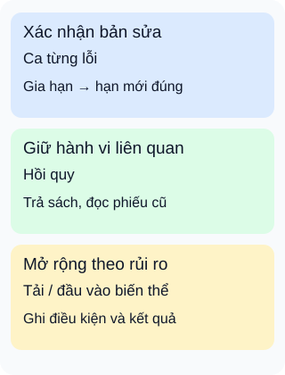

# Sau thay đổi API: chọn bộ kiểm tra theo rủi ro

**Bắt đầu từ điều vừa đổi và điều có thể bị ảnh hưởng.** Nhóm thư viện sửa quy tắc gia hạn phiếu mượn. Chạy lại đúng ca từng lỗi là cần thiết, nhưng chưa kiểm tra hết tác động lên trả sách hoặc hiển thị hạn mới.

## Từ viết tắt

- **API** (Application Programming Interface) — giao diện để chương trình yêu cầu chức năng hoặc dữ liệu.

## Đọc hình

- **Xác nhận bản sửa:** tái hiện ca gia hạn từng sai, đối chiếu hạn mới với quy tắc đã thống nhất. Đây là xác nhận lỗi cụ thể đã được sửa trong ca đó.
- **Hồi quy:** chọn hành vi cần giữ quanh phần thay đổi, như trả sách và đọc phiếu cũ. Có thể gồm kiểm tra chức năng, tích hợp với nơi lưu và thao tác qua giao diện.
- **Mở rộng theo rủi ro:** nếu thay đổi làm tăng số lần đọc kho, thêm phép đo tải; nếu nhận trường dữ liệu mới, thêm ca biên và đầu vào biến thể. Không chạy mọi loại chỉ để đủ một danh sách.

## Nhìn hình thử trả lời

Ca gia hạn từng lỗi đã đạt, nhưng trả sách bị tính sai hạn. Thẻ nào nhắc ta tìm tác động này?

Xem đáp án

Thẻ hồi quy. Xác nhận ca gia hạn không thay cho kiểm tra hậu quả ở hành vi khác. Phân tích nơi dùng chung quy tắc hạn trả giúp chọn ca phù hợp.

Đi sâu: một ca cần có điều kiện đạt và dấu vết

Với ca gia hạn, ghi phiên bản đang thử, dữ liệu phiếu ban đầu, người gọi, thao tác, hạn mong đợi và hạn thực tế. Đọc lại phiếu để kiểm tra dữ liệu đã lưu; nếu cần kiểm tra trải nghiệm, mở giao diện và quan sát hạn hiển thị. Gọi thẳng API không thay cho kiểm tra trình duyệt.

Với tải, ghi mô hình sử dụng, thời lượng, dữ liệu, môi trường, ngưỡng độ trễ và lỗi trước khi đo. Phân biệt tải thông thường với áp lực cao hơn thông thường; tên gọi có thể khác giữa công cụ. Một lần đo không tự xác nhận năng lực vận hành.

Dùng môi trường và dữ liệu thử có kiểm soát. Với đầu vào biến thể, lưu ca gây lỗi để tái hiện và bổ sung kiểm tra sau sửa. Cũng cần kiểm tra quyền khi thay đổi ảnh hưởng đối tượng được phép gia hạn; dữ liệu đúng kiểu chưa có nghĩa người gọi được quyền.

Kết quả đạt chỉ nói về phạm vi đã thử. Khi điều kiện thay đổi, xem lại bộ ca và rủi ro còn bỏ ngỏ. [Bài nhập môn các góc nhìn kiểm thử](../sd-01-045/lesson.md) giải thích vì sao các tên loại kiểm thử có thể chồng lấp.

## Nguồn đối chiếu

- [ByteByteGo — body ghim](https://github.com/ByteByteGoHq/system-design-101/blob/b28380a4710c5ec9638ec037d4168e288f334cba/data/guides/explaining-9-types-of-api-testing.md): đã đọc chín mục, không dùng ảnh.
- [Giáo trình kiểm thử nền tảng, §1.3 và §2.2.3](https://istqb.org/wp-content/uploads/2024/11/ISTQB_CTFL_Syllabus_v4.0.1.pdf).
- [Microsoft: phối hợp thành phần](https://learn.microsoft.com/en-us/aspnet/core/test/integration-tests?view=aspnetcore-10.0).
- [Playwright: gọi trực tiếp và phối hợp kiểm tra trình duyệt](https://playwright.dev/docs/api-testing).
- [Grafana: mục tiêu của các kiểu tải và giới hạn kết luận](https://grafana.com/docs/k6/latest/testing-guides/test-types/).
- [Hướng dẫn sinh đầu vào biến thể](https://owasp.org/www-community/Fuzzing).

- [Quyền trên đối tượng](https://owasp.org/API-Security/editions/2023/en/0xa1-broken-object-level-authorization/): kiểm tra hành động của người gọi trên từng bản ghi.

Đã đọc body ghim và các mục tài liệu nêu trên ngày2026-10-16. Ví dụ và hình tự thiết kế; đây là kế hoạch minh họa, chưa chạy kiểm thử API, đo tải hay thử bảo mật dịch vụ thật.
