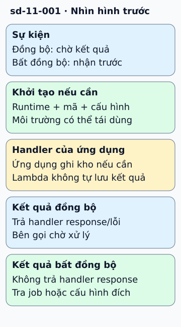

# AWS Lambda: mỗi lần gọi hàm chạy trong một máy ảo siêu nhẹ

**Lambda chạy hàm của bạn trong một "môi trường chạy" được dựng sẵn hoặc dựng mới, và cách một yêu cầu tới đó phụ thuộc vào kiểu gọi: gọi đồng bộ thì chờ kết quả ngay, gọi bất đồng bộ thì sự kiện được xếp hàng trước.**
Hiểu hai đường này, bạn biết vì sao lần gọi đầu thường chậm hơn và vì sao lỗi ở đường bất đồng bộ không hiện ngay cho người gọi.

## Từ viết tắt

- **CPU** (Central Processing Unit) — bộ xử lý trung tâm; "CPU ảo" là phần bộ xử lý được cấp cho một máy ảo.
- **AWS** (Amazon Web Services) — dịch vụ điện toán đám mây của Amazon; Lambda là một dịch vụ trong đó.
- **KVM** (Kernel-based Virtual Machine) — tính năng của nhân Linux cho phép chạy máy ảo; Firecracker dựa vào nó.
- **VM** (Virtual Machine) — máy ảo: một máy giả lập có hệ điều hành riêng, chạy bên trong máy thật.

## Đọc hình

**Môi trường chạy là một máy ảo nhỏ.** Theo tài liệu của Firecracker, mỗi tiến trình Firecracker chỉ chứa đúng một máy ảo siêu nhẹ (microVM). Firecracker dùng KVM của nhân Linux, và tài liệu nói nó được tạo ra tại AWS để tăng tốc các dịch vụ như Lambda và Fargate. Lý do chọn máy ảo thay vì chỉ dùng container: nhiều khách hàng khác nhau chạy trên cùng máy chủ, nên cần ranh giới cách ly chắc hơn. Firecracker thu nhỏ máy ảo bằng cách bỏ bớt thiết bị không cần, để dựng nhanh và tốn ít tài nguyên.

**Đường đồng bộ (khung một).** Người gọi giữ kết nối và chờ kết quả. Hệ thống cần một môi trường chạy: nếu chưa có thì dựng mới, rồi *khởi tạo* (nạp mã hàm và bộ chạy ngôn ngữ), rồi mới *gọi hàm*. Bước dựng và khởi tạo là lý do của "khởi động nguội": lần gọi đầu, hoặc khi mọi môi trường đều đang bận, phải trả thêm thời gian này. Gọi tiếp theo có thể dùng lại môi trường đã khởi tạo nên bỏ qua hai bước đó.

**Đường bất đồng bộ (khung hai).** Người gọi chỉ nhận lời xác nhận "đã nhận sự kiện". Sự kiện nằm trong hàng đợi cho tới khi có môi trường rảnh để xử lý. Nếu hàm lỗi, hệ thống có thể thử lại; người gọi không thấy lỗi đó trên đường trả lời.

## Giới hạn cần nhớ

Mô hình trong bài là của loại chạy mặc định. Lambda còn có loại cấu hình khác (Managed Instances), theo tài liệu AWS chạy container trên máy chủ ảo thuê của AWS thay vì máy ảo siêu nhẹ, xử lý nhiều lời gọi đồng thời và không có khởi động nguội do từng lời gọi; vòng đời mô tả ở đây không áp dụng cho loại đó. Điều này lấy từ tài liệu AWS do người đánh giá dẫn, chưa được kiểm trong phiên viết. Tài liệu Firecracker chỉ nói về lớp máy ảo; nó không mô tả bộ điều phối của Lambda (cách chọn máy chủ, cách giữ môi trường ấm). Các bước tìm, dựng, khởi tạo và hàng đợi trong hình là mô hình chung của người biên soạn, dựa trên cách Lambda được mô tả công khai, chưa đối chiếu với tài liệu Lambda hiện hành trong phiên viết bài (không đọc được tài liệu AWS từ môi trường biên soạn). Thời gian giữ môi trường ấm và số lần thử lại cụ thể thay đổi theo cấu hình và theo phiên bản dịch vụ, nên bài không nêu con số.

## Nhìn hình trả lời

Một hàm chậm bất thường chỉ ở lần gọi đầu tiên sau nhiều giờ không ai dùng. Bạn nghi nguyên nhân ở bước nào trong hình, và vì sao đường bất đồng bộ che được phần chậm này khỏi người dùng cuối?

Xem đáp án

Nghi bước dựng và khởi tạo môi trường (khởi động nguội): sau thời gian dài không dùng, môi trường cũ có thể đã bị thu hồi nên phải dựng lại. Đường bất đồng bộ che được vì người gọi không chờ hàm chạy xong: họ nhận xác nhận ngay, còn thời gian dựng nằm sau hàng đợi. Đây là suy luận của người biên soạn từ mô hình trong hình.

Xem sâu hơn: điều Firecracker nói và không nói

Tài liệu thiết kế của Firecracker ghi mỗi tiến trình một máy ảo, bộ `jailer` chuẩn bị tài nguyên cần quyền cao rồi hạ quyền, và bộ lọc lời gọi hệ thống áp lên từng luồng trước khi chạy mã khách. Nó cũng nêu tốc độ dựng ổn định 5 máy ảo mỗi lõi máy chủ mỗi giây và cấu hình tối đa 32 CPU ảo mỗi máy ảo. Tài liệu không đưa số liệu thời gian khởi động hay chi phí bộ nhớ, nên bài cũng không nêu.

## Nguồn đối chiếu

- [ByteByteGo — bài nguồn tại commit cố định](https://github.com/ByteByteGoHq/system-design-101/blob/b28380a4710c5ec9638ec037d4168e288f334cba/data/guides/how-does-aws-lambda-work-behind-the-scenes.md): chủ đề và tên mục (Firecracker, đường đồng bộ, đường bất đồng bộ).
- [Firecracker — tài liệu thiết kế tại commit cố định](https://github.com/firecracker-microvm/firecracker/blob/e786ba84fd5e0db878392a6a1f234e1b17fcaeb2/docs/design.md): một máy ảo mỗi tiến trình, KVM, jailer, bộ lọc lời gọi hệ thống, 5 máy ảo mỗi lõi mỗi giây, tối đa 32 CPU ảo.
- [Firecracker — README tại commit cố định](https://github.com/firecracker-microvm/firecracker/blob/e786ba84fd5e0db878392a6a1f234e1b17fcaeb2/README.md): Firecracker được phát triển tại AWS để tăng tốc các dịch vụ như Lambda và Fargate.

Đã đọc nguồn ngày 2026-10-19. Bài viết và hình được thiết kế độc lập; phần về khởi động nguội và hàng đợi là kiến thức chung của người biên soạn, chưa đối chiếu với tài liệu Lambda.
