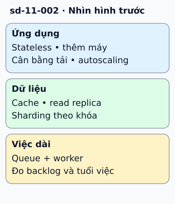

# Tám cách mở rộng hệ thống theo điểm nghẽn

Cửa hàng có nhiều khách hơn, nhưng tăng số máy ứng dụng chỉ hữu ích nếu ứng dụng là điểm nghẽn. Bắt đầu bằng đo CPU, thời gian chờ cơ sở dữ liệu và lượng việc tồn đọng.

**Đọc hình:** Các khung tóm tắt vai trò hoặc lựa chọn để đối chiếu. Các con số và tình huống trong bài là ví dụ minh họa, trừ khi ghi rõ cách tính.

Tám công cụ thường gặp là: dịch vụ stateless, mở rộng ngang, cân bằng tải, tự động co giãn, cache, bản sao dữ liệu, sharding và xử lý bất đồng bộ. Stateless đưa session ra kho dùng chung để request có thể sang máy khác. Load balancer phân phối request; autoscaling điều chỉnh số máy theo tín hiệu đã chọn.

Cache tránh tính hoặc đọc lại dữ liệu phổ biến. Read replica chia tải đọc, còn sharding chia dữ liệu và tải giữa các phân vùng. Queue chuyển việc dài như gửi email sang worker. Chọn công cụ ứng với số đo: nếu DB chậm, thêm web server có thể chỉ tạo nhiều kết nối hơn.

## Từ viết tắt

- **CPU** (Central Processing Unit) — bộ xử lý trung tâm: phần của máy chạy lệnh; bài khuyên bắt đầu bằng đo CPU, thời gian chờ cơ sở dữ liệu và lượng việc tồn đọng.
- **DB** (DataBase) — cơ sở dữ liệu: nơi lưu dữ liệu có tổ chức để ghi và tìm lại; nếu DB chậm, thêm máy chủ web có thể chỉ tạo thêm kết nối tới nó.

## Nhìn hình thử trả lời

CPU web server thấp nhưng DB quá tải. Thêm web server có giải quyết được không?

Xem đáp án

Không chắc. Cần xem truy vấn, index, cache và tải đọc/ghi ở DB trước; thêm máy web còn có thể làm DB nặng hơn.

## Giới hạn cần nhớ

Replica có thể trả dữ liệu cũ; cache cần chính sách hết hạn; queue cần đủ worker. Mỗi công cụ thêm công việc vận hành.

Xem sâu hơn

Đo lại p95/p99 sau mỗi thay đổi. Chọn tín hiệu autoscaling phản ánh workload, chẳng hạn độ dài queue hoặc số request đang xử lý, thay vì mặc định chỉ dùng CPU.

## Nguồn đối chiếu

- [Mục chủ đề ByteByteGo tại snapshot cố định](https://github.com/ByteByteGoHq/system-design-101/blob/b28380a4710c5ec9638ec037d4168e288f334cba/data/guides/8-must-know-scalability-strategies.md).
- [AWS Well-Architected Framework - AWS Well-Architected Framework](https://docs.aws.amazon.com/wellarchitected/latest/framework/welcome.html).
- [Cache-Aside Pattern - Azure Architecture Center | Microsoft Learn](https://learn.microsoft.com/en-us/azure/architecture/patterns/cache-aside).
- [Sharding Pattern - Azure Architecture Center | Microsoft Learn](https://learn.microsoft.com/en-us/azure/architecture/patterns/sharding).

Bài giải thích và hình được biên soạn độc lập; không dùng ảnh nguồn. Các tài liệu kỹ thuật trên là điểm đối chiếu cho review, không phải chứng nhận mọi claim đã được kiểm chứng.
