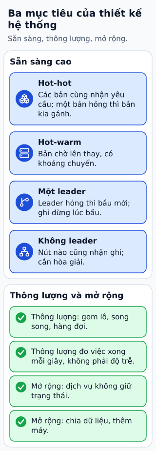

# Bảng tra thiết kế hệ thống: sẵn sàng cao, thông lượng cao, mở rộng cao

**Ba mục tiêu hay gặp khi thiết kế hệ thống, "sẵn sàng cao", "thông lượng cao" và "mở rộng cao", là ba câu hỏi khác nhau, và mỗi câu có bộ kỹ thuật riêng.**
Nhận ra mình đang cần mục tiêu nào giúp chọn đúng kỹ thuật, thay vì dán cả ba nhãn lên mọi hệ thống.

## Đọc hình

Tên các mục giữ theo bài nguồn; lời giải thích là của người biên soạn.

**High Availability (sẵn sàng cao): hệ thống vẫn trả lời khi một phần hỏng.** Bốn kiểu dự phòng:

- *Hot-hot*: hai (hoặc nhiều) bản cùng nhận yêu cầu cùng lúc. Một bản hỏng thì các bản còn lại gánh tiếp, gần như không có khoảng gián đoạn. Giá: phải giữ dữ liệu của các bản khớp nhau, và tốn tài nguyên chạy cùng lúc.
- *Hot-warm*: một bản chính nhận yêu cầu; bản kia chạy sẵn, nhận dữ liệu từ bản chính nhưng chờ. Bản chính hỏng thì bản chờ lên thay, mất một khoảng chuyển.
- *Single-leader cluster* (cụm một leader): một nút nhận mọi lần ghi và chuyển cho các nút theo sau. Leader hỏng thì cụm phải bầu leader mới; trong lúc bầu, việc ghi dừng.
- *Leaderless cluster* (cụm không leader): nút nào cũng nhận ghi; để đọc đúng, đọc hoặc ghi cần được nhiều nút xác nhận. Không có bước bầu, nhưng các nút có thể tạm khác nhau và phải tìm cách hòa giải.

**High Throughput (thông lượng cao): làm được nhiều việc mỗi giây.** Thông lượng là số việc xong trong một đơn vị thời gian, khác với độ trễ của một việc. Các hướng chính: gom nhiều việc nhỏ thành một lô, xử lý song song, đưa việc không gấp ra hàng đợi, và tìm đúng chỗ nghẽn trước khi tối ưu.

**High Scalability (mở rộng cao): thêm tài nguyên thì sức chứa tăng theo.** Các hướng chính: giữ dịch vụ không phụ thuộc trạng thái trên máy, chia dữ liệu thành nhiều mảnh, và thêm máy thay vì thay bằng máy to hơn.

## Giới hạn cần nhớ

Bảng này là tra cứu, không phải công thức chọn. Ba mục tiêu kéo nhau: dự phòng nhiều làm thêm việc đồng bộ dữ liệu và có thể hạ thông lượng. Chi tiết "bầu leader" và "đọc ghi cần nhiều nút xác nhận" ở trên là mô tả chung (và việc sao chép sang các nút theo sau có thể là bất đồng bộ hoặc chờ xác nhận, hai chế độ có độ bền khác nhau); mỗi sản phẩm làm khác nhau và bài chưa đối chiếu với tài liệu của sản phẩm cụ thể nào. Hai chữ "hot" và "warm" trong ngành không có định nghĩa chuẩn duy nhất.

## Nhìn hình trả lời

Hệ thống đặt hàng của bạn không được mất lần ghi nào nhưng chấp nhận ngừng ghi vài giây khi sự cố. Trong bốn kiểu ở khung một, kiểu nào hợp để bắt đầu, và vì sao chưa chọn hot-hot?

Xem đáp án

Cụm một leader hợp để bắt đầu: mọi lần ghi đi qua một nút nên thứ tự rõ ràng, và việc dừng ghi trong lúc bầu leader mới là đúng điều mà đề bài chấp nhận. Riêng yêu cầu "không mất lần ghi nào" thì chưa đủ nếu chỉ chọn kiểu này: nếu leader báo xong rồi hỏng trước khi bản sao nhận được, leader mới sẽ không có lần ghi đó. Cần thêm chính sách để leader chỉ báo xong sau khi ít nhất một bản sao (hoặc đa số) đã xác nhận, đổi lại mỗi lần ghi chậm hơn. Chưa chọn hot-hot vì nhiều nơi cùng nhận ghi buộc phải giải bài toán hai nơi ghi cùng một dữ liệu, một độ phức tạp mà đề bài chưa đòi hỏi. Đây là suy luận của người biên soạn.

Xem sâu hơn: điều đã sắp xếp lại so với bài nguồn

Bài nguồn là một bảng tra gọn ba mục tiêu với các kiểu dự phòng dưới mục đầu. Bài này giữ tên mục, thêm cho mỗi kiểu câu "khi một nút hỏng thì sao" và tách thông lượng khỏi độ trễ, phần nguồn không nhấn.

## Nguồn đối chiếu

- [ByteByteGo — bài nguồn tại commit cố định](https://github.com/ByteByteGoHq/system-design-101/blob/b28380a4710c5ec9638ec037d4168e288f334cba/data/guides/system-design-cheat-sheet.md): chỉ lấy tên ba mục và bốn kiểu dự phòng. Lời giải thích là của người biên soạn.

Đã đọc nguồn ngày 2026-10-19. Bài viết và hình được thiết kế độc lập; phần giải thích là kiến thức chung của người biên soạn, chưa đối chiếu với tài liệu chính thức.
