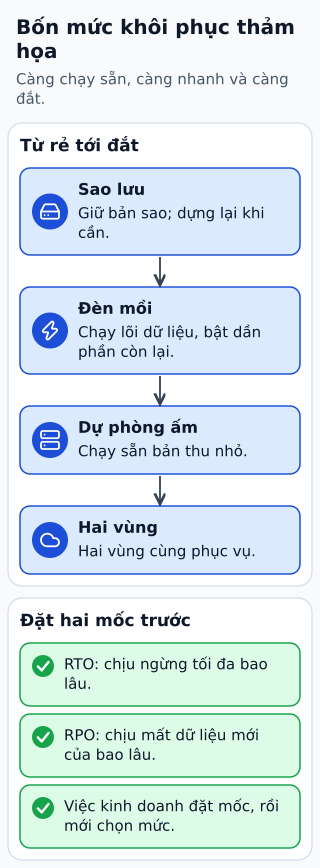

# Bốn chiến lược khôi phục sau thảm họa

Giả sử một vùng cloud không thể phục vụ. Đội vận hành cần trả lời hai câu: được ngừng bao lâu và được mất bao nhiêu dữ liệu gần nhất? RTO là mục tiêu thời gian khôi phục; RPO là mục tiêu mất dữ liệu tính theo thời gian.

**Đọc hình:** Các khung tóm tắt vai trò hoặc lựa chọn để đối chiếu. Các con số và tình huống trong bài là ví dụ minh họa, trừ khi ghi rõ cách tính.

Backup/restore giữ bản sao lưu và dựng lại sau sự cố. Pilot light giữ phần lõi, thường là dữ liệu, rồi bổ sung năng lực khi cần. Warm standby duy trì một hệ thống chạy được ở quy mô nhỏ. Active/active cho nhiều nơi cùng phục vụ và yêu cầu xử lý định tuyến, đồng bộ, xung đột ghi.

Càng duy trì nhiều năng lực dự phòng, chi phí thường càng cao và thời gian kích hoạt có thể càng ngắn. Nhưng con số thật phụ thuộc dữ liệu, tự động hóa và diễn tập. Một kế hoạch trên giấy chưa chứng minh đạt RTO/RPO.

## Từ viết tắt

- **AZ** (Availability Zone) — vùng sẵn sàng: một cụm trung tâm dữ liệu tách biệt trong cùng một Region, để lỗi ở nơi này ít lan sang nơi khác; bài tách lỗi một máy, lỗi một AZ và lỗi cả vùng, vì mức dự phòng tương ứng khác nhau.
- **DNS** (Domain Name System) — hệ thống tên miền: "danh bạ" của Internet, đổi tên miền thành địa chỉ mạng để biết tìm dịch vụ ở đâu; lần diễn tập khôi phục gồm dữ liệu, secrets, DNS, cấu hình và kiểm tra nghiệp vụ.
- **RTO** (Recovery Time Objective) — mục tiêu thời gian khôi phục: được ngừng tối đa bao lâu trước khi chạy lại.
- **RPO** (Recovery Point Objective) — mục tiêu điểm khôi phục: được mất tối đa bao nhiêu dữ liệu gần nhất, tính theo thời gian.

## Nhìn hình thử trả lời

Backup mỗi giờ có bảo đảm RPO bằng 0 không?

Xem đáp án

Không. Có thể mất thay đổi sau backup thành công gần nhất; phải kiểm tra cả tần suất và khả năng phục hồi bản sao.

## Giới hạn cần nhớ

Không gán số phút hoặc “không mất dữ liệu” chỉ từ tên chiến lược. Replication cũng có thể sao chép thao tác xóa nhầm; cần backup và thử restore.

Xem sâu hơn

Diễn tập gồm khôi phục dữ liệu, secrets, DNS, cấu hình và kiểm tra nghiệp vụ. Tách lỗi một máy, lỗi AZ và lỗi cả vùng vì mức dự phòng tương ứng khác nhau.

## Nguồn đối chiếu

- [Mục chủ đề ByteByteGo tại snapshot cố định](https://github.com/ByteByteGoHq/system-design-101/blob/b28380a4710c5ec9638ec037d4168e288f334cba/data/guides/cloud-disaster-recovery-strategies.md).
- [Disaster recovery options in the cloud - Disaster Recovery of Workloads on AWS: Recovery in the Cloud](https://docs.aws.amazon.com/whitepapers/latest/disaster-recovery-workloads-on-aws/disaster-recovery-options-in-the-cloud.html).

Bài giải thích và hình được biên soạn độc lập; không dùng ảnh nguồn. Các tài liệu kỹ thuật trên là điểm đối chiếu cho review, không phải chứng nhận mọi claim đã được kiểm chứng.
