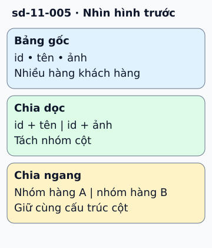

# Chia bảng theo cột hay theo hàng?

Bảng khách hàng chứa id, tên và ảnh hồ sơ lớn. Nếu trang danh sách chỉ cần tên, có thể tách ảnh sang bảng khác: đó là vertical partitioning, chia theo cột và giữ khóa để nối dữ liệu.

**Đọc hình:** Các khung tóm tắt vai trò hoặc lựa chọn để đối chiếu. Các con số và tình huống trong bài là ví dụ minh họa, trừ khi ghi rõ cách tính.

Nếu bảng có quá nhiều khách hàng, có thể chia hàng theo vùng hoặc hash của id: đó là horizontal partitioning. Mỗi phần giữ cùng cấu trúc cột nhưng chỉ giữ một tập hàng. Sharding thường nói tới việc đặt các phần này trên những node khác nhau.

Cách chia phải phục vụ truy vấn. Chia theo tenant giúp nhiều truy vấn ở một shard, nhưng tenant lớn có thể thành điểm nóng. Chia theo hash thường phân tán tốt hơn, nhưng truy vấn theo khoảng hoặc tổng hợp có thể cần nhiều shard. Vertical partitioning tránh đọc cột lớn; nó không phải nâng CPU/RAM của máy.

## Từ viết tắt

- **CPU** (Central Processing Unit) — bộ xử lý trung tâm: phần của máy chạy lệnh; chia bảng theo cột để tránh đọc cột lớn, không phải nâng CPU hay RAM của máy.
- **RAM** (Random Access Memory) — bộ nhớ truy cập ngẫu nhiên: bộ nhớ làm việc của máy, đọc ghi nhanh nhưng mất sạch khi tắt điện; chia bảng theo cột không phải là nâng RAM của máy.
- **DB** (DataBase) — cơ sở dữ liệu: nơi lưu dữ liệu có tổ chức để ghi và tìm lại; chia bảng trong cùng một DB chưa phải là chia dữ liệu qua nhiều máy.

## Nhìn hình thử trả lời

Tách cột ảnh sang bảng riêng là chia dọc hay chia ngang?

Xem đáp án

Chia dọc. Tập thuộc tính bị tách, còn chia ngang tách tập bản ghi.

## Giới hạn cần nhớ

Partitioning trong cùng một DB không đồng nghĩa sharding qua nhiều máy. Chia nhỏ cũng không tự làm mọi truy vấn nhanh hơn.

Xem sâu hơn

Cần kế hoạch định tuyến, đổi số shard và truy vấn xuyên shard. Phép id mod N đơn giản nhưng khi N đổi, nhiều bản ghi phải chuyển chỗ.

## Nguồn đối chiếu

- [Mục chủ đề ByteByteGo tại snapshot cố định](https://github.com/ByteByteGoHq/system-design-101/blob/b28380a4710c5ec9638ec037d4168e288f334cba/data/guides/vertical-partitioning-vs-horizontal-partitioning.md).
- [Sharding Pattern - Azure Architecture Center | Microsoft Learn](https://learn.microsoft.com/en-us/azure/architecture/patterns/sharding).
- [PostgreSQL: Documentation: 18: 5.12. Table Partitioning](https://www.postgresql.org/docs/current/ddl-partitioning.html).

Bài giải thích và hình được biên soạn độc lập; không dùng ảnh nguồn. Các tài liệu kỹ thuật trên là điểm đối chiếu cho review, không phải chứng nhận mọi claim đã được kiểm chứng.
